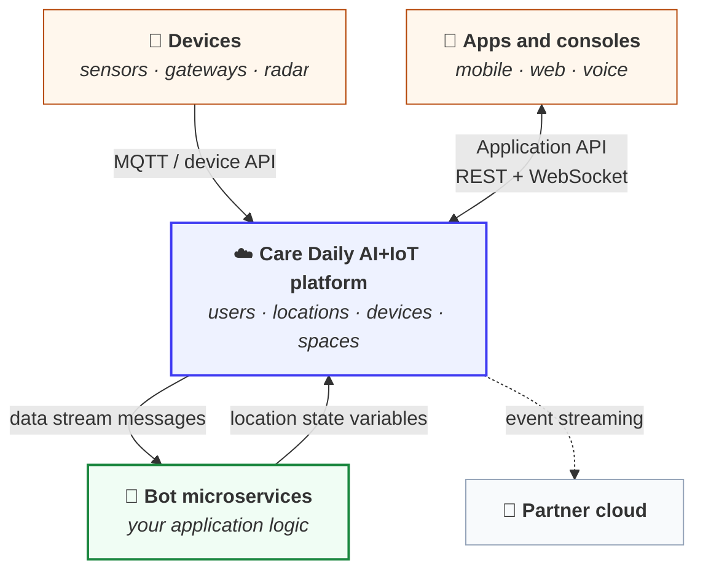

# Care Daily Developer Documentation

Build apps, devices, and services on the Care Daily AI+IoT platform for home health.

This repository is the guide. The complete API reference is generated from the platform itself and
lives online:

| Reference | What is in it |
| --- | --- |
| [Application API](https://app.caredaily.ai/cloud/apidocs/cloud.html) | Everything an app or web console calls: users, locations, devices, spaces, commands, files, and the Synthetic API endpoints |
| [Admin API](https://app.caredaily.ai/cloud/apidocs/admin.html) | Organization management for command centers: people, places, and things at administrator scope |
| [Bots API](https://app.caredaily.ai/cloud/apidocs/bots.html) | What a bot microservice calls back into the platform |

---

## How the platform fits together

There are two layers, and knowing which one you are talking to explains almost every question a new
developer has.

**The platform** stores and moves the real things: users, locations, devices, spaces, measurements,
commands. It is a synchronous REST API with WebSocket alternatives where latency matters.

**The bot layer** is where features get invented. Bots receive `data stream messages` and write
`location state variables` back. An app reads those state variables exactly like any other API
response, which is why we call them *Synthetic APIs*: they look like platform APIs to the app, but
a bot is answering, not the platform.

---

## Start here

**Just getting started?**
Read [Authentication](platform_apis/authentication.md). Everything else needs an API key, and the
choice between a user key and an administrator key shapes what you build next.

**Building a mobile or web app?**
Read [Synthetic APIs](synthetic_apis/README.md) first. Most of what a modern Care Daily app renders
on screen (the dashboard, insights, trends, daily report, services) comes from a bot, not from a raw
platform endpoint.

**Connecting a device or a partner cloud?**
Read [Platform APIs](platform_apis/README.md), then
[MQTT](platform_apis/mqtt.md) for devices or
[Event Streaming](platform_apis/event_streaming.md) for cloud-to-cloud.

**Wiring up a screen and want to see the exact call order?**
Read the [Message Sequence Charts](message_sequence_charts/README.md). They show real flows, request
by request, including login, device onboarding, and how the device UI is assembled.

**Need something to update the instant it changes?**
Read [WebSockets](platform_apis/websockets.md) rather than polling.

---

## The three sections

### [Platform APIs](platform_apis/README.md)

Provided by the AI+IoT platform itself, for applications, devices, and administrators. Includes the
role-based REST APIs, WebSockets, cloud-to-cloud event and observation streaming to partner clouds,
the MQTT device path, and [location modes](platform_apis/modes.md).

### [Synthetic APIs](synthetic_apis/README.md)

Provided by the bot application layer on top of the platform. This is how you invent application
features the platform does not offer on its own, and how the flagship user interfaces are actually
driven. Documented here are the bot microservice packages behind our most-used screens.

### [Message Sequence Charts](message_sequence_charts/README.md)

How clients work, end to end, as diagrams: mobile app schema, user login and registration, device
onboarding and configuration, the device UI, and services and alerts.

---

## Conventions used in this repository

| Term | Meaning |
| --- | --- |
| **Data stream message** | An asynchronous message *into* a bot. Has an address and arbitrary JSON content. The input half of a Synthetic API. |
| **Location state variable** | Non-volatile JSON stored against a location, written by a bot and readable by any app. The output half of a Synthetic API. |
| **Location** | A home, apartment, or community space. Nearly everything is scoped to one. |
| **Scope** | `1` is the location, `2` is the organization. Determines who receives a data stream message. |
| **Microservice package** | A bundle of bot logic. The Synthetic APIs here map to our most popular packages. |

---

## Contributing

Corrections and additions are welcome. Pages marked *in progress* are the ones we most want help
with, and the fastest way to get one prioritized is to say what you are building.

Contact **dmoss@caredaily.ai**.
