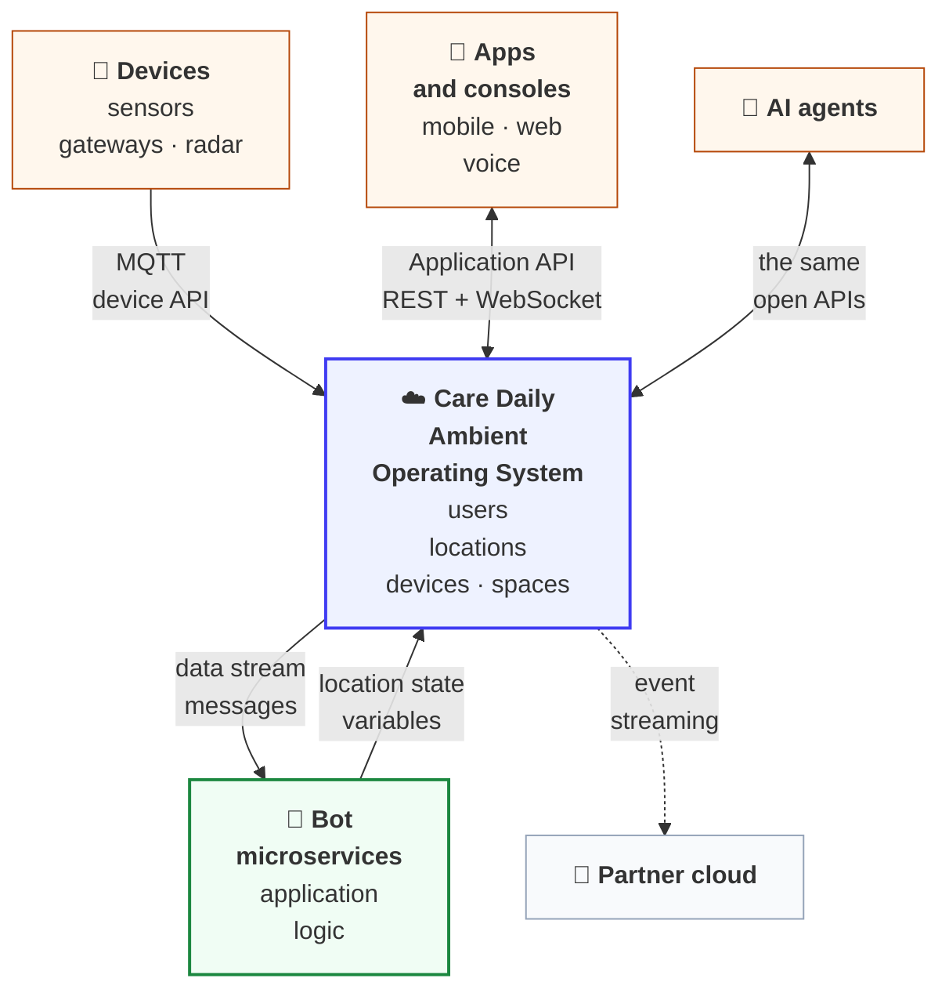
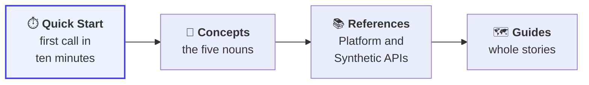

# Care Daily Developer Documentation

**Care Daily is the Ambient Operating System that helps people live independently, in homes and
communities.** Sensors in a home or an apartment report to the Care&nbsp;Daily cloud. Bots running in the cloud turn those signals into insights, alerts and a
daily picture of how someone is doing. Apps, consoles, partner clouds and AI agents read all of it
through open APIs, and talk back to the bots to act on it.

This repository is the guide. The complete, generated API reference lives online:

| Reference | What is in it |
| --- | --- |
| [Application API](https://app.caredaily.ai/cloud/apidocs/cloud.html) | Everything an app or web console calls: users, locations, devices, spaces, commands, files, and the data stream and state calls behind the Synthetic APIs |
| [Admin API](https://app.caredaily.ai/cloud/apidocs/admin.html) | Organization management for command centers: people, places and things at administrator scope, plus reports |
| [Bots API](https://app.caredaily.ai/cloud/apidocs/bots.html) | Bot instances, and what a bot microservice calls back into the platform |

---

## How the platform fits together



There are two layers, and knowing which one you are talking to answers most first-week questions.

**The platform** stores and moves the real things: users, locations, devices, spaces,
measurements, commands. It is a synchronous REST API, with WebSockets where latency matters.

**The bot layer** is where features are invented. Bots receive `data stream messages` and write
`location state variables` back. An app reads those state variables like any other API response,
which is why we call them *Synthetic APIs*: they look like platform APIs to the app, but a bot is
answering.

---

## Start here



| Step | Page | You will know |
| :---: | --- | --- |
| 1 | [Start here](getting_started/README.md) | A reading order, and which track is yours |
| 2 | [Quick Start](getting_started/quick_start.md) | How to log in and read a real home in ten minutes |
| 3 | [Concepts](concepts/README.md) | Organizations, locations, users, devices, bots, data streams and state |
| 4 | [Authentication](platform_apis/authentication.md) | Key types, and the two-step administrator login |
| 5 | [Result codes and gotchas](platform_apis/result_codes.md) | What a number other than `0` means |

---

## Find your way by what you are building

| You are building | Read |
| --- | --- |
| **A mobile or web app** | [Synthetic APIs](synthetic_apis/README.md), then [WebSockets](platform_apis/websockets.md) |
| **An administrative console** | [Concepts](concepts/README.md), the [Admin API](https://app.caredaily.ai/cloud/apidocs/admin.html), then [The life of an alert](guides/life_of_an_alert.md) |
| **Device firmware or a gateway** | [MQTT](platform_apis/mqtt.md) and [Devices and parameters](concepts/devices_and_parameters.md) |
| **A partner cloud** | [Event Streaming](platform_apis/event_streaming.md) |
| **An AI agent** | [Agent Kit](agent_kit/README.md) |
| **One screen, and it half works** | [Message Sequence Charts](message_sequence_charts/README.md) |

---

## What is in this repository

```text
getting_started/          Start here and the Quick Start
concepts/                 The five nouns behind every API call
platform_apis/            Authentication, REST conventions, result codes, WebSockets,
                          Event Streaming, MQTT, modes
synthetic_apis/           Every bot-provided API: dashboard, insights, trends, alerts, and more
guides/                   The life of an alert, watching a home live, troubleshooting
message_sequence_charts/  The exact call order behind each app screen
agent_kit/                Instructions that teach an AI agent to use the open APIs safely
```

### [Platform APIs](platform_apis/README.md)

Provided by the platform itself, for applications, devices and administrators: the role-based
REST APIs, WebSockets, cloud-to-cloud event streaming, the MQTT device path, and
[location modes](platform_apis/modes.md).

### [Synthetic APIs](synthetic_apis/README.md)

Provided by the bot layer on top of the platform. This is how the flagship user interfaces are
driven, and how you can invent features the platform does not offer on its own.

### [Guides](guides/README.md)

Whole stories that cross several APIs, such as following one fall from the sensor to the family's
phones and back.

### [Message Sequence Charts](message_sequence_charts/README.md)

How clients work, end to end, as diagrams: login and registration, the app's structure, device
onboarding and configuration, the device UI, and services and alerts.

### [Agent Kit](agent_kit/README.md)

The same knowledge written for AI agents: standing rules, a login helper that never prints a key,
discovery, reading, safe writes, errors and retries, and live events.

---

## Conventions used in this repository

| Term | Meaning |
| --- | --- |
| **Location** | A home, apartment, or community space. Nearly everything is scoped to one |
| **Data stream message** | An asynchronous message *into* a bot. Has an address and arbitrary JSON content. The input half of a Synthetic API |
| **Location state variable** | Non-volatile JSON stored against a location, written by a bot and readable by any app. The output half of a Synthetic API |
| **Scope** | `1` is the location, `2` is the organization. Determines which bots receive a data stream message |
| **Microservice package** | A bundle of bot logic. The Synthetic APIs here map to our most popular packages |
| **TODO(verify)** | A note on a fact we have not yet confirmed as public and current. Treat it as unconfirmed |

---

## Contributing

Corrections and additions are welcome. Pages marked *in progress* are the ones we most want help
with, and the fastest way to get one prioritized is to say what you are building.

Contact **dmoss@caredaily.ai**.
