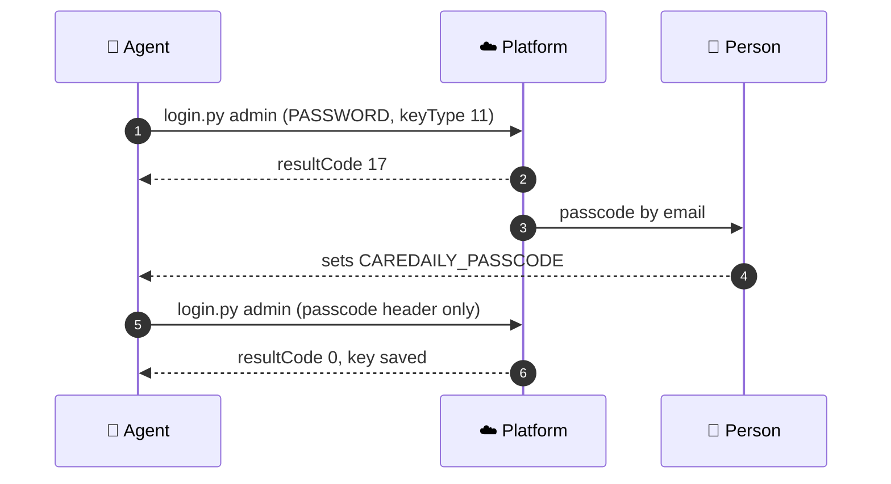

# 01. Authentication

Every call sends one header, `API_KEY`. This file gets the agent a key without ever showing it the
password or printing the key. Background for humans is in
[Authentication](../platform_apis/authentication.md).

---

## Key types

| `keyType` | Name | Second step | Reaches |
| :---: | --- | --- | --- |
| `0` | User | None | The account's own locations and devices |
| `11` | Administrator | Passcode by email or SMS | Organization-scoped calls and `/admin/json/...` for the organizations the account administers |

**Start with `keyType=0`.** Use `11` when a call is organization-scoped. **If organization-scoped
calls fail with `resultCode 7`, suspect the key type before you suspect permissions.**

---

## Put the login in the shell environment

The person running the agent does this once, in their shell profile. The agent never reads it from
a file.

```bash
# ~/.zshrc or ~/.bashrc
export CAREDAILY_USER="integration@your-company.example"
export CAREDAILY_PASSWORD='the password'          # single quotes
export CAREDAILY_SERVER="https://sboxall.peoplepowerco.com"   # sandbox first
```

```powershell
# PowerShell profile
$env:CAREDAILY_USER = "integration@your-company.example"
$env:CAREDAILY_PASSWORD = 'the password'
$env:CAREDAILY_SERVER = "https://sboxall.peoplepowerco.com"
```

Accounts are per cloud. A sandbox account and a production account with the same email address are
separate records, possibly with different passwords.

---

## The login helper

Save as `~/.caredaily/login.py`. Standard library only. It URL-encodes the password, writes the key
to `~/.caredaily/key.env` with owner-only permissions, and prints only the result code, key type and
expiry.

```python
#!/usr/bin/env python3
"""Mint a Care Daily API key without printing it.
  python ~/.caredaily/login.py                               user key (keyType 0)
  python ~/.caredaily/login.py admin                         admin key, step 1: sends a passcode
  CAREDAILY_PASSCODE=XXXXXX python ~/.caredaily/login.py admin   admin key, step 2
"""
import json, os, pathlib, sys, urllib.parse, urllib.request

server = os.environ["CAREDAILY_SERVER"].rstrip("/")
admin = len(sys.argv) > 1 and sys.argv[1] == "admin"
passcode = os.environ.get("CAREDAILY_PASSCODE", "").strip().upper()

params = {"username": os.environ["CAREDAILY_USER"],
          "keyType": 11 if admin else 0,
          "expiry": 1}                       # days; always pass it
headers = {"Accept": "application/json"}
if admin and passcode:
    headers["passcode"] = passcode           # lowercase header, no password on step 2
else:
    headers["PASSWORD"] = urllib.parse.quote(os.environ["CAREDAILY_PASSWORD"], safe="")
    if admin:
        params["prefDeliveryType"] = 2       # 2 = email, 3 = SMS

url = server + "/cloud/json/login?" + urllib.parse.urlencode(params)
with urllib.request.urlopen(urllib.request.Request(url, headers=headers)) as r:
    j = json.load(r)

code = j.get("resultCode")
if code == 17:
    print("resultCode 17: passcode sent. Re-run with CAREDAILY_PASSCODE set.")
    sys.exit(0)
if code != 0 or "key" not in j:
    print(f"resultCode {code}: {j.get('resultCodeMessage', '')}")
    sys.exit(1)

d = pathlib.Path.home() / ".caredaily"
d.mkdir(mode=0o700, exist_ok=True)
f = d / "key.env"
f.write_text(f"export CAREDAILY_API_KEY='{j['key']}'\n")
os.chmod(f, 0o600)
print(f"resultCode 0: {'admin' if admin else 'user'} key saved to {f}, "
      f"server {server}, expires {j.get('keyExpire', 'unknown')}")
```

Then every later shell command starts with:

```bash
source ~/.caredaily/key.env
```

---

## The administrator login, step by step



**Diagram in text:**

1. The agent runs `login.py admin` with PASSWORD and keyType 11.
2. The platform answers `resultCode 17`.
3. The platform emails a passcode to the person.
4. The person sets `CAREDAILY_PASSCODE` for the agent.
5. The agent runs `login.py admin` again, with only the passcode header.
6. The platform answers `resultCode 0`, and the key is saved.

- A person reads the passcode and hands it to the agent. **The agent must not repeat the passcode
  in its output.**
- **Trigger once.** Each step-one call replaces the previous passcode.
- Passcodes are six letters and digits. If a passcode fails, a second trigger is almost always why.

---

## After you have a key

```bash
source ~/.caredaily/key.env
curl -s "$CAREDAILY_SERVER/cloud/json/user" -H "API_KEY: $CAREDAILY_API_KEY" -H "Accept: application/json"
```

An administrator account can show **zero locations** here. That is correct: administrators are
usually not members of the homes they administer.

Read `keyExpire` on the login response. The server can cap a key's life below what you asked for.
When calls start failing with `resultCode 2`, run the helper again.

## Where the key lives

- In `~/.caredaily/key.env`, owner-only, outside every repository and every synced folder.
- In `CAREDAILY_API_KEY` while a command runs.
- Nowhere else. Not in output, logs, tickets, email, chat or commits.

Do not paste a key into a command line either: shells keep history.
