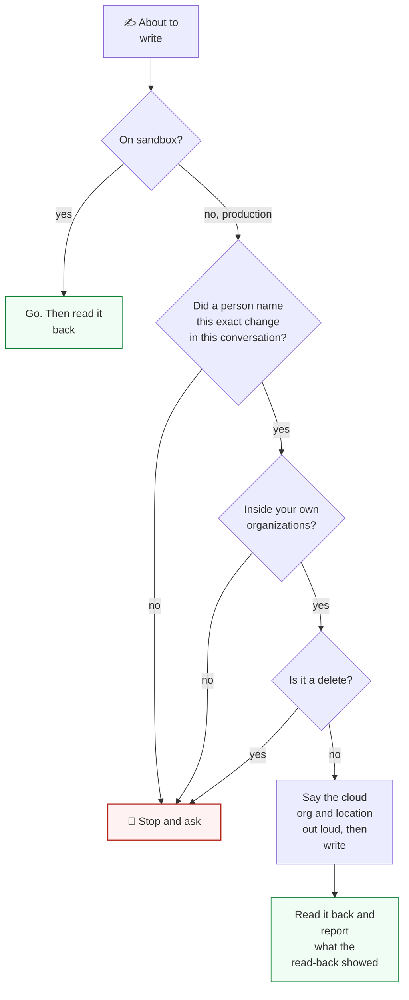

# 04. Safe writes

Production holds real people in real homes, and some devices are safety devices. These rules come
first. They are short because they are meant to be followed without exceptions.



**Diagram in text:**

- **Sandbox:** go, then read it back.
- **Production:** stop and ask, unless a person named this exact change in this conversation, the change is inside your own organizations, and it is not a delete.
- When all three hold, say the cloud org and location out loud, write, then read it back and report what the read-back showed.

---

## The rules

1. **Sandbox first.** Every recipe, script and bot runs on sandbox before production.
2. **Production writes need a person.** A write to production happens because a person asked for
   that specific change, for that specific home, in this conversation. The agent does not decide on
   its own that a production change is a good idea.
3. **Announce the target.** Before any write, state the cloud, the organization and the location.
4. **Stay inside your organizations.** Never write to an organization, location, device or user
   outside them, even when the API allows it.
5. **Never delete.** Not an organization, location, device, user, space or organization object.
   Deleting a user can take their location and devices with it. Route deletions to a person.
6. **Read back every write that matters**, and report what the read-back showed.

---

## Writes, and what "success" means for each

| Write | Call | `resultCode 0` means |
| --- | --- | --- |
| Device command | `PUT /cloud/json/devices/{deviceId}/parameters?locationId=` | **Queued.** Re-read after a few seconds. `21` means offline |
| Device record | `PUT /cloud/json/locations/{loc}/devices/{deviceId}` | Saved. `newDevice` stays `true` until you send `false` |
| Message to a bot | `POST /cloud/appstore/stream?address=&scope=1&locationId=` | **Accepted for delivery.** Look for the effect in state and history |
| People on a home | `PUT /cloud/json/location/{loc}/users` | Saved |
| Organization object | `PUT /admin/json/organizations/{org}/objects/{name}` | Saved. Needs a real `Content-Type` |

### Device commands

```json
{"commandType": 0, "commandTimeout": 60000, "comment": "why", "params": [{"name": "...", "value": "..."}]}
```

`commandTimeout` is in milliseconds. A setting the firmware does not support can return `0` and
never change, so the read-back is the only proof. On a safety device, a command that turns off a
protection changes a decision a family made: only on their request.

### Messages to bots

- **One home per message.** Always pass `locationId`. An administrator sending with only
  `organizationId` reaches every user's bots in the organization.
- **Never overwrite a bot's state** to change what it shows. Send the bot's own input message. See
  [07 Bots and state](07_bots_and_state.md).

### Bots you did not write

Never publish over, pause, reconfigure, delete or purchase a bot instance you do not own, and never
remove a bot from a customer's home. Build your own bots under your own bundle namespace.

---

## Secrets

Never print, echo, log or write a password, passcode or API key. Not in the terminal, a file in a
repository, a ticket, an email, a chat message or a commit. Not even a prefix.

## Related

- [05 Errors and retries](05_errors_and_retries.md)
- [Result codes: success that did not happen](../platform_apis/result_codes.md#success-that-did-not-happen)
