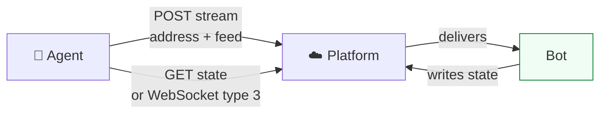

# 07. Bots and state

Most of what a Care Daily app shows, beyond raw device values, is written by a bot: the dashboard,
insights, trends, the daily report, the history. This file is how an agent reads that output and
asks a bot to change it.

Concepts for humans: [Bots and services](../concepts/bots_and_services.md) and
[Data streams and state](../concepts/data_streams_and_state.md).

---

## The model in three lines

- **Input:** a data stream message to an address. `POST /cloud/appstore/stream`.
- **Output:** a location state variable. `GET /cloud/json/locations/{loc}/state?name=`.
- **Asynchronous:** the message returns nothing; the state changes a moment later.



---

## Before sending anything

1. **Is a bot running here?** `GET /cloud/appstore/appInstance?locationId=`.
2. **Does it accept this address?** `GET /cloud/appstore/summary?locationId=` and look in
   `dataStreams[]`.
3. **What does the message look like?** Find the address in the
   [Synthetic API address lookup](../synthetic_apis/README.md#address-lookup) and read its page.
4. **Sandbox first**, per [04 Safe writes](04_safe_writes.md).

## Sending

```bash
source ~/.caredaily/key.env
curl -s -X POST "$CAREDAILY_SERVER/cloud/appstore/stream?address=<address>&scope=1&locationId=<loc>" \
  -H "API_KEY: $CAREDAILY_API_KEY" -H "Content-Type: application/json" \
  -d '{"feed": { ... }}'
```

Then read the state the page says the bot updates, and report what changed.

### Worked example: remove a card from the NOW dashboard

The [Dashboard Status](../synthetic_apis/dashboard_status.md) page says a message with the card's
`type`, `title` and `content.id` and nothing else deletes it:

```bash
curl -s -X POST "$CAREDAILY_SERVER/cloud/appstore/stream?address=update_dashboard_content&scope=1&locationId=<loc>" \
  -H "API_KEY: $CAREDAILY_API_KEY" -H "Content-Type: application/json" \
  -d '{"feed": {"type": 0, "title": "NOW", "content": {"id": "<card id>"}}}'
```

Read `now` again to confirm. A card that bots write in response to real events comes back the next
time those events happen; tell the person that rather than promising it is gone for good. Check
the card's `alarms` first: many cards are already scheduled to delete themselves.

---

## The one rule

**Never `PUT` a state a bot owns.** The bot keeps its own copy and restores it on its next run.
Change bot output only through the bot's input address.

## Reading tips

- One `name` returns `value`; several return `states[]`.
- Time-series states (for example `dailyreport`, `falls`) are read with
  `GET /cloud/json/locations/{loc}/timeStates?name=&startDate=&endDate=`.
- An empty state may simply not exist yet for that home. Compare with a home where it does.
- Organization-wide: `GET /admin/json/locations?organizationId=&stateName=<name>` returns that state
  with each location.

## Related

- [Synthetic APIs](../synthetic_apis/README.md)
- [The life of an alert](../guides/life_of_an_alert.md)
