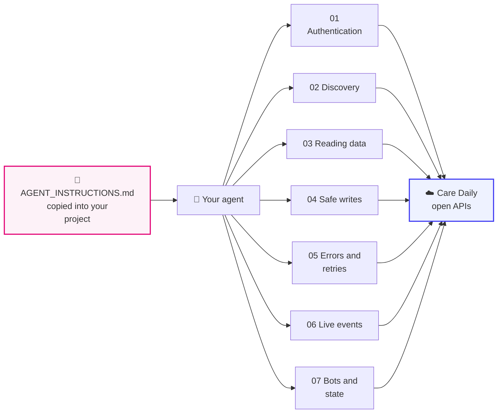

# Care Daily Agent Kit

Markdown files that teach an AI agent to work with Care Daily's open APIs: how to log in, find its
way around, read a home, write safely, recover from errors, and watch events live.

**Who it is for:** anyone pointing a coding agent (Claude Code, or any agent that reads a project
instruction file) at the Care Daily platform on behalf of their own organization.

**It contains no credentials and no customer data.** You supply your own account, once, in your
shell environment.

**Diagram in text:** `AGENT_INSTRUCTIONS.md`, copied into your project, leads your agent to the kit's pages: 01 Authentication, 02 Discovery, 03 Reading data, 04 Safe writes, 05 Errors and retries, 06 Live events, and 07 Bots and state. Every page leads to the Care Daily open APIs.

---

## Install

1. Clone this repository somewhere your agent can read, for example `~/caredaily-docs/`.
2. Copy [`AGENT_INSTRUCTIONS.md`](AGENT_INSTRUCTIONS.md) into the root of the project your agent
   works in, as `CLAUDE.md`, `AGENTS.md`, or whatever file your agent loads by default. Or append it
   to the one you already have. Fix the path on its first line.
3. Put your login in your shell environment (see [01 Authentication](01_authentication.md)), never
   in a file the agent reads.
4. Tell the agent once: *"Read the Care Daily Agent Kit before doing any Care Daily platform work."*

## Reading order

| File | Read it when |
| --- | --- |
| [AGENT_INSTRUCTIONS.md](AGENT_INSTRUCTIONS.md) | Always. The standing rules |
| [01_authentication.md](01_authentication.md) | Getting a key, or a login is failing |
| [02_discovery.md](02_discovery.md) | Finding the server, the specs, and what exists on a home |
| [03_reading_data.md](03_reading_data.md) | Reading accounts, homes, devices, history and bot output |
| [04_safe_writes.md](04_safe_writes.md) | **Before the first write to production** |
| [05_errors_and_retries.md](05_errors_and_retries.md) | A call returned a number other than `0` |
| [06_live_events.md](06_live_events.md) | Watching a home over WebSocket |
| [07_bots_and_state.md](07_bots_and_state.md) | Anything a bot produces, or asking a bot to change it |

## Why a separate kit?

The API references list every endpoint and parameter. What an agent cannot infer from them is the
connective tissue: the order to call things in, which success codes do not mean success, and what an
error actually means. That is what these files are for. The references stay the source of truth:
when this kit and the live spec disagree, the spec wins.

## What this kit does not cover

How Care Daily's bots and analytics reach their conclusions. The kit describes the open APIs:
what goes in and what comes out.

## Related

- [Start here](../getting_started/README.md), the same material for human developers
- [Result codes and gotchas](../platform_apis/result_codes.md)
