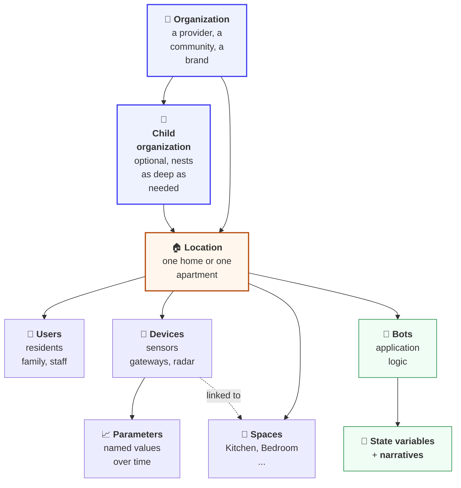

# Concepts

Five nouns explain almost every API call on the platform. Learn how they nest and the rest of the
documentation reads like a map.

| Concept | One line | Read |
| --- | --- | --- |
| **Organizations and locations** | Who the account belongs to, and the home it describes | [organizations_and_locations.md](organizations_and_locations.md) |
| **Users and access** | People, what they can do in each home, and who gets alerted first | [users_and_access.md](users_and_access.md) |
| **Devices and parameters** | Hardware, what it reports, and how to send it a command | [devices_and_parameters.md](devices_and_parameters.md) |
| **Bots and services** | Where the intelligence runs, and why a new home can look empty | [bots_and_services.md](bots_and_services.md) |
| **Data streams and state** | How you talk to a bot, and how it answers | [data_streams_and_state.md](data_streams_and_state.md) |
| **Application attributes** | The shared names every app uses for user properties, tags, and location states | [application_attributes.md](application_attributes.md) |

---

## The one-paragraph version

An **organization** owns **locations**. A location is a home. **Users** belong to locations, each
with an access level and a role in that home. **Devices** are registered to a location and report
**parameters**. **Bots** run on each location, listen to those parameters and to messages you send
them, and publish their conclusions as **state variables** (the current picture) and
**narratives** (the history). Apps read the state and the narratives, and subscribe over WebSocket
to hear when either changes.

---

## Four rules that hold everywhere

1. **IDs belong to one cloud.** US production, EU production and sandbox each have their own
   organizations, locations, users, devices and keys. Never reuse an ID from one cloud on another.
2. **Nearly everything is scoped to a location.** When a call asks for `locationId`, that is the
   home you mean.
3. **Bots own what bots write.** Change bot output by sending the bot a message, never by
   overwriting its state. See [Data streams and state](data_streams_and_state.md).
4. **Success is `resultCode 0`.** HTTP 200 only means the request arrived. See
   [Result codes](../platform_apis/result_codes.md).

## Related

- [Quick Start](../getting_started/quick_start.md)
- [Working with the REST API](../platform_apis/conventions.md)
- [Synthetic APIs](../synthetic_apis/README.md)
