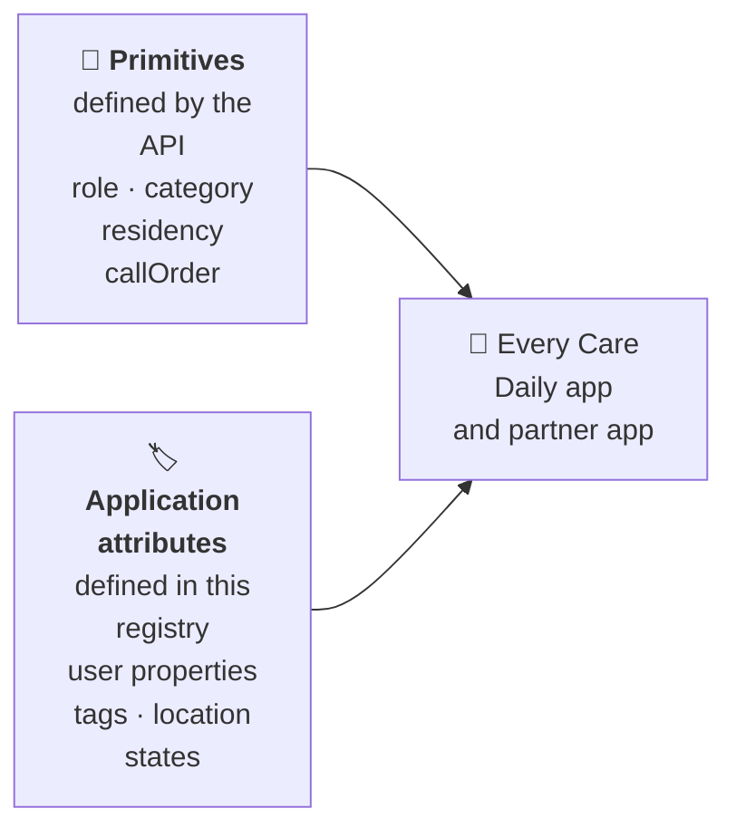

# Application attributes

**When to use it:** your app stores or reads something about a person or a home that the platform
itself does not define, and other Care Daily apps need to read it the same way.

The platform gives every app the same **primitives**: the fields on a person's link to a home
(`role`, `category`, `residency`, `callOrder`, `locationAccess`) are part of the API, so every app
understands them. See [Users and access](users_and_access.md).

Everything else an app adds is an **application attribute**: a user property, a tag, or a location
state variable. The platform stores it but does not know what it means. This page is the registry
of the attributes Care Daily apps use, so that every app, ours and our partners', writes the same
name with the same values and reads it the same way.

**Diagram in text:** Primitives, defined by the API (role, category, residency, callOrder), and application attributes, defined in this registry (user properties, tags, location states), are both used by every Care Daily app and partner app.

**On this page:**
[Conventions](#conventions) ·
[User properties](#user-properties) ·
[Tags](#tags) ·
[Location state variables](#location-state-variables) ·
[Adding an attribute](#adding-an-attribute)

## Conventions

| Rule | Example |
|------|---------|
| User property names are namespaced with the owner and a dot, lower case with underscores | `care-daily.tech_helper` |
| Booleans are stored as the text `true` or `false`, never `yes`, `no`, `1`, or `0` | `care-daily.tech_helper` = `true` |
| Tags are lower case words joined by hyphens | `tech-helper` |
| A location state variable holds one JSON object with a version field `v` | `{"v": 1, ...}` |
| A writer never changes a field another app owns; readers ignore fields they do not know | |

User properties are stored per user and follow the person to every home they belong to. If a fact
belongs to one home only, store it on the location instead.

## User properties

Read and write with `GET` and `PUT /cloud/json/userProperty/{name}` (`userId` and `value` as
query parameters).

| Name | Values | Meaning | Written by | Read by |
|------|--------|---------|------------|---------|
| `care-daily.tech_helper` | `true`, `false` | This person is the family member to call with technical questions about the home's equipment | The hand-off app, when the home is handed to the family | Support, family messaging |

## Tags

Tags classify a user, location, or device inside an organization, so an app can search for them.
Write with `PUT /admin/json/organizations/{organizationId}/tags`.

| Tag | Applies to | Meaning | Paired with |
|-----|-----------|---------|-------------|
| `tech-helper` | User (type 1) | Same as the `care-daily.tech_helper` property; lets an organization find every tech helper | `care-daily.tech_helper` = `true` |

Always write the property and the tag together, and remove both together.

## Location state variables

Read with `GET /cloud/json/locations/{locationId}/state?name={name}`. See
[Data streams and state](data_streams_and_state.md).

| Name | Holds | Written by |
|------|-------|------------|
| `handoff` | The record of a home handed to a family: who handed it off and when, the circle as set up, consent, who sets up the box, the tech contact, the family's own description of the home (`about`, verbatim), and why each alert was turned on or off | The hand-off app |
| `home_profile` | The family's description as structured details: household, pets, sleep places, routines, time outdoors, worries, hopes, notes on reading the home's data, and alert and product ideas, each with its reason | The hand-off app, once per hand-off |
| `journey` | Where the family is in its welcome journey, and what has been sent | The journey app |

### `home_profile` fields

| Field | Type | Example |
|-------|------|---------|
| `v` | number | `1` |
| `household` | text | `"Father and mother"` |
| `pets` | list of `{kind, count}` | `[{"kind": "cat", "count": 2}]` |
| `sleep_places` | list of text | `["bed", "recliner"]` |
| `routines` | list of `{activity, when, away_from_home}` | `[{"activity": "Church", "when": "weekends", "away_from_home": true}]` |
| `outdoors` | list of text | `["gardening"]` |
| `worries`, `hopes` | list of text | `["A fall"]` |
| `reading_the_data` | list of text | `["Motion at night may be the cats."]` |
| `alert_ideas` | list of `{alert, why}` | |
| `product_ideas` | list of `{product, label, why}` | `{"product": "extra_motion", "why": "No motion sensor in the bathroom"}` |
| `sensors_seen` | text | The device names in the home when the profile was made |

The examples are made up and describe no real household.

## Adding an attribute

1. Pick the narrowest home for it: a person's link to a home if a primitive fits, a location state
   if it belongs to one home, a user property only if it truly follows the person.
2. Name it by the conventions above.
3. Add a row here in the same change that first writes it, with its values, meaning, writer, and readers.

## Related

- [Users and access](users_and_access.md), the primitives on a person's link to a home
- [Data streams and state](data_streams_and_state.md), how location state variables work
- [Synthetic APIs](../synthetic_apis/README.md), the bot-provided application APIs
