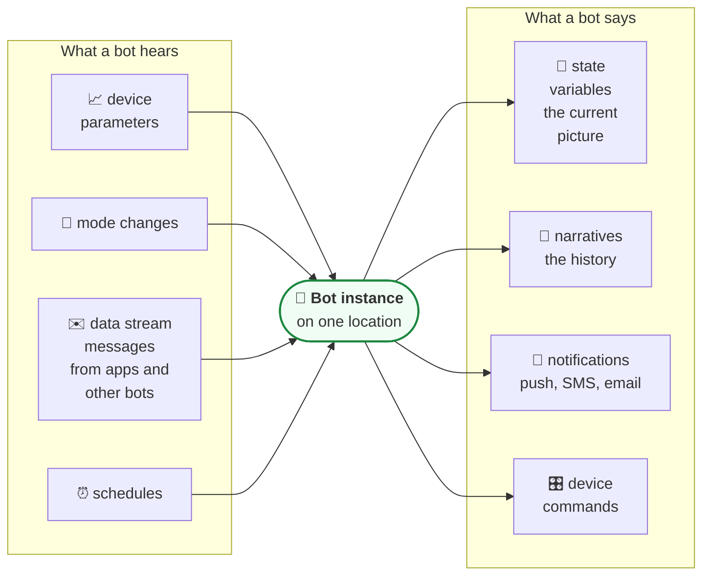

# Bots and services

A **bot** is application logic that runs in the cloud on behalf of one location, or one
organization. Bots are where features live: fall alerts, sleep insights, the dashboard, the daily
report, the reminders a family gets. The platform stores and moves data; bots decide what it means.

**When to read this:** you are wondering why a home shows raw sensor values and nothing else, or
you want to know which bots are running where.



This page describes bots from the outside, as an API consumer sees them: what goes in and what
comes out. How any particular bot reaches its conclusions is not part of the public API.

---

## No bot, no intelligence

Which bots run on a location follows from the **service plan** the location has. Assigning bots to
service plans is done by Care Daily on the backend; there is no public API to define those
services.

That produces the most common "the platform is broken" report, which it is not:

| You see | It means |
| --- | --- |
| Device parameters flowing, `batteryLevel`, `motionStatus` and friends | The devices and the platform are fine |
| No dashboard, insights, trends, daily report or history | No bot is running on this location yet |
| The behavior list for a device type comes back empty | Same cause: behaviors are published by bots |

Raw device parameters are always readable. Everything a bot produces needs the bot.

### Check what is running

```http
GET /cloud/appstore/appInstance?locationId={locationId}
```

This is in the [Bots API reference](https://app.caredaily.ai/cloud/apidocs/bots.html). Each entry in
`bots[]` has the instance ID (`appInstanceId`), `status`, whether it is `active`, and a `bot` block
with its `bundle` name and a `version` block.

```http
GET /cloud/json/userServicePlans?locationId={locationId}
```

This returns the service plans on the location. Filter with `status`: 0 active, 1 expired or
canceled, 2 paused, -1 initial.

---

## Three things bots produce that you will read

| Output | What it is | Read it with |
| --- | --- | --- |
| **State variables** | Named JSON documents on a location. The dashboard, insights, trends | `GET /cloud/json/locations/{locationId}/state?name=` |
| **Narratives** | Time-stamped history entries with a priority, a title and a description | `GET /cloud/json/locations/{locationId}/narratives?rowCount=` |
| **Notifications** | What was actually sent to a person | `GET /cloud/json/notifications?userId=&startDate=` |

The format of each state variable a Care Daily bot publishes is documented in
[Synthetic APIs](../synthetic_apis/README.md). Narrative priorities are listed in
[Event Streaming](../platform_apis/event_streaming.md#narrative-event-streaming).

## How you talk to a bot

You send it a **data stream message**. You never call it directly and it never replies on the same
call. See [Data streams and state](data_streams_and_state.md).

---

## Writing your own bot

The bot developer API has its own reference, [bots.html](https://app.caredaily.ai/cloud/apidocs/bots.html),
and its own header: code running inside a bot authenticates with `ANALYTIC_API_KEY` rather than
`API_KEY`. The same reference covers creating, versioning, uploading and publishing a bot.

> **TODO(verify):** where outside developers should start with the bot framework, and the process
> for publishing a bot to production locations.

## Related

- [Data streams and state](data_streams_and_state.md)
- [Synthetic APIs](../synthetic_apis/README.md)
- [The life of an alert](../guides/life_of_an_alert.md)
