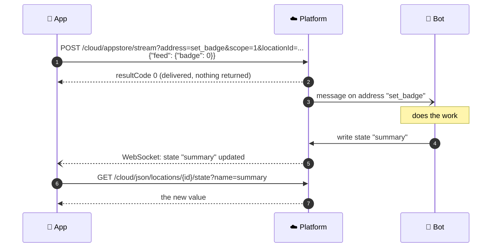
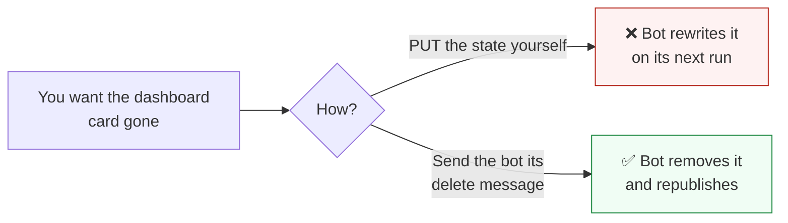

# Data streams and state

This is how you and a bot talk. You send a **data stream message** to an address. The bot does the
work and publishes a **location state variable**. You read the state, or get it pushed to you.
Together, the pair is a [Synthetic API](../synthetic_apis/README.md).

**When to read this:** before you send anything to a bot, and before you are tempted to edit a
state variable by hand.



---

## Sending: data stream messages

```http
POST /cloud/appstore/stream?address={address}&scope=1&locationId={locationId}
Content-Type: application/json

{ "feed": { "any": "JSON the bot expects" } }
```

| Parameter | Where | Meaning |
| --- | --- | --- |
| `address` | query, required | The data stream address a bot listens on |
| `scope` | query, required | Bitmask: `1` location bots, `2` organization bots |
| `locationId` | query | The home. Required for end users |
| `organizationId` | query | Used by administrators to reach the bots of every user in an organization |
| `feed` | body | The message content. Any JSON object |
| `locations`, `bots` | body | Optional lists of location IDs and bot instance IDs, to address specific targets |

What to know about a data stream message:

- **It is transient.** The platform does not store it. Its effect shows up in state variables and
  narratives.
- **It never returns data.** `resultCode 0` means the message was accepted for delivery.
- **One home at a time.** An administrator can send with `organizationId` alone, which reaches
  every user's bots in the organization. Always pass `locationId` unless that broadcast is truly
  what you mean.
- **Discover before you send.** `GET /cloud/appstore/summary?locationId=` lists the data stream
  addresses the bots on that location accept, in `dataStreams[]`.
- **Discover what they publish.** The `location_properties` state variable lists the state
  variables bots write on that location: `additional_properties` holds regular state names, and
  `timeseries_properties` maps each time-series state to the timestamp of its latest entry.

### Creating objects without a reply

A normal REST POST returns the ID of what it created. A data stream message cannot. When you create
something you will want to edit or delete later, **generate the ID yourself** (a UUID works) and
send it in the content.

---

## Reading: location state variables

```http
GET /cloud/json/locations/{locationId}/state?name=dashboard_header
GET /cloud/json/locations/{locationId}/state?name=now&name=dashboard_header
```

One `name` returns the document in `value`. Several names return `states[]`, each with a `name`
and a `value`.

A state variable is non-volatile JSON stored against a location. It outlives the bot that wrote it.

### Time-series state

Some states are stored per timestamp, for example the daily report.

```http
GET /cloud/json/locations/{locationId}/timeStates?name=dailyreport&startDate=...&endDate=...
```

`startDate` is required. Without `endDate`, only states dated exactly at `startDate` come back.

### Get told, instead of asking

Subscribe to a state over [WebSockets](../platform_apis/websockets.md) (subscription `type` 3) and
the platform pushes each change. Partner clouds can receive the same changes through
[Event Streaming](../platform_apis/event_streaming.md) (data `type` 3 and 5).

---

## The golden rule: bots own what bots write

The Application API lets any authorized caller write a state with
`PUT /cloud/json/locations/{locationId}/state`. **Do not use it on a state a bot owns.** The bot
keeps its own copy of what it published. Overwrite the state and the bot's copy disagrees with
yours; the next time it runs, your change is gone and the old value is back.



Each [Synthetic API](../synthetic_apis/README.md) page lists the input address that changes its
output. For example, [Dashboard Status](../synthetic_apis/dashboard_status.md) explains how to
delete a card through `update_dashboard_content`.

Writing a state of your own, one no bot owns, is fine. That is how an app can store a setting
against a home.

## Related

- [Synthetic APIs](../synthetic_apis/README.md), with every address and state in one table
- [Bots and services](bots_and_services.md)
- [WebSockets](../platform_apis/websockets.md)
