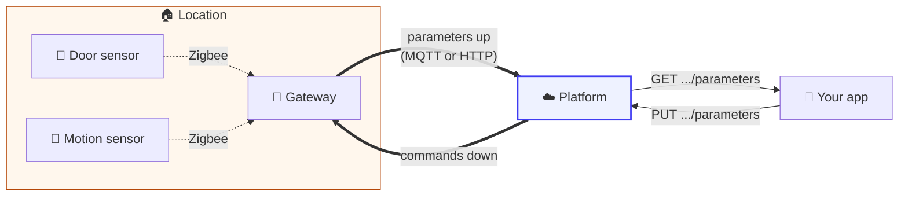
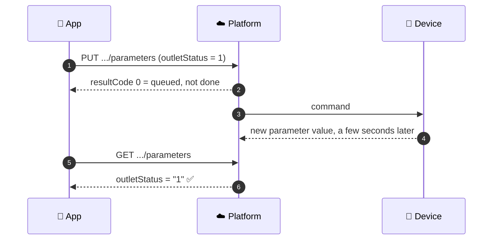

# Devices and parameters

A **device** is anything that reports data or takes commands: a gateway, a motion sensor, a door
sensor, a radar, a smart plug, even a phone. Devices report **parameters**, which are named values
with timestamps, and they accept **commands**, which set parameters.

**When to read this:** you are listing what is installed in a home, reading sensor values or their
history, or sending a device a command.



---

## Identity

Every device has a globally unique `id` on its cloud, a numeric `type`, and a human name in `desc`,
which is what the app shows. Before a device can talk to the platform, the server needs a
**device type** definition for it and the device must be **registered to a location**.

| Call | Use |
| --- | --- |
| `GET /cloud/json/devices?locationId=` | Every device in a home, with current parameters |
| `GET /cloud/json/devices/{deviceId}?locationId=&checkConnected=true` | One device, with a live connection check |
| `GET /cloud/json/deviceTypes?deviceType=` | What a device type is |
| `GET /cloud/json/preregistered/{deviceId}` | Whether the cloud already knows this device ID, and its type and model |
| `POST /cloud/json/devices?deviceId=&locationId=&deviceType=&desc=` | Register a device to a location |
| `PUT /cloud/json/locations/{locationId}/devices/{deviceId}` | Rename it, set its behavior (`goalId`), clear `newDevice`, or move it to another location |

> **The "New Device" badge is the `newDevice` flag, and nothing clears it for you.** Naming the
> device, choosing its behavior and linking it to a space all leave the badge showing. Send
> `{"device": {"newDevice": false}}` when onboarding is done.

A device's **behavior** (`goalId`) tells the bots what it is for: a door sensor on the front door
and one on a medicine cabinet are the same hardware with different jobs. The choices per device
type are in [Behaviors](../synthetic_apis/behaviors.md).

---

## Online or offline?

A device record has several timestamps, and they answer different questions.

| Field | Means |
| --- | --- |
| `lastDataReceivedDateMs` | The last time the platform received and stored data from this device |
| `lastMeasureDateMs` | The timestamp of the last measurement the device reported |
| `lastConnectedDateMs` | The last time the device connected |
| `connected` | The current connection flag. Add `checkPersistent=true` to the list call to have the server check live connections |

> **Judge freshness from `lastDataReceivedDateMs`.** The `connected` flag follows the heartbeat and
> can flip back and forth. How stale is too stale depends on how often the device type reports; a
> day without data is a reasonable first alarm for most sensors.

---

## Reading parameters

```http
GET /cloud/json/devices/{deviceId}/parameters?locationId={locationId}
GET /cloud/json/devices/{deviceId}/parameters?locationId={locationId}&paramName=motionStatus&paramName=batteryLevel
```

```json
{
  "resultCode": 0,
  "devices": [
    {
      "id": "<deviceId>",
      "lastDataReceivedDateMs": 1403293631000,
      "parameters": [
        { "name": "motionStatus", "value": "1", "lastUpdateTimeMs": 1403293631000 }
      ]
    }
  ]
}
```

> **Two parsing traps.** The values are nested at `devices[0].parameters[]`, one level down from the
> top. And **every value is a string**, so compare with `"1"`.

To learn what a parameter means, including its units:

```http
GET /cloud/json/deviceParameters?paramName=batteryLevel
```

### History

| Call | Returns |
| --- | --- |
| `GET /cloud/json/devices/{deviceId}/parametersByDate/{startDate}?locationId=&endDate=&paramName=` | Measurements in a date range |
| `GET /cloud/json/devices/{deviceId}/parametersByCount/{rowCount}?locationId=&paramName=` | The last N measurements |

`parametersByDate` can also aggregate: `interval` in minutes, and `aggregation` 0 last value
(default), 1 minimum, 2 maximum, 3 median, 4 time-distributed average, 5 average.

---

## Sending a command

```http
PUT /cloud/json/devices/{deviceId}/parameters?locationId={locationId}
Content-Type: application/json

{
  "commandType": 0,
  "commandTimeout": 60000,
  "comment": "Why this command was sent",
  "params": [ { "name": "outletStatus", "value": "1" } ]
}
```

| Field | Meaning |
| --- | --- |
| `commandType` | `0` set parameters (default), `4` ask the device to report parameters |
| `commandTimeout` | Optional, in **milliseconds** from creation |
| `params[]` | `name`, `value`, and optionally `index` and `unit` |



> **`resultCode 0` means the command was queued.** The device applies it when it can. Read the
> parameter back after a few seconds when it matters, and treat a setting that never changes as
> unsupported by that firmware. `resultCode 21` means the device is offline right now.

---

## Firmware

Firmware jobs are created by the server. A client can see them and approve or decline one that is
not forced:

```http
GET /cloud/json/fwupdate?deviceId=
PUT /cloud/json/fwupdate?deviceId=&status=2     (2 approve, 3 decline)
```

## Related

- [MQTT](../platform_apis/mqtt.md), the recommended path for device firmware
- [Device API reference](https://app.caredaily.ai/cloud/apidocs/devices.html)
- [Device Onboarding charts](../message_sequence_charts/diagrams/apps/device_onboarding/README.md)
- [WebSockets](../platform_apis/websockets.md), to get parameter changes pushed to you
