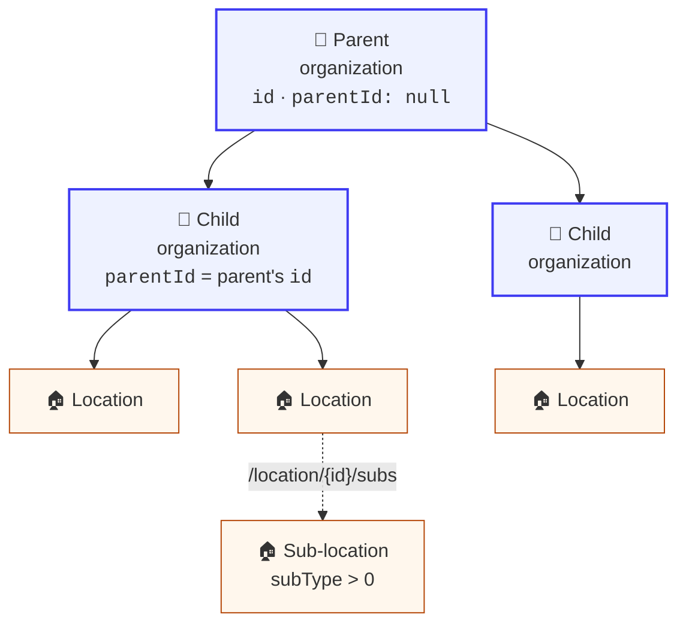
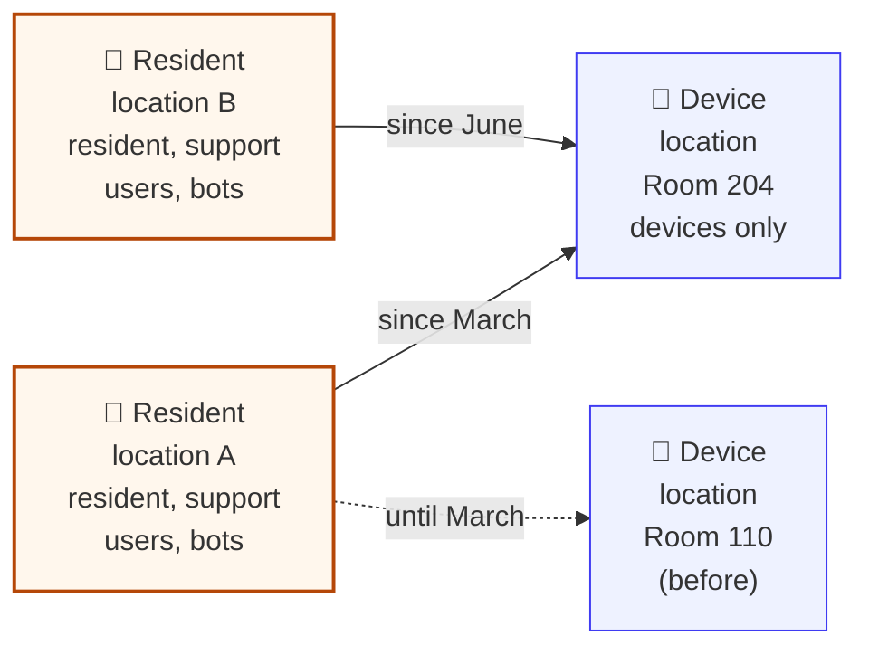

# Organizations and locations

An **organization** is the account container: a care provider, a senior living community, a
reseller, a brand. A **location** is one home inside it. Nearly every call you make is about one
location.

**When to read this:** before you write anything that lists homes, provisions a new home, or
reasons about which organization a home belongs to.



**Diagram in text:** A parent organization (`parentId: null`) has two child organizations, each with `parentId` set to the parent's `id`. One child has two locations and the other has one. One location has a sub-location (`subType > 0`), listed through `/location/{id}/subs`.

---

## Organizations

Organizations nest. Each row returned by the Admin API has an `id` and a `parentId`, and walking
`parentId` upward gives you the chain. A child organization **inherits** settings from its parent,
branding included, until it sets its own.

| Call | What it does |
| --- | --- |
| `GET /admin/json/organizations?organizationId=` | One organization. Also accepts `domainName` (exact) or `name` (first characters) |
| `GET /admin/json/organizations/{organizationId}/narratives?rowCount=` | History and alerts across the organization |
| `GET /admin/json/organizations/{organizationId}/admins` | Who administers it, with each admin's role |
| `GET /admin/json/organizations/{organizationId}/objects` | The organization's object store: branding and configuration |

All of these need an administrator key. See [Authentication](../platform_apis/authentication.md).

> **The ID field is `id`, not `organizationId`.** The query parameter is called `organizationId`,
> but the row that comes back names the same value `id`.

### Branding lives in the object store

An organization's logos, display name and colors are named objects:

| Object name | Kind | Purpose |
| --- | --- | --- |
| `logo`, `logoLight`, `logoDark` | image | Logo, default and per theme |
| `businessName` | string | Display name in the app |
| `businessUrl` | string | Website |
| `primaryColor`, `secondaryColor` | string | Hex colors |

Upload images with `PUT /admin/json/organizations/{organizationId}/objects/{objectName}?private=false`,
the raw bytes as the body, and a real `Content-Type` header. Leaving out `Content-Type` fails with
`resultCode 9`. Set strings with `POST /admin/json/organizations/{organizationId}/objects`.

> **TODO(verify):** these object names come from how the Care Daily apps behave in practice, not
> from the API reference. Confirm them as a supported contract, together with the recommended logo
> size and how soon a change appears in each app.

The store also holds configuration that bots read. Change only the objects you understand.

---

## Locations

A location is one household: one address, one time zone, zero or more users and zero or more
devices. The platform calls it a location rather than a home because it can also be an apartment,
a community space, or a room inside a larger place.

| Call | What it does |
| --- | --- |
| `GET /cloud/json/user` | Your own account, with `locations[]` you belong to |
| `POST /cloud/json/location` | Add a location to the calling user |
| `GET /admin/json/locations?organizationId=` | Locations in an organization. Filters include `searchBy` (name and address, `*` wildcard), `deviceType`, `stateName`, `locationType`, `externalId` |
| `GET /cloud/json/location/{locationId}/spaces` | The rooms defined in this home |
| `GET /cloud/json/location/{locationId}/events` | Mode history, latest first. See [Modes](../platform_apis/modes.md) |

> **`/admin/json/locations` has no `userId` filter.** Pass one and it is ignored: you get the
> unfiltered list. To go from a person to their homes, read `GET /cloud/json/user?userId=` with an
> administrator key, or find their devices with `GET /admin/json/devices?userId=`.

### Addresses use IDs

A location's `state` and `country` are integer IDs and its `timezone` is a string ID. One call
resolves all three:

```http
GET /cloud/json/countries?countryCode=US
```

It returns `countries[]`, each with nested `states[]` (with `id`, `name`, `timezoneId`) and
`timezones[]`.

### Sub-locations

A location can hold sub-locations, for example the apartments of a building. A sub-location has
`subType > 0`, and `PUT /cloud/json/location/{locationId}/subs?subLocationId=` assigns one.
`GET /cloud/json/location/{locationId}/subs` returns the assignment history and needs a
`startDate`.

> **Not subscriptions.** Despite the name, `/subs` is about sub-locations. For the bots running on a
> location, see [Bots and services](bots_and_services.md).

### Resident locations and device locations in care facilities

In a home, one location holds everything: the people, the devices and the bots. In a care facility
the platform splits that into two kinds of location, because people move between rooms and rooms
are shared.

| | Resident location | Device location |
| --- | --- | --- |
| **Is** | One resident | A room or an apartment in the facility |
| **Holds** | The resident, their support users (family, staff), the bots, the resident's personal devices, state variables, narratives and subscriptions | Devices only, no users |
| **Lives** | As long as the person is a resident | As long as the room exists |

A resident location is related to the device location of the room the resident lives in, with
the `/subs` calls above. The bots on the resident location read the devices of that room.

- **A shared room has two residents.** Two resident locations can be related to the same device
  location at the same time, when two residents share a room.
- **The relation is historical.** When a resident moves to another room, the new relation starts
  and the old one ends, but it is kept. `GET /cloud/json/location/{locationId}/subs` with a
  `startDate` returns which room a resident was in, and when. Read the relation for the time you
  are asking about, never only the current one.



**Diagram in text:** Resident location A (the resident, support users, and bots) has been related to device location Room 204 since March, and was related to Room 110 until March. Resident location B has been related to Room 204 since June. A device location has devices only.

> **TODO(verify):** confirm which location goes in the path and which in `subLocationId` when a
> resident location is related to a device location, and how a device location is marked
> (`subType`, `locationType`).

### Spaces

Spaces are the rooms of a home. Each has a `type` and a `name`, and a device can link to several.

| `type` | Space | `type` | Space |
| :---: | --- | :---: | --- |
| 0 | Undefined | 7 | Family Room |
| 1 | Kitchen | 8 | Laundry Room |
| 2 | Bedroom | 9 | Office |
| 3 | Bathroom | 10 | Stairs |
| 4 | Hallway | 11 | Garage |
| 5 | Living Room | 12 | Basement |
| 6 | Dining Room | 13 | Other |

Create or rename one with `POST /cloud/json/location/{locationId}/spaces` (add `?spaceId=` to
update). The answer holds only a `resultCode`, so read the list again to learn the new ID. Link a
device with `PUT /cloud/json/locations/{locationId}/devices/{deviceId}/spaces/{spaceId}`.

---

## Related

- [Users and access](users_and_access.md)
- [Devices and parameters](devices_and_parameters.md)
- [Admin API reference](https://app.caredaily.ai/cloud/apidocs/admin.html)
