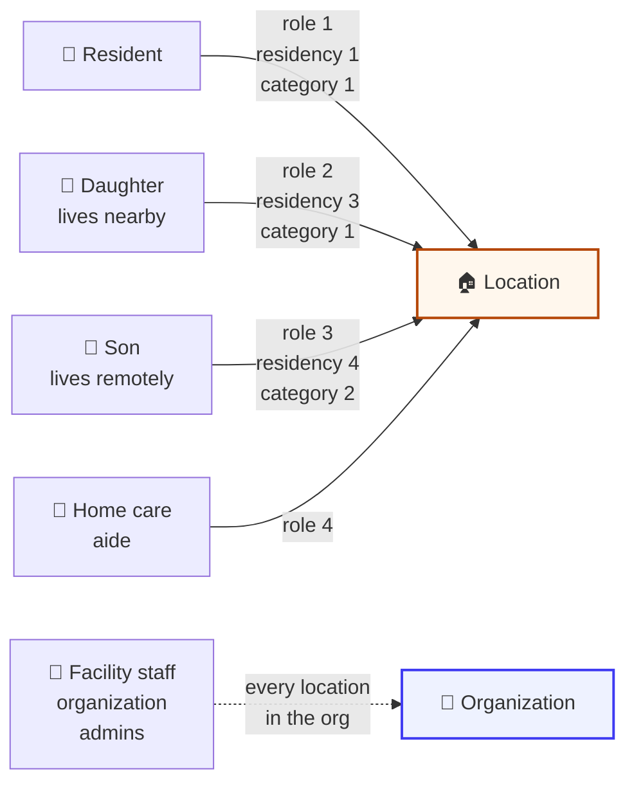

# Users and access

A **user** is a person with a login. A user can belong to several locations and play a different
part in each: the resident in one home, the daughter who gets the alerts in another.

**When to read this:** you are showing who is in a home's circle, deciding who can control what, or
working out why a family member does not receive alerts.



The people attached to a location are its **Trusted Circle**. Every person's link to a home has
its own settings, read and written on the location:

```http
GET /cloud/json/location/{locationId}/users
PUT /cloud/json/location/{locationId}/users      (update people already on the location)
POST /cloud/json/location/{locationId}/users     (add existing users)
```

Each entry in `users[]` has the person's name and contact fields plus these link fields:
`locationAccess`, `role`, `category`, `residency`, `callOrder`, `hidden`, `temporary`,
`nickname` and `relationships[]`.

---

## The four enums

These tables are from the [Application API reference](https://app.caredaily.ai/cloud/apidocs/cloud.html#tag/Locations/operation/Add%20Location%20Users).

### `locationAccess`: what they can do

| Value | Name | Can |
| :---: | --- | --- |
| 0 | None | Nothing on this location |
| 10 | Read | Read all location and device information |
| 20 | Control | Change location modes and control devices |
| 30 | Admin | Manage the location and its devices |

### `role`: who they are here

| Value | Role |
| :---: | --- |
| 0 | None |
| 1 | Supported Resident (care recipient) |
| 2 | Lead Supporter (primary caregiver) |
| 3 | Backup Supporter (secondary caregiver) |
| 4 | Professional Support Personnel |
| 5 | Circle Member |
| 6 | Attending Doctor (physician) |

### `category`: when they hear about an alert

| Value | Category |
| :---: | --- |
| 0 | None |
| 1 | Notify First |
| 2 | Notify Second |
| 3 | Social Check-in Reminders |

### `residency`: where they live

| Value | Residency |
| :---: | --- |
| 0 | Unknown |
| 1 | Resident |
| 2 | On-Site Community Staff |
| 3 | Lives Nearby |
| 4 | Lives Remotely |

`callOrder` ranks people for a phone tree. `hidden` keeps a person out of the list other members
see. `temporary` marks an access grant that ends.

## Location users and facility staff

Location users and facility staff reach a home in two different ways.

| | Location users | Facility or community staff |
| --- | --- | --- |
| **Who** | The resident, family, friends, and the people who support this one home, including professional caregivers and support personnel (`role` 4) | The staff of a care facility or senior living community |
| **Linked to** | One location at a time, through `/cloud/json/location/{locationId}/users` | The organization, as organization administrators. See [Organizations and locations](organizations_and_locations.md) |
| **Sees** | Only the locations they are added to | Every location in the organization |

Staff users are not added to individual locations. A professional caregiver who visits one house
is a location user of that house; a nurse on a community's staff is an administrator of the
community's organization. To list a facility's staff, read
`GET /admin/json/organizations/{organizationId}/admins`, not the users of each location.

> **"My brother never gets the alerts."** Check his `role` and `category` on that location first.
> A person with `category` 0 is not in the alert order, and bots may leave a person with `role` 0
> out of alerts entirely. Then read what was actually sent to him, below.

---

## Finding a person

| Call | Use |
| --- | --- |
| `GET /cloud/json/user` | The calling user, and the locations they belong to |
| `GET /cloud/json/user?userId=` | Another user, with an administrator key |
| `GET /admin/json/users?organizationId=&searchBy=` | Search an organization by login, ID, email, phone, first or last name. `*` is a wildcard |

> **No match returns no `users` field at all**, only `{"resultCode": 0}`. Test for the field before
> you count it.

> **Plus-addressed sign-ups hide from an exact search.** Someone who registered as
> `pat+home@example.com` does not match `pat@example.com`. Try `pat+*@example.com` and `pat*`
> before you conclude an account does not exist.

## What was sent to a person

```http
GET /cloud/json/notifications?userId=&startDate=&locationId=
```

`startDate` is required. Each notification has a `deliveryType`, a `sourceType` and the text that
went out.

| `deliveryType` | Channel |
| :---: | --- |
| 1 | Push notification |
| 2 | Email |
| 3 | Outgoing SMS |
| 4 | Incoming SMS |

| `sourceType` | Who sent it |
| :---: | --- |
| 0 | External API call |
| 1 | Rule |
| 2 | Bot |
| 4 | Device firmware update |
| 5 | Internal system logic, such as an account issue |
| 6 | Cloud business logic |
| 7 | External incoming message |

---

## Handle with care

Location users and notifications are personal data: names, phone numbers, email addresses, who
lives where. Read them for the person in front of you, show them, and keep no copy you do not
need.

## Related

- [Organizations and locations](organizations_and_locations.md)
- [Action Plans](../synthetic_apis/action_plans.md), which shows who a bot will contact, in what order
- [User Login and Registration charts](../message_sequence_charts/diagrams/apps/user_login_and_registration/README.md)
