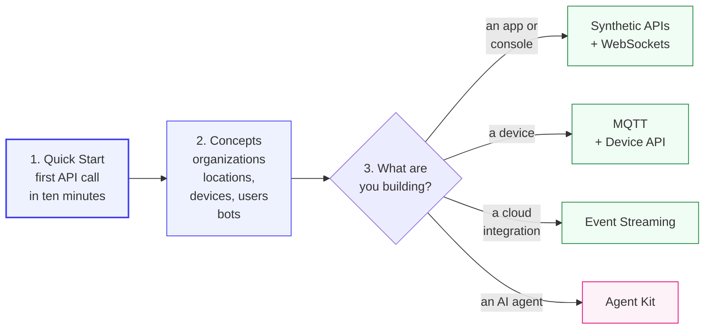

# Start here

A reading order for your first day on the Care Daily platform. Follow it top to bottom and you will
have made a real API call, understood what came back, and know which page to open next.

| Step | Read | You will know |
| :---: | --- | --- |
| 1 | [Quick Start](quick_start.md) | How to find the server, log in, and read your own home and devices |
| 2 | [Concepts](../concepts/README.md) | The five nouns every API call is about, and how they nest |
| 3 | [Authentication](../platform_apis/authentication.md) | Which key type you need, and the two-step administrator login |
| 4 | [Working with the REST API](../platform_apis/conventions.md) | Dates, paging, sorting, and how to read a response |
| 5 | [Result codes and gotchas](../platform_apis/result_codes.md) | What an unfamiliar number means, and the calls that succeed without doing anything |

Then pick your track:

| You are building | Go to |
| --- | --- |
| A mobile or web app | [Synthetic APIs](../synthetic_apis/README.md), then [WebSockets](../platform_apis/websockets.md) |
| An administrative console | [Admin API](https://app.caredaily.ai/cloud/apidocs/admin.html), then [The life of an alert](../guides/life_of_an_alert.md) |
| Firmware for a device | [MQTT](../platform_apis/mqtt.md) and the [Device API reference](https://app.caredaily.ai/cloud/apidocs/devices.html) |
| A partner cloud that receives data | [Event Streaming](../platform_apis/event_streaming.md) |
| An AI agent that drives the platform | [Agent Kit](../agent_kit/README.md) |

---

## Three ideas that save you a day

1. **Every response has a `resultCode`.** HTTP 200 only means the request arrived. `0` means it
   worked. Anything else is an error, with a readable `resultCodeMessage`.
2. **Most of what an app shows comes from a bot.** The dashboard, insights, trends and the daily
   report are written by bots as location state variables. If a new home shows raw sensor values
   but nothing smart, no bot is running there yet. See
   [Bots and services](../concepts/bots_and_services.md).
3. **A device command returns `0` when it is queued.** The device applies it a few seconds later,
   or not at all. Read the parameter back when it matters.

---

## Related

- [Concepts](../concepts/README.md)
- [Guides](../guides/README.md)
- [Message Sequence Charts](../message_sequence_charts/README.md) for the exact call order behind each app screen
