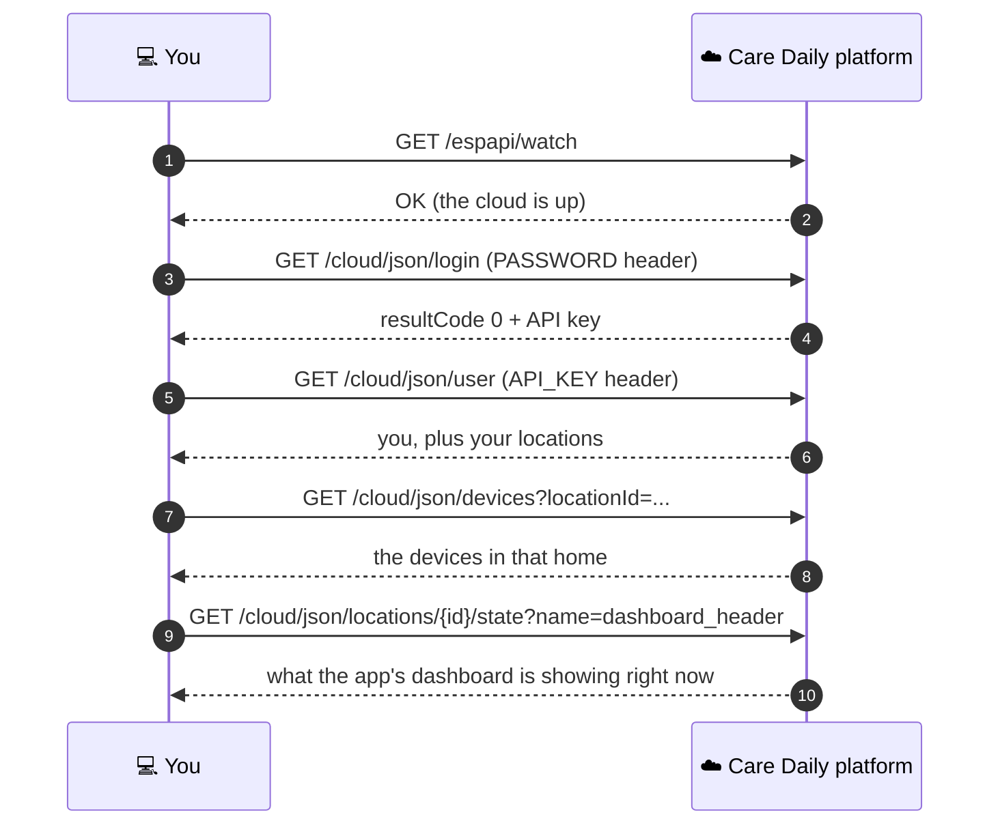

# Quick Start: your first API call

Ten minutes from nothing to reading live sensor values from a home. You need a terminal with
`curl` (or Python 3) and a Care Daily account, the same one you use in the Care Daily app.

**When to use this page:** you have never called the platform before and want proof that it works
before you read anything else.



**Diagram in text:**

1. You send `GET /espapi/watch`.
2. The platform answers OK: the cloud is up.
3. You send `GET /cloud/json/login` with the PASSWORD header.
4. The platform returns `resultCode 0` and an API key.
5. You send `GET /cloud/json/user` with the API_KEY header.
6. The platform returns you, plus your locations.
7. You send `GET /cloud/json/devices?locationId=...`.
8. The platform returns the devices in that home.
9. You send `GET .../state?name=dashboard_header` for that location.
10. The platform returns what the app's dashboard is showing right now.

---

## Step 0: pick a server

The platform runs as separate clouds. Each has its own accounts, its own IDs and its own API keys,
so an ID or a key from one means nothing on another.

| Cloud | API base URL |
| --- | --- |
| US production | `https://app.peoplepowerco.com` |
| EU production | `https://eu.caredaily.ai` |
| Sandbox | `https://sboxall.peoplepowerco.com` |

These are the servers listed in the [Application API reference](https://app.caredaily.ai/cloud/apidocs/cloud.html).
You can also ask the platform, with no key at all:

```bash
curl -s https://app.peoplepowerco.com/cloud/json/settings
```

The answer lists each cloud and its servers. `type: appapi` is the REST API host and
`type: webapp` is the web console.

Use the cloud where your account lives. If you signed up in the Care Daily app in the United
States, that is US production. Everything on this page is a read, so it is safe to run there.

> **TODO(verify):** how an outside developer gets a sandbox account. Until that is documented, ask
> your Care Daily contact.

Set it once:

```bash
export CAREDAILY_SERVER="https://app.peoplepowerco.com"
```

## Step 1: is it up?

```bash
curl -s "$CAREDAILY_SERVER/espapi/watch"
```

`OK`. The platform does not answer ICMP ping, so this is the health check.

## Step 2: log in and get an API key

A user key (`keyType=0`) needs no second step. Two details matter: the password goes in a header,
and it must be URL-encoded.

**Python**, standard library only. It saves the key and never prints it:

```python
import json, os, urllib.parse, urllib.request

server = os.environ["CAREDAILY_SERVER"]
params = urllib.parse.urlencode({
    "username": os.environ["CAREDAILY_USER"],
    "keyType": 0,     # end user
    "expiry": 1,      # days; always pass it
})
req = urllib.request.Request(
    f"{server}/cloud/json/login?{params}",
    headers={
        "PASSWORD": urllib.parse.quote(os.environ["CAREDAILY_PASSWORD"], safe=""),
        "Accept": "application/json",
    },
)
reply = json.load(urllib.request.urlopen(req))
print("resultCode", reply["resultCode"], "expires", reply.get("keyExpire"))
if reply["resultCode"] == 0:
    with open(os.path.expanduser("~/.caredaily_key"), "w") as f:
        f.write(reply["key"])
```

Keep the username and password in environment variables rather than in the script. Put single
quotes around the password when you export it, so the shell leaves special characters alone.

A good answer looks like this:

```json
{
  "resultCode": 0,
  "key": "<your API key>",
  "keyExpire": "2026-10-01T14:54:54-04:00",
  "keyExpireMs": 1790880894000
}
```

Read `keyExpire`. The server can give you a shorter life than you asked for, so plan around the
value it returns. (The dates above are examples.)

From now on, every call sends that key in the `API_KEY` header:

```bash
export CAREDAILY_API_KEY="$(cat ~/.caredaily_key)"
```

Trouble? [Authentication](../platform_apis/authentication.md) covers every failure you are likely
to see, and why `resultCode 12` is not always a wrong password.

## Step 3: who am I, and where do I live?

```bash
curl -s "$CAREDAILY_SERVER/cloud/json/user" \
  -H "API_KEY: $CAREDAILY_API_KEY" -H "Accept: application/json"
```

You get a `user` object and a `locations[]` array. Each location is a home you belong to, and its
`locationUser` block says what you are there: your access level, your role, and whether you live
there. Copy a location `id`.

```bash
export LOC=123456   # your location ID
```

## Step 4: what is installed?

```bash
curl -s "$CAREDAILY_SERVER/cloud/json/devices?locationId=$LOC" \
  -H "API_KEY: $CAREDAILY_API_KEY" -H "Accept: application/json"
```

Each device in `devices[]` has an `id`, a `type`, the name people see (`desc`), and its current
`parameters[]`. For one device:

```bash
curl -s "$CAREDAILY_SERVER/cloud/json/devices/<deviceId>/parameters?locationId=$LOC" \
  -H "API_KEY: $CAREDAILY_API_KEY" -H "Accept: application/json"
```

The values sit at `devices[0].parameters[]`, one level down. Every value is a string, so compare
with `"1"`, not `1`.

## Step 5: what is the app showing?

```bash
curl -s "$CAREDAILY_SERVER/cloud/json/locations/$LOC/state?name=dashboard_header" \
  -H "API_KEY: $CAREDAILY_API_KEY" -H "Accept: application/json"
```

This is a **location state variable** written by a bot: the banner at the top of the app. Its format
is in [Dashboard Header](../synthetic_apis/dashboard_header.md). Ask for several at once by repeating
`name`, for example `?name=dashboard_header&name=now`.

An empty answer usually means no bot has written that state for this home yet. See
[Bots and services](../concepts/bots_and_services.md).

---

## You did it. Now what?

| Next | Why |
| --- | --- |
| [Concepts](../concepts/README.md) | Make sense of what you just read |
| [WebSockets](../platform_apis/websockets.md) | Get those values pushed to you the moment they change |
| [Synthetic APIs](../synthetic_apis/README.md) | Everything bots publish, and how to talk back to them |
| [Result codes](../platform_apis/result_codes.md) | For the first time something returns a number that is not `0` |

## Related

- [Application API reference](https://app.caredaily.ai/cloud/apidocs/cloud.html)
- [Authentication](../platform_apis/authentication.md)
- [Agent Kit](../agent_kit/README.md), if an AI agent will be making these calls
