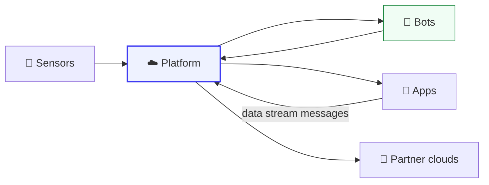

# Guides

Worked stories that cross several APIs. Each one follows a real task from start to finish and
links to the reference pages for the detail.

| Guide | You will learn |
| --- | --- |
| [The life of an alert](life_of_an_alert.md) | How a fall moves from a sensor to a bot, to the family's phones, to a partner cloud, and back when someone resolves it |
| [Watch a home live](watch_a_home_live.md) | The baseline, subscribe, react pattern behind installation tools and live dashboards |
| [Troubleshooting a home](troubleshooting.md) | The order of checks when someone says "it is not working" |

For the exact request order behind each app screen, see the
[Message Sequence Charts](../message_sequence_charts/README.md).

## Related

- [Concepts](../concepts/README.md)
- [Agent Kit](../agent_kit/README.md), the same knowledge written for AI agents
