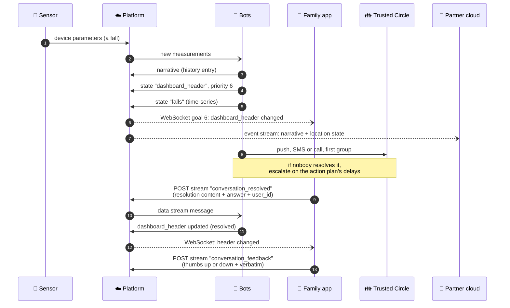
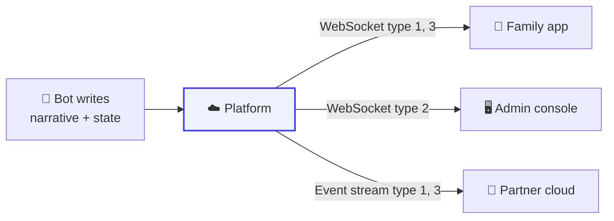
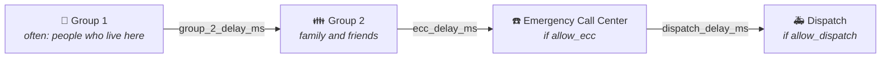

# The life of an alert

A fall is detected at 3:36 in the afternoon. This guide follows that one event from the sensor to
the family's phones and back, and names the API surface you touch at each step. It is the best way
to see how the platform, the bots and your app fit together.

**When to read this:** you are building the alert experience in an app or a console, or you are
integrating a partner cloud that must react to alerts.

Everything below is the public contract: what goes in and what comes out. How a bot decides that a
fall happened is not part of it.

---

## The whole story on one page

---

## 1. The measurement arrives

The sensor reports parameters to the platform, over [MQTT](../platform_apis/mqtt.md) or the device
API. Nothing about an alert exists yet; it is data.

**You can see:** the raw values with `GET /cloud/json/devices/{deviceId}/parameters?locationId=`,
or live with a WebSocket subscription of `type` 6.

## 2. A bot decides it matters

Bots running on the location receive the new measurements. When one concludes that a person may
have fallen, it writes its conclusions back to the platform in three forms.

| Output | What it is | Documented in |
| --- | --- | --- |
| A **narrative** | The history entry the timeline shows. Priority 2 is a warning, 3 is critical | [Event Streaming: narratives](../platform_apis/event_streaming.md#narrative-event-streaming) |
| The **`dashboard_header`** state, priority 6 | The red banner: "Help needed!" | [Dashboard Header](../synthetic_apis/dashboard_header.md) |
| The **`falls`** time-series state | A record of the fall itself, when a fall-detecting radar saw it | [Fall History](../synthetic_apis/falls.md) |

Priority 6 on the dashboard header means **Critical Alert**, rendered red. The header also says
whether to show the call button (`call`) and the Emergency Call Center (`ecc`), and holds the
`resolution` and `feedback` objects your app will use in step 5.

## 3. Everyone who needs to know, knows

At the same moment:

- **An app with a WebSocket subscription** to `dashboard_header` (`type` 3) or to location
  narratives (`type` 1) receives the change as a `goal` 6 message. No polling.
- **An administrative console** subscribed to organization narratives (`type` 2) sees the alert in
  its list.
- **A partner cloud** with [Event Streaming](../platform_apis/event_streaming.md) receives the
  narrative (data `type` 1) and the state change (data `type` 3).

## 4. People are contacted, in order

Who hears about it, and when, is the location's **action plan** for that service, published in the
[`action_plans`](../synthetic_apis/action_plans.md) state variable so an app can explain it.

Who is in each group comes from each person's settings on the location: their `category` (Notify
First, Notify Second) and `callOrder`. See [Users and access](../concepts/users_and_access.md). What
was actually sent to each person is readable afterward with `GET /cloud/json/notifications`.

## 5. Someone resolves it in the app

The dashboard header's `resolution` object tells the app what button to show ("UPDATE STATUS >"),
what choices to offer ("Resolved", "False Alarm"), and where to send the answer. When the person
taps a choice, the app:

1. **Merges** `resolution.content` with the chosen option's `content`, adds the `user_id`, and
   sends it as a data stream message to `resolution.datastream_address`.
2. **Acknowledges** at once, showing the option's `ack` text while the bot catches up.

The bot then rewrites `dashboard_header`, and the app's WebSocket subscription delivers the new
banner. The [Dashboard Header working example](../synthetic_apis/dashboard_header.md#working-example)
has every field and the exact message.

## 6. Feedback closes the loop

If the header has a `feedback` object, the app asks a thumbs-up or thumbs-down question, then an
open question, and sends both to `feedback.datastream_address`. This is how the people who live
with the system tell it how it did.

---

## The same story, started by a person

Not every alert starts with a sensor. A person can ask for help from the app or a smart speaker by
sending a [Request Assistance](../synthetic_apis/request_assistance.md) message. From step 2
onward, the story is the same.

## Related

- [Dashboard Header](../synthetic_apis/dashboard_header.md)
- [Action Plans](../synthetic_apis/action_plans.md)
- [WebSockets](../platform_apis/websockets.md)
- [Services and Alerts charts](../message_sequence_charts/diagrams/apps/services_and_alerts/README.md)
