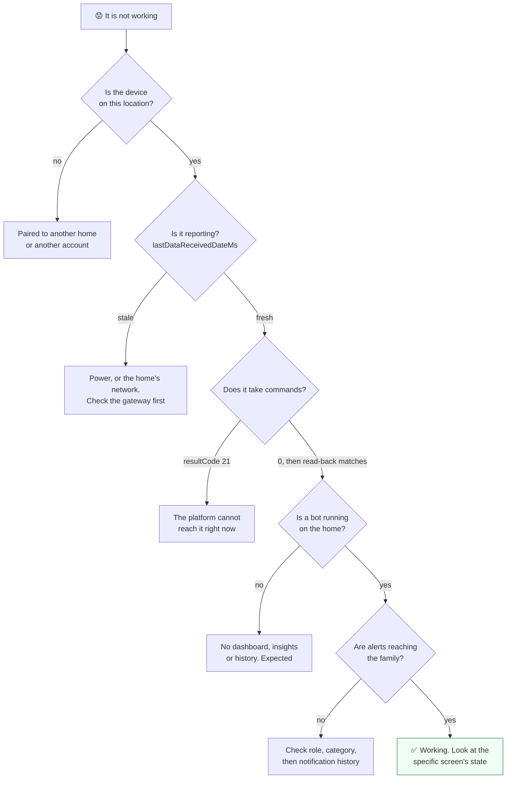

# Troubleshooting a home

A checklist for the questions support teams hear most, as API call sequences. Every step is a read.
Work top to bottom and stop at the first answer.

**When to use this guide:** someone says "it is not working" and you need to know whether the
cause is the account, the hardware, the network, or the bots.



---

## 1. Is the device on this location?

```http
GET /cloud/json/devices?locationId={locationId}
```

Find the device by `type` and `desc`. If it is not there, it was never paired, or it was paired to
a different home or account. Check the person's other locations with `GET /cloud/json/user`.

`GET /cloud/json/preregistered/{deviceId}` tells you whether the cloud knows the device ID at all,
and its type and model. Useful when a device will not join.

## 2. Is it reporting?

Look at `lastDataReceivedDateMs` on the device record rather than `connected`, which flips back and
forth with the heartbeat. If data is stale:

- **Check the gateway before the sensor.** When a gateway is offline or rebooting, every sensor
  behind it stops reporting at once.
- **Ask about power and the home's network** before anything else.

## 3. Does it take commands?

A command answered with `resultCode 21` means the platform cannot reach the device now. A command
answered with `0` is only queued; read the parameter back after a few seconds to see whether the
device applied it. See [Devices and parameters](../concepts/devices_and_parameters.md#sending-a-command).

## 4. Is a bot running on the home?

```http
GET /cloud/appstore/appInstance?locationId={locationId}
```

No bot means no dashboard, no insights, no trends and no history from bots, while raw device values
keep flowing. That is expected for a home with no service yet. See
[Bots and services](../concepts/bots_and_services.md).

If a bot is running and a screen is still empty, read the state behind that screen, for example
`GET /cloud/json/locations/{locationId}/state?name=insights`. An empty state can mean the bot has not
had anything to say yet.

## 5. Are alerts reaching the family?

```http
GET /cloud/json/location/{locationId}/users
```

Check the person's `role` and `category` on this location. Someone with `category` 0 is not in the
alert order. Then read what was actually sent:

```http
GET /cloud/json/notifications?userId={userId}&locationId={locationId}&startDate={date}
```

Each entry has the `deliveryType` (push, email, SMS) and the text. If nothing was sent, the cause is
upstream: the person's settings, or no alert fired. If it was sent and not seen, the cause is on the
phone: notifications turned off, or the app signed out.

## 6. "The card keeps coming back"

A dashboard card written in response to real events reappears the next time those events happen.
Deleting it with the bot's own delete message removes today's copy, which is the right fix for a
stale card and no fix at all for a recurring one. Before you call a card stuck, read its `alarms`
map in the [`now` state](../synthetic_apis/dashboard_status.md): many cards are scheduled to expire
on their own.

---

## Still stuck?

Collect the cloud, the location ID, the device ID, the exact calls you made and the result codes
they returned, and contact Care Daily. Leave out passwords, passcodes, API keys, and any personal
data the question does not need.

## Related

- [Result codes and gotchas](../platform_apis/result_codes.md)
- [Watch a home live](watch_a_home_live.md)
- [The life of an alert](life_of_an_alert.md)
