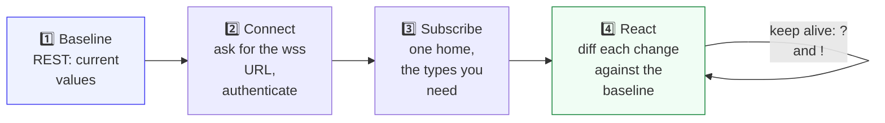

# Watch a home live

Open a door and see it on your screen a second later. This guide wires the REST API and the
WebSocket API together into the pattern behind installation tools, live dashboards and support
consoles: take a baseline, subscribe, react to changes.

**When to use this guide:** you are building anything that must show a home's sensors or bot
output as they change.



**Diagram in text:**

1. Baseline: current values over REST.
2. Connect: ask for the wss URL, then authenticate.
3. Subscribe: one home, the types you need.
4. React: diff each change against the baseline, and keep the connection alive with `?` and `!`.

---

## 1. Take a baseline over REST

```http
GET /cloud/json/devices?locationId={locationId}
```

Keep each device's `id`, `desc` and current `parameters[]`. A WebSocket message tells you what
changed; the baseline tells you what it changed from. Without it, the first event after you connect
is indistinguishable from a change.

## 2. Connect and authenticate

Ask for the WebSocket server each time, then send your API key as the first message. The full
protocol is in [WebSockets](../platform_apis/websockets.md).

```json
{"goal": 1, "id": "auth", "key": "<API key>"}
```

## 3. Subscribe to what you need

| You want to see | Subscription |
| --- | --- |
| Sensor values change | `{"type": 6, "operation": 1, "locationId": ...}` |
| The dashboard banner change | `{"type": 3, "operation": 3, "locationId": ..., "name": "dashboard_header"}` |
| History entries as bots add them | `{"type": 1, "operation": 7, "locationId": ...}` |

Send each inside `{"goal": 3, "id": "...", "subscription": {...}}`. The `operation` field is a
bitmask: 1 create, 2 update, 4 delete, so 3 is create and update and 7 is everything.

## 4. React

Parameter changes arrive as `goal` 6 messages with a `params[]` array. Each entry has the
`deviceId`, the parameter `name`, the new `value` (a string) and the `time`.

```json
{"goal": 6, "id": "params", "data": {"type": 6, "operation": 1, "locationId": 123456,
  "params": [{"deviceId": "<deviceId>", "name": "doorStatus", "value": "1", "time": 1790000000000}]}}
```

Look the device up in your baseline, show the change, and update the baseline.

---

## Tips from the field

- **One home per session.** Fewer events, less ambiguity, and nothing on screen belongs to a home
  you did not mean to show.
- **Shrink the watch list as you go.** During an installation, once a device is identified and
  configured, stop watching it.
- **Know which parameter moves.** Motion sensors report `motionStatus` and door sensors report
  `doorStatus`, each `1` or `0`. Some hardware reports motion under a different name. If a sensor
  you are shaking stays silent, read its full parameter list over REST and see what changed.
- **Some values trail others.** A device that sends a periodic status report can update a status
  parameter up to one reporting interval after the matching event parameter.
- **Ping every 15 to 30 seconds**, answer the server's `?` with `!`, and reconnect when a pong does
  not come back.

> **TODO(verify):** the list of alternative motion parameter names by device model.

## Related

- [WebSockets](../platform_apis/websockets.md), including a complete Python client
- [Devices and parameters](../concepts/devices_and_parameters.md)
- [Device Onboarding charts](../message_sequence_charts/diagrams/apps/device_onboarding/README.md)
