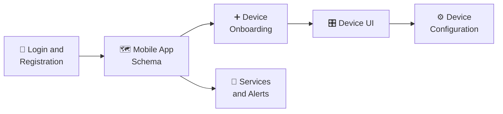

# Message Sequence Charts

The reference tells you what each call does. These tell you **what order to make them in**.

Every chart here is a real client flow drawn request by request, from the first tap to the last
response, including the calls you would not have guessed were needed. If you are implementing a
screen and it half works, this is usually the section that explains why.

---



**Diagram in text:** Login and Registration leads to the Mobile App Schema. From there, one path goes to Device Onboarding, then Device UI, then Device Configuration. The other path goes to Services and Alerts.

A person meets the flows roughly in this order: they sign in, land in the app, add a device, use
its screen, change its settings later, and turn services on.

## The flows

| Flow | What it shows | Read it when |
| --- | --- | --- |
| [User Login and Registration](diagrams/apps/user_login_and_registration/README.md) | 8 charts covering sign up, sign in, password reset and the branches between them | You are building authentication and want to know what order the calls go in |
| [Device Onboarding](diagrams/apps/device_onboarding/README.md) | 5 charts taking a device from unboxed to reporting | A device pairs but never appears, or appears but stays "New Device" |
| [Device Configuration](diagrams/apps/device_configuration/README.md) | Changing a device after it is installed | You are building settings screens |
| [Device UI](diagrams/apps/device_ui/README.md) | How a device screen is assembled from the platform and the bots | You are rendering a device and cannot work out where a field comes from |
| [Mobile App Schema](diagrams/apps/mobile_app_schema/README.md) | 13 charts of the app's overall structure and navigation | You are building a whole client rather than one screen |
| [Services and Alerts](diagrams/apps/services_and_alerts/README.md) | Turning services on and off, and how alerts surface | You are wiring up the services screen |

Start with [Application MSC Diagrams](diagrams/apps/README.md) for the same list with a little more
description of each.

---

## Reading a chart

Charts are generated with [mscgen](http://www.mcternan.me.uk/mscgen/). Each one shows the
participants across the top, usually some combination of **User**, **Client**, **Device**,
**Server** and a **Bot**, and time running down the page. An arrow is a call, and the label on it
is the API being invoked.

Where a chart references an API, the surrounding page links to that call in the
[Application API reference](https://app.caredaily.ai/cloud/apidocs/cloud.html) so you can go
straight from the arrow to the parameters.

---

## Working on the charts

Diagrams are committed already rendered, so you do not need to install anything to read them.

To change one, edit its `.msc` source and regenerate:

```bash
./generateDiagrams.sh
```

That rebuilds every `.eps` from its `.msc`. The layout on disk is one directory per flow, each
holding its sources and rendered output:

```text
diagrams/
│
├── class/
│   │
│   └── component/
│       │
│       ├── sequence.eps
│       └── sequence.msc
│
├── generateDiagrams.sh
│
└── README.md
```
