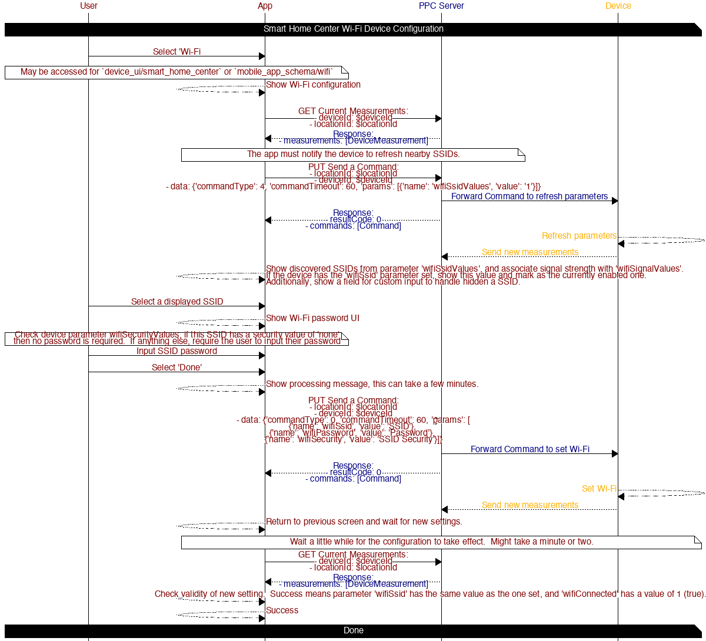

# Device Configuration

## Table of contents

* [Smart Home Center Wi-Fi](#smart-home-center-wi-fi)

## Diagrams

### Smart Home Center Wi-Fi

Configuring Wi-Fi for the Smart Home Center device types is done by using device commands to interact with the device.
This requires the device to be connected to the Cloud.

*Tap the chart to open it full size.* The user selects Wi-Fi, the app reads the current measurements and sends a command so the device refreshes nearby SSIDs, shows them with their signal strength, takes the chosen SSID and its password (none is needed when `wifiSecurityValues` is 'none'), sends the command that sets Wi-Fi, and after a minute or two reads the measurements again to confirm that `wifiSsid` matches and `wifiConnected` is 1.

#### APIs

##### [GET List of Devices](https://app.caredaily.ai/cloud/apidocs/cloud.html#tag/Devices/operation/Get%20Devices)

*Refreshing devices at the current location*

Params:
- locationId: $locationId _Current Location ID_
- checkPersistent: true _Determine if the device is connected_

##### [PUT Send A Command](https://app.caredaily.ai/cloud/apidocs/cloud.html#tag/Device-Measurements/operation/Send%20Commands)

*Notify device to refresh discover SSIDs*

Params:
- locationId: $locationId _Current Location ID_
- deviceId: $deviceId _Smart Home Center Device ID_
- data: `{'commandType': 0, 'commandTimeout': 60, 'params': [{'name': 'wifiSsidValues', 'value': '1'}]}`

*Notify device to connect to Wi-Fi*
Params:
- locationId: $locationId
- deviceId: $deviceId
- data: `{'commandType': 0, 'commandTimeout': 60, 'params': [{'name': 'wifiSsid', 'value': 'SSID'}, {'name': 'wifiPassword', 'value': 'Password'}, {'name': 'wifiSecurity', 'value': 'SSID Security'}]}`

##### [GET Current Measurements](https://app.caredaily.ai/cloud/apidocs/cloud.html#tag/Device-Measurements/operation/Get%20Current%20Measurements)

*Refresh device parameters to retrieve discovered SSIDs and to validate Wi-Fi connection state*

Params:
- locationId: $locationId
- deviceId: $deviceId

## Related

- [Devices and parameters: sending a command](../../../../concepts/devices_and_parameters.md#sending-a-command)
- [Device UI](../device_ui/README.md)
