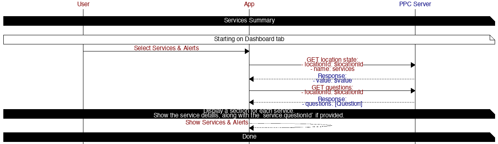

# Services and Alerts

## Table of contents

* [Services Summary](#services-summary)

## Diagrams

### Services Summary

#### APIS

##### [GET State](https://app.caredaily.ai/cloud/apidocs/cloud.html#tag/Synthetic-APIs/operation/Get%20Location%20State)

*Refresh services location state*

Params:
- locationId: $locationId
- name: services
- name: action_plans

##### [GET Questions](https://app.caredaily.ai/cloud/apidocs/cloud.html#tag/User-Communications/operation/Get%20Questions)

*Refresh questions*

Params:
- locationId: $locationId

## Related

- [Services and Alerts](../../../../synthetic_apis/services.md)
- [Action Plans](../../../../synthetic_apis/action_plans.md)
- [The life of an alert](../../../../guides/life_of_an_alert.md)
