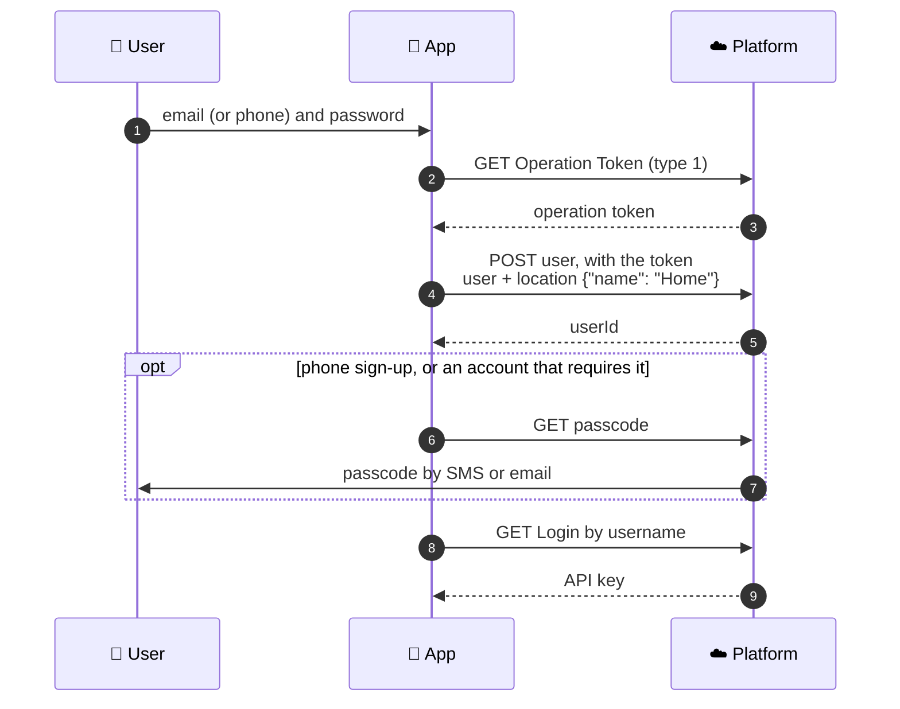
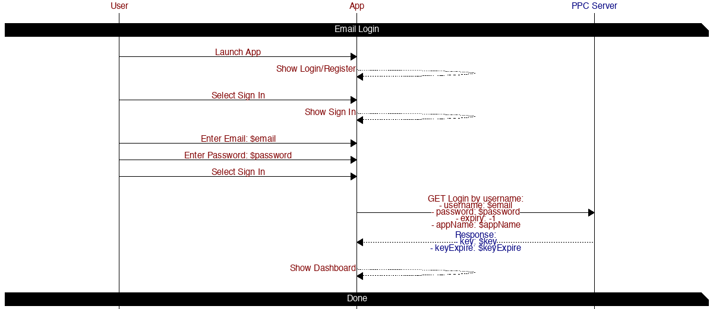
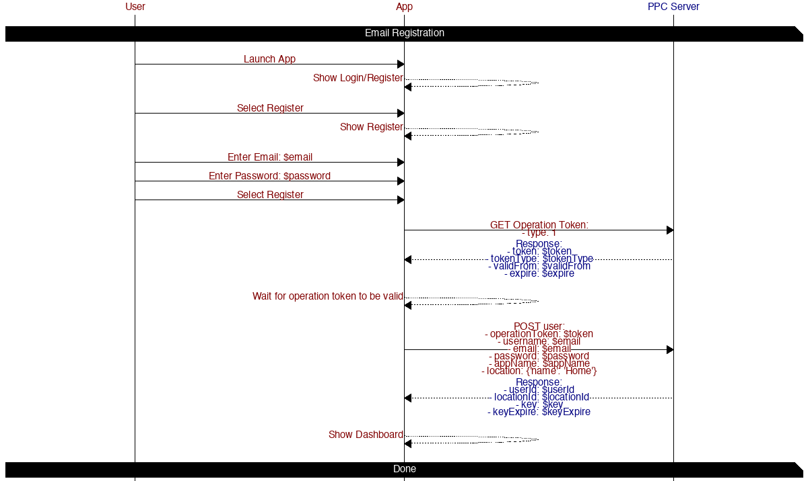
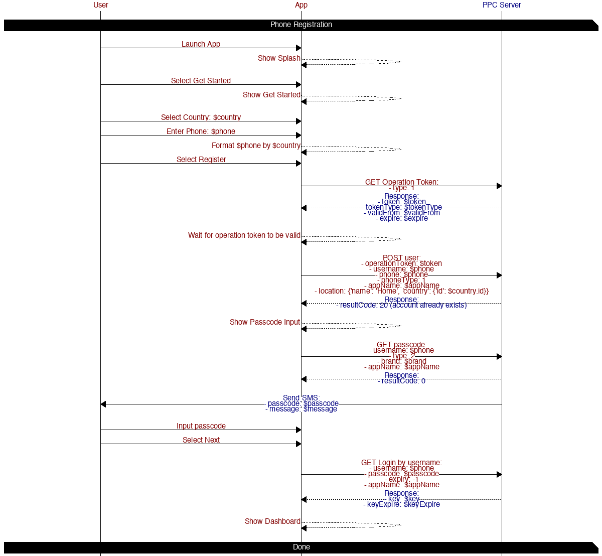
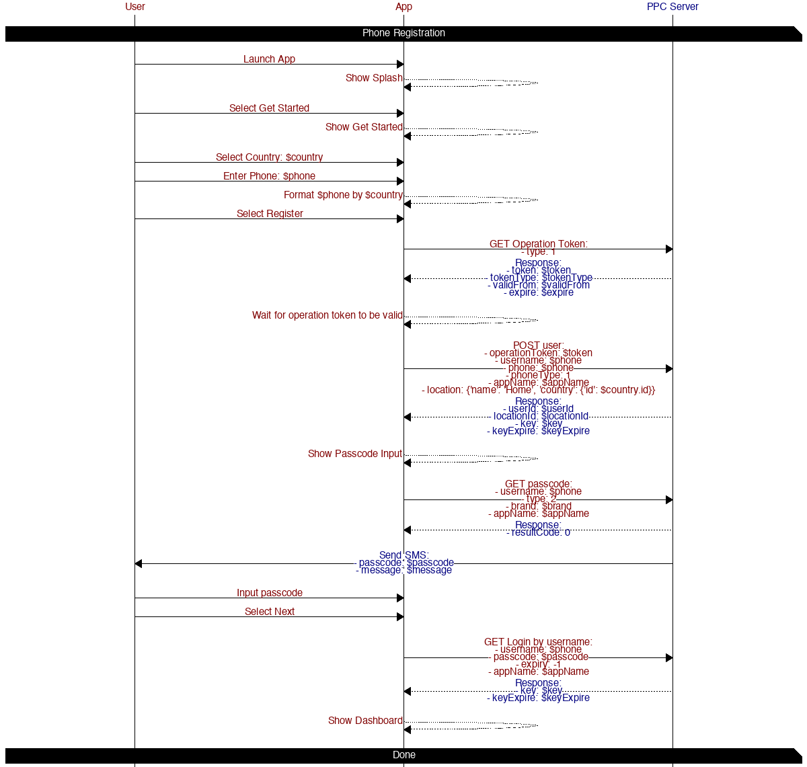
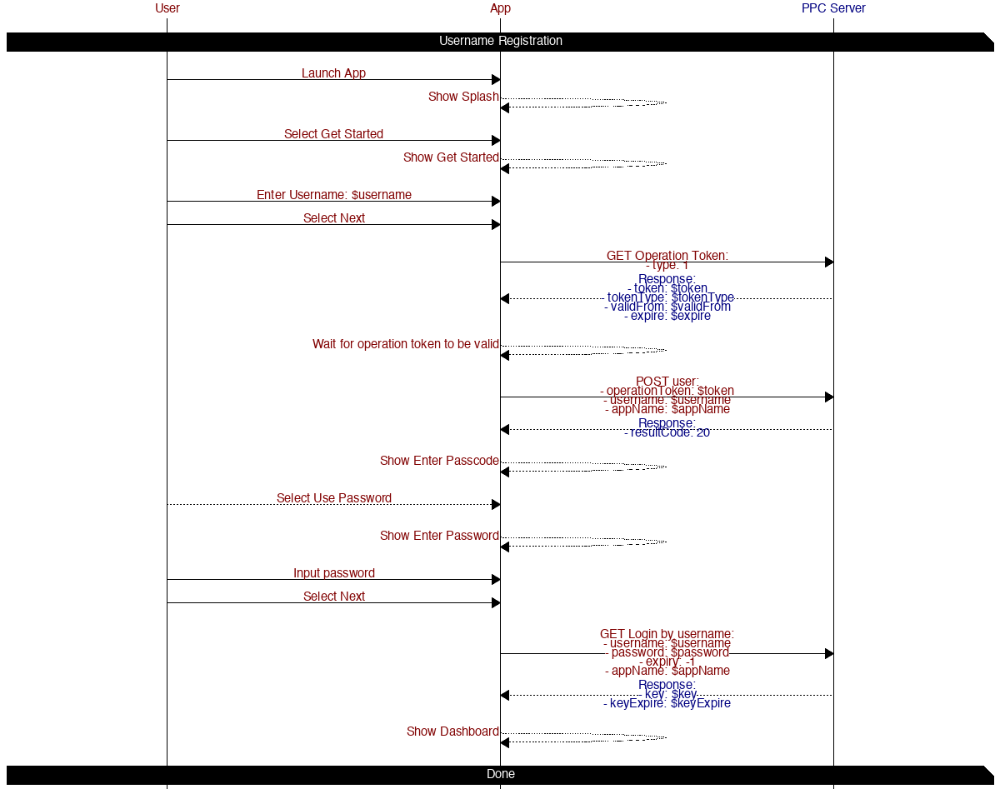
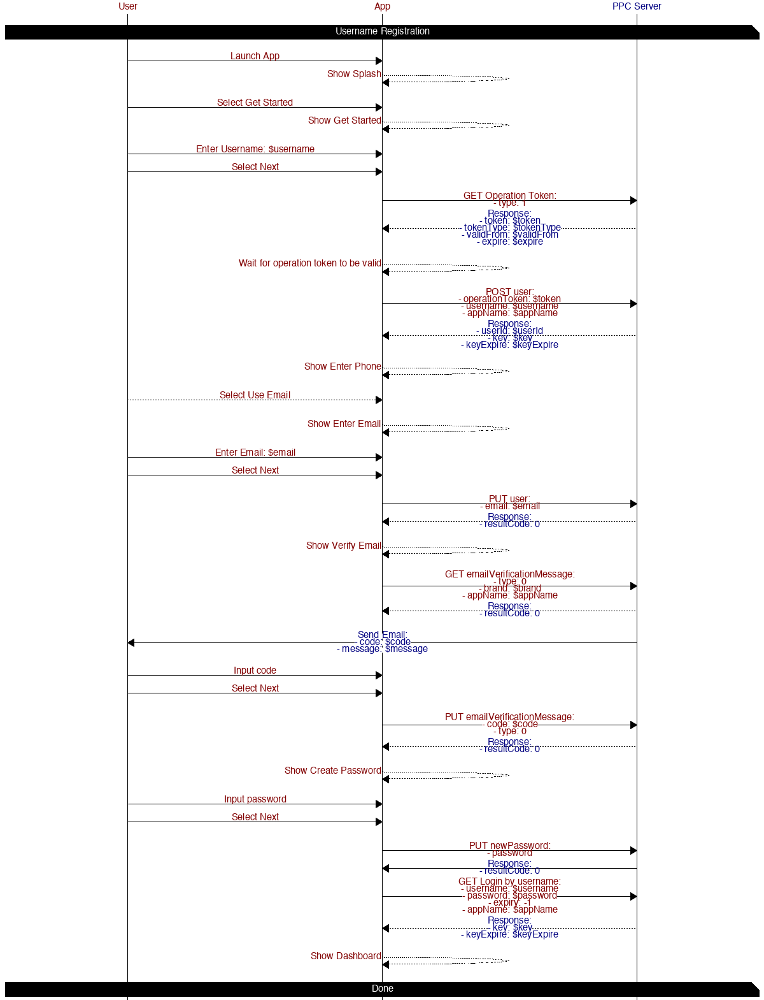
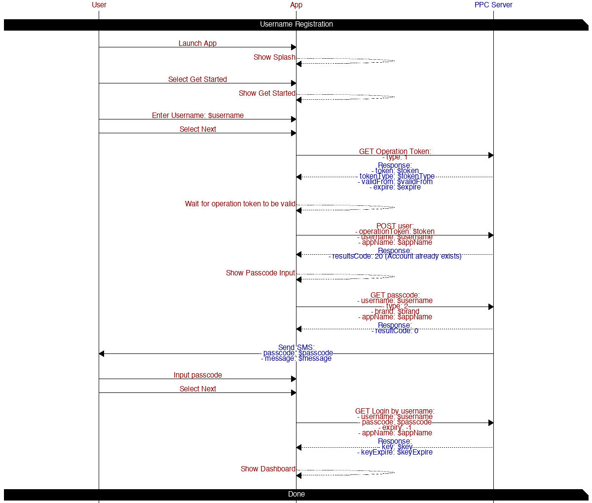
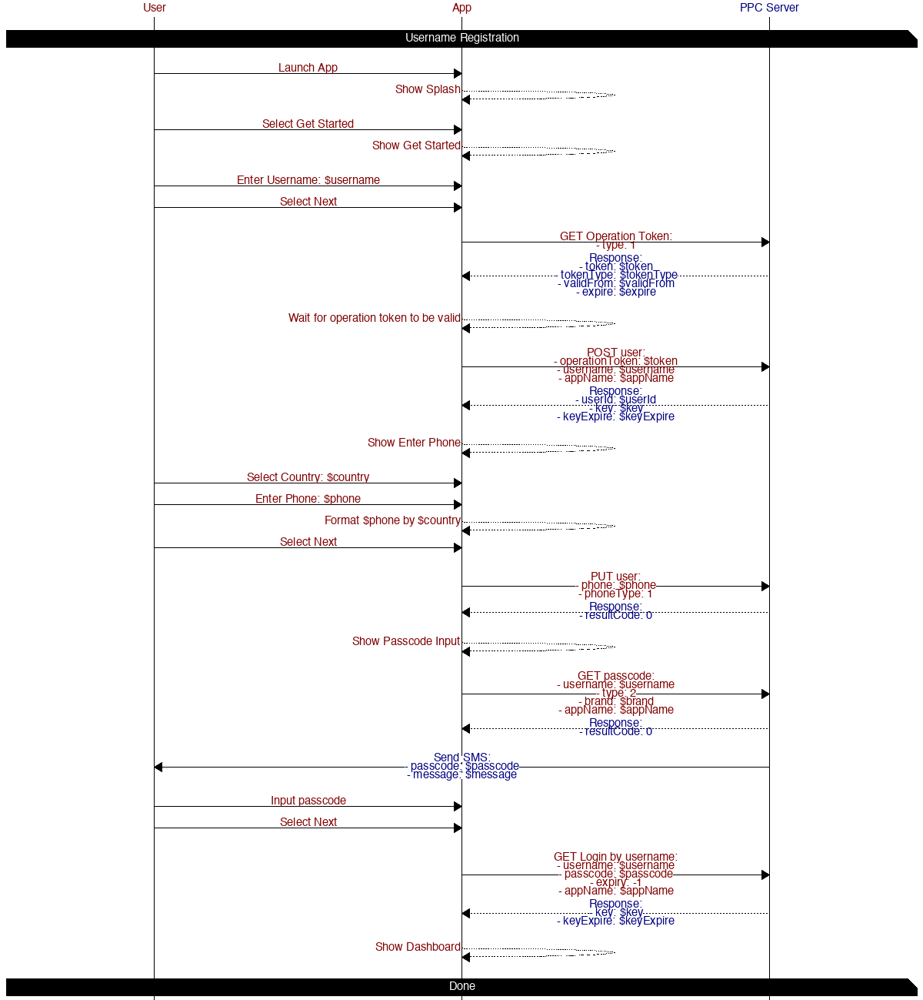

# User Login and Registration

## Table of contents

* [Email Login](#email-login)
* [Email Register](#email-register)
* [Phone login](#phone-login)
* [Phone Register](#phone-register)
* [Username Email Login](#username-email-login)
* [Username Email Register](#username-email-register)
* [Username Phone Login](#username-phone-login)
* [Username Phone Register](#username-phone-register)

## The pattern behind every registration chart

**Diagram in text:**

1. The user enters an email (or phone) and password in the app.
2. The app sends GET Operation Token (type 1).
3. The platform returns the operation token.
4. The app sends POST user with the token: the user, and a location `{"name": "Home"}`.
5. The platform returns the `userId`.
6. For a phone sign-up, or an account that requires it, the app sends GET passcode.
7. The platform sends the passcode to the user by SMS or email.
8. The app sends GET Login by username.
9. The platform returns the API key.

The charts below are the variations: email or phone, with or without a separate username, and the
verification steps each one adds. The [Authentication guide](../../../../platform_apis/authentication.md)
covers key types and the two-step administrator login.

## Diagrams

### Email Login

*Tap the chart to open it full size.* The user launches the app, selects Sign In, and enters an email and password, and the app calls GET Login by username, receives the key, and shows the dashboard.

#### APIS

##### [GET Login by username](https://app.caredaily.ai/cloud/apidocs/cloud.html#tag/Authentication/operation/Login%20by%20Username)

*Login existing userLogin user*

Params:
- username: $email
- password: $password
- expiry: -1
- appName: $appName

### Email Register

*Tap the chart to open it full size.* The user launches the app, selects Register, and enters an email and password, and the app gets an operation token, waits for it to be valid, sends POST user, and shows the dashboard.

#### APIS

##### [GET Operation Token](https://app.caredaily.ai/cloud/apidocs/cloud.html#tag/Authentication/operation/Get%20Operation%20Token)

*Retrieve an operation token*

Params:
- type: 1

##### [POST user](https://app.caredaily.ai/cloud/apidocs/cloud.html#tag/User-Accounts/operation/Create%20User%20and%20Location)

*Create a new user*

Params:
- operationToken: $token
- username: $email
- email: $email
- password: $password
- appName: $appName
- location: `{'name': 'Home'}`

### Phone login

*Tap the chart to open it full size.* The user selects Get Started, a country, and a phone number, then Register; the app gets an operation token and sends POST user, which answers `resultCode 20` (account already exists), so the app requests a passcode, the server sends it by SMS, and the app logs in with GET Login by username and the passcode, then shows the dashboard.

#### APIS

##### [GET Operation Token](https://app.caredaily.ai/cloud/apidocs/cloud.html#tag/Authentication/operation/Get%20Operation%20Token)

*Retrieve an operation token*

Params:
- type: 1

##### [POST user](https://app.caredaily.ai/cloud/apidocs/cloud.html#tag/User-Accounts/operation/Create%20User%20and%20Location)

*Create a new user*

Params:
- operationToken: $token
- username: $phone
- phone: $phone
- phoneType: 1
- appName: $appName
- location: `{'name': 'Home', 'country': {'id': $country.id}}`

##### [GET passcode](https://app.caredaily.ai/cloud/apidocs/cloud.html#tag/Authentication/operation/Send%20Passcode)

*Trigger a new passcode to be sent over sms*

Params:
- username: $phone
- type: 2
- brand: $brand
- appName: $appName

##### [GET Login by username](https://app.caredaily.ai/cloud/apidocs/cloud.html#tag/Authentication/operation/Login%20by%20Username)

*Login existing user*

Params:
- username: $phone
- passcode: $passcode
- expiry: -1
- appName: $appName

### Phone Register

*Tap the chart to open it full size.* The user selects Get Started, a country, and a phone number, then Register; the app gets an operation token, sends POST user, and requests a passcode, the server sends it by SMS, and the app logs in with GET Login by username and the passcode, then shows the dashboard.

#### APIS

##### [GET Operation Token](https://app.caredaily.ai/cloud/apidocs/cloud.html#tag/Authentication/operation/Get%20Operation%20Token)

*Retrieve an operation token*

Params:
- type: 1

##### [POST user](https://app.caredaily.ai/cloud/apidocs/cloud.html#tag/User-Accounts/operation/Create%20User%20and%20Location)

*Create a new user*

Params:
- operationToken: $token
- username: $phone
- phone: $phone
- phoneType: 1
- appName: $appName
- location: `{'name': 'Home', 'country': {'id': $country.id}}`

##### [GET passcode](https://app.caredaily.ai/cloud/apidocs/cloud.html#tag/Authentication/operation/Send%20Passcode)

*Trigger a new passcode to be sent over sms*

Params:
- username: $phone
- type: 2
- brand: $brand
- appName: $appName

##### [GET Login by username](https://app.caredaily.ai/cloud/apidocs/cloud.html#tag/Authentication/operation/Login%20by%20Username)

*Login existing user*

Params:
- username: $phone
- passcode: $passcode
- expiry: -1
- appName: $appName

### Username Email Login

*Tap the chart to open it full size.* The user selects Get Started and enters a username; the app gets an operation token and sends POST user, which answers `resultCode 20`, then the user selects Use Password and enters it, and the app logs in with GET Login by username and shows the dashboard.

#### APIS

##### [GET Operation Token](https://app.caredaily.ai/cloud/apidocs/cloud.html#tag/Authentication/operation/Get%20Operation%20Token)

*Retrieve an operation token*

Params:
- type: 1

##### [POST user](https://app.caredaily.ai/cloud/apidocs/cloud.html#tag/User-Accounts/operation/Create%20User%20and%20Location)

*Create a new user*

Params:
- operationToken: $token
- username: $username
- appName: $appName

##### [GET Login by username](https://app.caredaily.ai/cloud/apidocs/cloud.html#tag/Authentication/operation/Login%20by%20Username)

*Login existing user*

Params:
- username: $username
- password: $password
- expiry: -1
- appName: $appName

### Username Email Register

*Tap the chart to open it full size.* The user selects Get Started and enters a username; the app gets an operation token and sends POST user, the user selects Use Email and enters an email, the app sends PUT user and requests an email verification message, the user enters the emailed code, the app confirms it with PUT emailVerificationMessage, the user creates a password (PUT newPassword), and the app logs in with GET Login by username and shows the dashboard.

#### APIS

##### [GET Operation Token](https://app.caredaily.ai/cloud/apidocs/cloud.html#tag/Authentication/operation/Get%20Operation%20Token)

*Retrieve an operation token*

Params:
- type: 1

##### [POST user](https://app.caredaily.ai/cloud/apidocs/cloud.html#tag/User-Accounts/operation/Create%20User%20and%20Location)

*Create a new user*

Params:
- operationToken: $token
- username: $username
- appName: $appName

##### [PUT user](https://app.caredaily.ai/cloud/apidocs/cloud.html#tag/User-Accounts/operation/Update%20User)

*Update users email*

Params:
- email: $email

##### [GET emailVerificationMessage](https://app.caredaily.ai/cloud/apidocs/cloud.html#tag/User-Accounts/operation/Send%20Verification%20Message)

*Trigger a verification message be sent*

Params:
- type: 0
- brand: $brand
- appName: $appName

##### [PUT emailVerificationMessage](https://app.caredaily.ai/cloud/apidocs/cloud.html#tag/User-Accounts/operation/Provide%20Verification%20Code)

*Apple email verification code*

Params:
- code: $code
- type: 0

##### [PUT newPassword](https://app.caredaily.ai/cloud/apidocs/cloud.html#tag/User-Accounts/operation/Update%20Password)

*Update new password*

Params:
- password

##### [GET Login by username](https://app.caredaily.ai/cloud/apidocs/cloud.html#tag/Authentication/operation/Login%20by%20Username)

*Login existing user*

Params:
- username: $username
- password: $password
- expiry: -1
- appName: $appName

### Username Phone Login

*Tap the chart to open it full size.* The user selects Get Started and enters a username; the app gets an operation token, sends POST user, and requests a passcode, the server sends it by SMS, and the app logs in with GET Login by username and the passcode, then shows the dashboard.

#### APIS

##### [GET Operation Token](https://app.caredaily.ai/cloud/apidocs/cloud.html#tag/Authentication/operation/Get%20Operation%20Token)

*Retrieve an operation token*

Params:
- type: 1

##### [POST user](https://app.caredaily.ai/cloud/apidocs/cloud.html#tag/User-Accounts/operation/Create%20User%20and%20Location)

*Create a new user*

Params:
- operationToken: $token
- username: $username
- appName: $appName

##### [GET passcode](https://app.caredaily.ai/cloud/apidocs/cloud.html#tag/Authentication/operation/Send%20Passcode)

*Trigger a new passcode to be sent over sms*

Params:
- username: $username
- type: 2
- brand: $brand
- appName: $appName

##### [GET Login by username](https://app.caredaily.ai/cloud/apidocs/cloud.html#tag/Authentication/operation/Login%20by%20Username)

*Login existing user*

Params:
- username: $username
- passcode: $passcode
- expiry: -1
- appName: $appName

### Username Phone Register

*Tap the chart to open it full size.* The user selects Get Started and enters a username; the app gets an operation token and sends POST user, the user selects a country and enters a phone number, the app sends PUT user and requests a passcode, the server sends it by SMS, and the app logs in with GET Login by username and the passcode, then shows the dashboard.

#### APIS

##### [GET Operation Token](https://app.caredaily.ai/cloud/apidocs/cloud.html#tag/Authentication/operation/Get%20Operation%20Token)

*Retrieve an operation token*

Params:
- type: 1

##### [POST user](https://app.caredaily.ai/cloud/apidocs/cloud.html#tag/User-Accounts/operation/Create%20User%20and%20Location)

*Create a new user*

Params:
- operationToken: $token
- username: $username
- appName: $appName

##### [PUT user](https://app.caredaily.ai/cloud/apidocs/cloud.html#tag/User-Accounts/operation/Update%20User)

*Update users phone and phone type*

Params:
- phone: $phone
- phoneType: 1

##### [GET passcode](https://app.caredaily.ai/cloud/apidocs/cloud.html#tag/Authentication/operation/Send%20Passcode)

*Trigger a new passcode to be sent over sms*

Params:
- username: $username
- type: 2
- brand: $brand
- appName: $appName

##### [GET Login by username](https://app.caredaily.ai/cloud/apidocs/cloud.html#tag/Authentication/operation/Login%20by%20Username)

*Login existing user*

Params:
- username: $username
- passcode: $passcode
- expiry: -1
- appName: $appName

## Related

- [Authentication](../../../../platform_apis/authentication.md)
- [Quick Start](../../../../getting_started/quick_start.md)
- [Users and access](../../../../concepts/users_and_access.md)
