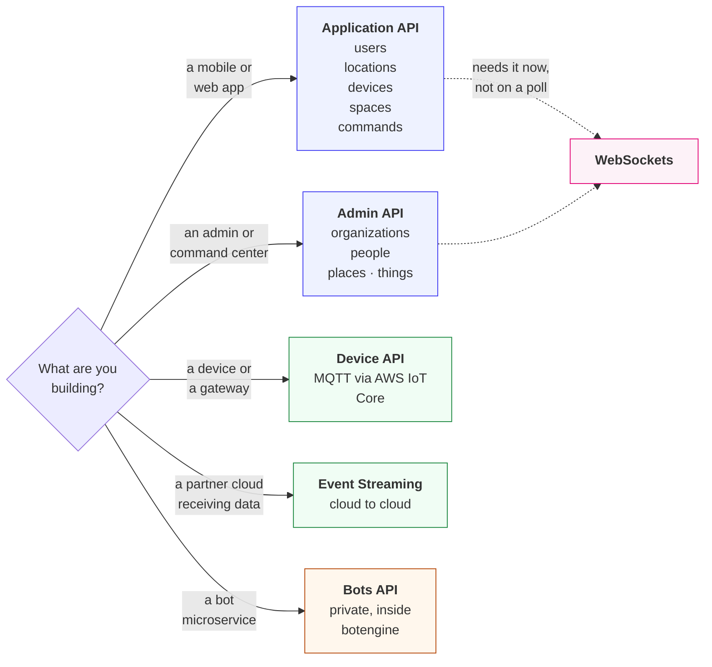
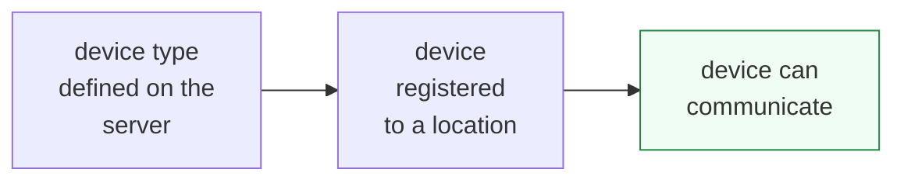

# Platform APIs

These are the APIs of the Care Daily Ambient Operating System itself: for applications, for devices, and for
administrators. The platform answers role-based REST calls, and it streams events and observations
to partner clouds.

The complete reference for each is generated from the platform and lives online. This page tells you
which one you want and what to expect from it.

---

## Which API do I want?

**Diagram in text:**

- A mobile or web app: **Application API** (users, locations, devices, spaces, commands).
- An admin or command center: **Admin API** (organizations, people, places, things).
- A device or a gateway: **Device API** (MQTT via AWS IoT Core).
- A partner cloud receiving data: **Event Streaming** (cloud to cloud).
- A bot microservice: **Bots API** (private, inside botengine).
- The Application API and the Admin API both link to **WebSockets**, for an app that needs data now, not on a poll.

| API | Reference | Use it for |
| --- | --- | --- |
| **Authentication** | [authentication.md](authentication.md) | Getting an API key, and the traps in it. Start here |
| **REST conventions** | [conventions.md](conventions.md) | Base URLs, reading a response, dates, paging, reports |
| **Result codes** | [result_codes.md](result_codes.md) | What each code usually means, and success that did not happen |
| **Application** | [cloud.html](https://app.caredaily.ai/cloud/apidocs/cloud.html) | Everything an end-user app or web console does |
| **Admin** | [admin.html](https://app.caredaily.ai/cloud/apidocs/admin.html) | Managing people, places, and things across an organization |
| **Device** | [devices.html](https://app.caredaily.ai/cloud/apidocs/devices.html) | Getting measurements up from hardware, and commands down |
| **Bots** | [bots.html](https://app.caredaily.ai/cloud/apidocs/bots.html) | Bot infrastructure development inside `botengine` |
| **WebSockets** | [websockets.md](websockets.md) | Anything that must update the moment it changes |
| **Event Streaming** | [event_streaming.md](event_streaming.md) | Pushing events, insights and subscriptions to a partner cloud |

---

## Authentication

[Authentication guide](authentication.md)

Every call below needs an API key. The guide covers choosing a key type, the two-step
administrator login, and the handful of details that cost people an afternoon.

## Working with the REST API

[Conventions](conventions.md) · [Result codes and gotchas](result_codes.md)

Every REST call returns a `resultCode`, accepts dates as ISO 8601 or epoch milliseconds, and pages
collections the same way. Read these two pages once and every reference page reads faster.

## Application API

[Reference](https://app.caredaily.ai/cloud/apidocs/cloud.html)

The APIs available to mobile apps and web consoles. Primarily synchronous REST, with WebSocket
alternatives for some calls.

The Application API is focused on end-user applications, but some of its calls can be made with an
`ADMIN_API_KEY` to execute as an administrator of an organization. There are also several APIs
toward the beginning of the reference that exist for devices, so they can work out which of the
device servers to talk to in a deployment made up of several.

## Administrative API

[Reference](https://app.caredaily.ai/cloud/apidocs/admin.html)

Admin-specific APIs that are not in the Application API. These are what administrative command
centers use to manage people, places, and things.

## Device API

[MQTT through AWS IoT Core](mqtt.md) is the recommended path for getting device data to the cloud.

Care Daily also supports cloud-to-cloud integration and a set of asynchronous HTTP and WebSocket
device APIs. [Device API reference](https://app.caredaily.ai/cloud/apidocs/devices.html).

Devices are identified by globally unique IDs. Before a device can communicate, two things must be
true: the server must have a **device type** definition that describes it, and the device must be
**registered to a location**.

**Diagram in text:** A device type defined on the server, then the device registered to a location, and then the device can communicate.

## WebSockets API

[WebSockets documentation](websockets.md)

Use WebSockets where the experience is time-critical, rather than polling REST. Two common cases:
updating a UI driven by bot [Synthetic APIs](../synthetic_apis/README.md), and showing alerts on an
administrative console.

## Cloud-to-Cloud Streaming

[Event Streaming documentation](event_streaming.md)

The platform can stream events, insights, subscriptions and more to a partner platform.

## Bot API

[Reference](https://app.caredaily.ai/cloud/apidocs/bots.html)

This is private bot API documentation, for bot infrastructure developers. The APIs described there
are implemented as software APIs inside the `botengine`, and the reference also covers the
management and lifecycle of a bot.

Note on subscriptions: bots are linked to subscriptions manually on the backend today. There are no
public or private APIs for managing those subscription definitions. Defining and managing the
available subscription services in an organization goes through our server team.

## Security Modes and Occupancy Status

[Security Modes and Occupancy Status](modes.md)

How to set and interpret the "Location Scene" field so that it is recognized by the existing
application layers.

## Related

- [Concepts](../concepts/README.md), the nouns these APIs are about
- [Quick Start](../getting_started/quick_start.md)
- [Agent Kit](../agent_kit/README.md)
