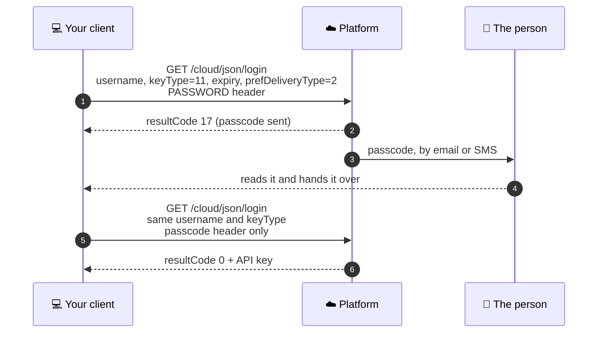

# Authentication

Every call on the platform sends one header, `API_KEY`. This page is how you get a value to put in
it, and the handful of details that make a correct login look broken.

**When to use this page:** before your first call, and whenever a login answers with a result code
you did not expect.

The [Application API reference](https://app.caredaily.ai/cloud/apidocs/cloud.html#tag/Authentication)
documents every authentication option, including signature login and TOTP. This page is the short
path through it.

---

## Pick your key type first

| `keyType` | Who it is | What it reaches | Second step? |
| :---: | --- | --- | --- |
| `0` | End user | That user's own locations and devices | No |
| `11` | Administrator | Organization-scoped calls and the Admin API | Usually yes |
| `15` | Service | Server-to-server service integrations | Depends on the account |

**Start with `keyType=0`.** If your calls are about one person's own home and devices, a user key is
enough and there is no second step to build. Reach for `11` when a call is organization-scoped.

Both key types use the same header name, `API_KEY`. An administrator key also works on most
`/cloud/json/...` calls. Code running inside a bot uses a different header, `ANALYTIC_API_KEY`,
described in the [Bots API reference](https://app.caredaily.ai/cloud/apidocs/bots.html).

Keys and accounts belong to one cloud. A sandbox key fails on production, and the same email
address can be two different accounts on two clouds. See the server list in the
[Quick Start](../getting_started/quick_start.md#step-0-pick-a-server).

---

## The simple case: a user key

```http
GET /cloud/json/login?username=<username>&keyType=0&expiry=1
PASSWORD: <URL-encoded password>
Accept: application/json
```

A success returns result code `0`, a `key`, and `keyExpire`. Send the key as the `API_KEY` header
on every later call. Storing and protecting it is your application's responsibility.

```bash
curl -s -G "$CAREDAILY_SERVER/cloud/json/login" \
  --data-urlencode "username=$CAREDAILY_USER" \
  --data-urlencode "keyType=0" \
  --data-urlencode "expiry=1" \
  -H "PASSWORD: $(python -c "import os,urllib.parse;print(urllib.parse.quote(os.environ['CAREDAILY_PASSWORD'],safe=''))")" \
  -H "Accept: application/json"
```

> **URL-encode the password.** The server URL-decodes the `PASSWORD` header. A password with a `%`
> in it, sent raw, fails with `resultCode 8` and a message about illegal hex characters, which looks
> like a wrong password and is not one. In Python: `urllib.parse.quote(password, safe="")`.

> **Always pass `expiry`.** It is the key lifetime in days. Leave it out and the default is `-1`,
> which asks for a key that never expires, and a key that never expires is one you can never
> rotate. The server may give you a shorter life than you asked for, so read `keyExpire` on the
> response and plan around it. When calls start failing with `resultCode 2`, mint a new key.

---

## The two-step case: an administrator key

Accounts with administrative privileges usually complete a second step. The first call succeeds
at its job, which is to send a passcode.



What to know about the second call:

- **`passcode` is a header, and it is lowercase.** Sent as a query parameter it is ignored and you
  get `17` again, which looks like a loop.
- **Do not send the password on the second call.** The reference says so, and sending both is a
  known cause of `resultCode 12` with a passcode you know is right.
- **Send it promptly.** The passcode is valid for a limited time.
- **Every first-step call replaces the previous passcode.** Trigger twice and the first code is
  already dead. Trigger once, wait for that passcode, redeem once.

Steer where the passcode goes with `prefDeliveryType`: `2` for email, `3` for SMS. Passcodes are
letters and digits, not only digits. If you ever extract one from an email, anchor on the sentence
around it rather than on a bare six-character pattern, which matches ordinary words and color codes.

### If the person has an authenticator app

Where a user has set up a Time-based One-Time Password, pass `totp=true` on the login call. The
platform answers with result code `24` and a temporary key, and you finish through
[Login by Key](https://app.caredaily.ai/cloud/apidocs/cloud.html#tag/Authentication/operation/Login%20by%20Key)
with the code in the `passcode` header. If you already know TOTP is set up, send username, password
and code together in one call with `totp=true`.

### Logging in without a password at all

RSA signature login is the right answer for an unattended integration that should not hold a
password. Register a public key for the user and `appName`, then exchange a signed challenge for a
key. The [reference covers the full sequence](https://app.caredaily.ai/cloud/apidocs/cloud.html#tag/Authentication).

---

## Result codes you will meet at login

| Code | Meaning | What it usually is |
| :---: | --- | --- |
| `0` | Success | |
| `2` | Wrong API key | The key expired, or it belongs to another cloud |
| `7` | Access denied | A user key on an organization-scoped call. Get a `keyType=11` key |
| `8` | Wrong parameter value | A raw `%` in an unencoded `PASSWORD` header |
| `12` | Invalid username or wrong password | A wrong password, a badly encoded one, or `PASSWORD` sent along with `passcode` |
| `16` | Account locked out | Too many failed attempts. Wait before trying again |
| `17` | Passcode required | Expected on the first step of an administrator login |
| `24` | Second step required | TOTP path. Finish with Login by Key |
| `44` | Too many API calls | Slow down. Never retry a login in a loop |

The full table is in [Result codes](result_codes.md) and at the top of the
[Application API reference](https://app.caredaily.ai/cloud/apidocs/cloud.html).

---

## "It logged in, and it says organizations: 0"

It happens in two situations:

1. **You have a user key.** A `keyType=0` key logs in cleanly and then every organization-scoped
   call fails with `resultCode 7`. Log in again with `keyType=11`.
2. **You have an administrator key, and `GET /cloud/json/user` shows no locations.** That is
   correct. Administrators are usually not members of the homes they administer. Use the
   [Admin API](https://app.caredaily.ai/cloud/apidocs/admin.html) to see what the account reaches.

If an administrator key still reaches no organizations, the account lacks administrator rights.
That is a question for whoever administers your organization.

---

## Keep the key secret

- Keep it outside every source repository and every synced folder, readable only by you.
- Never print it, log it, or paste it into a ticket, a chat or a commit. Not even the first few
  characters.
- Report a key by its type and expiry, never its value.

## Related

- [Quick Start](../getting_started/quick_start.md), a complete first login
- [Agent Kit: authentication](../agent_kit/01_authentication.md), a login helper that never prints the key
- [User Login and Registration charts](../message_sequence_charts/diagrams/apps/user_login_and_registration/README.md)
  for how the mobile app does this end to end
