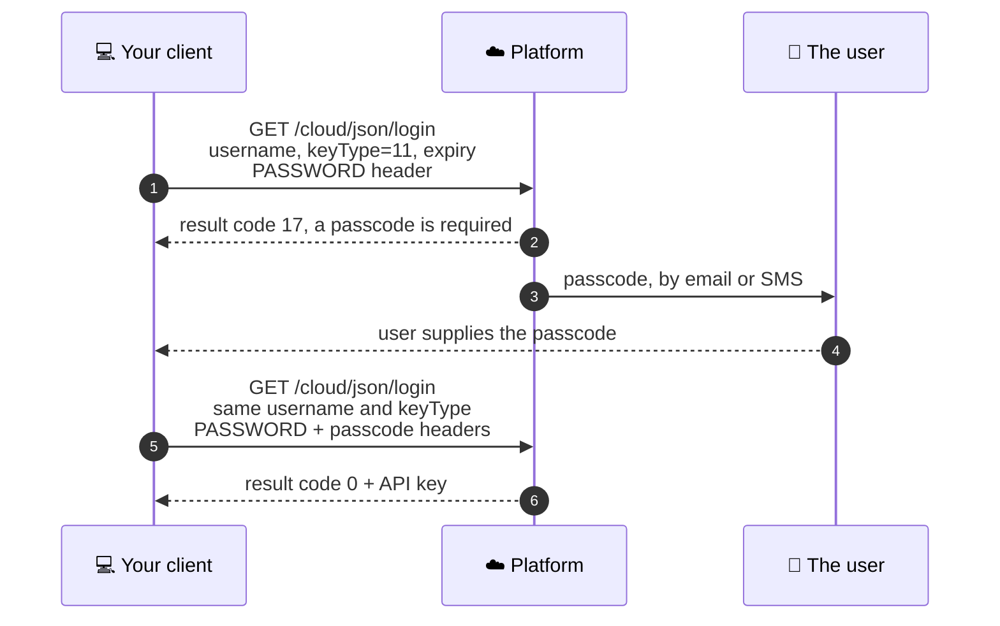

# Authentication

Everything else in the platform needs an API key, so this is the first thing you build and the first
place people get stuck.

The [Application API reference](https://app.caredaily.ai/cloud/apidocs/cloud.html#tag/Authentication)
documents every authentication option there is, including signature login and TOTP. This page is the
short path through it: the two calls most developers need, and the details that cost people an
afternoon.

---

## Pick your key type first

Everything follows from this choice.

| `keyType` | Who it is | What it reaches | Second step? |
| :---: | --- | --- | --- |
| `0` | End user | That user's own locations and devices | No |
| `11` | Administrator | Organization-scoped calls, the Admin API | Usually yes |
| `15` | Service | Service integrations | Depends on the account |

**Start with `keyType=0`.** If the calls you need are about one person's own home and devices, a user
key is enough and there is no second step to build. Reach for `11` only when a call is genuinely
organization-scoped.

---

## The simple case: a user key

```http
GET /cloud/json/login?username=<username>&keyType=0&expiry=30
PASSWORD: <url-encoded password>
Accept: application/json
```

A success returns result code `0` and an API key. Send that key as the `API_KEY` header on every
later call. Storing and protecting it is the application's responsibility.

> **URL-encode the password.** The password travels in a header, and a password containing
> characters that are not header-safe will fail in ways that look like a wrong password rather than
> a malformed request. Percent-encode it before you set the header. In Python that is
> `urllib.parse.quote(password, safe="")`.

> **Always pass `expiry`.** It is the key lifetime in days. Leave it out and the default is `-1`,
> which means the key never expires. A key that never expires is one you can never rotate.

---

## The two-step case: an administrator key

Accounts with administrative privileges are generally required to complete a second step. The first
call does not fail, it asks for a passcode.



Three things about the second call that are easy to get wrong:

- **`passcode` is a header, and it is lowercase.** Not a query parameter, and not `PASSCODE`.
- **Send it promptly.** The passcode is valid for a limited period.
- **Every first-step call replaces the previous passcode.** If you trigger the login twice and then
  go looking for the code, the older one is already dead. Trigger once, wait for that passcode,
  redeem once.

You can steer where the passcode goes with `prefDeliveryType`, which is `2` for email and `3` for
SMS.

### If the user has an authenticator app

Where a user has configured a Time-based One-Time Password, pass `totp=true` on the login call. The
platform answers with result code `24` and a temporary key, and you complete the login through
[Login by Key](https://app.caredaily.ai/cloud/apidocs/cloud.html#tag/Authentication/operation/Login%20by%20Key)
with the code in the `passcode` header. If you already know TOTP is configured, you can send
username, password and code together in one call with `totp=true`.

### Logging in without a password at all

The platform supports RSA signature login, which is the right answer for an unattended integration
that should not hold a password. Register a public key for the user and `appName`, then exchange a
signed challenge for a key. The
[reference covers the full sequence](https://app.caredaily.ai/cloud/apidocs/cloud.html#tag/Authentication).

---

## Result codes you will actually meet

| Code | Meaning | What it usually is |
| :---: | --- | --- |
| `0` | Success | |
| `2` | Wrong API key | Expired, or the wrong key type for an organization-scoped call |
| `7` | Access denied | Authenticated, but this account lacks the right for that call |
| `12` | Invalid username or wrong password | Also what a badly encoded password header looks like |
| `16` | Account locked out | Too many failed attempts |
| `17` | Passcode required | Expected on the first step of an admin login, not an error |
| `24` | Second step required | TOTP path, use the temporary key with Login by Key |

The [full result code table](https://app.caredaily.ai/cloud/apidocs/cloud.html) is at the top of the
Application API reference.

---

## "It says organizations: 0"

If you authenticate successfully with `keyType=11` and then find no organizations, and every
organization-scoped call fails, the usual cause is that the account does not carry administrator
rights, rather than anything wrong with your code. That is an account role question for whoever
administers your organization.

---

## Related

- [Application API reference](https://app.caredaily.ai/cloud/apidocs/cloud.html) for every parameter
- [Admin API](https://app.caredaily.ai/cloud/apidocs/admin.html), which is what an admin key unlocks
- [User Login and Registration message sequence charts](../message_sequence_charts/diagrams/apps/user_login_and_registration/README.md)
  for how the mobile app does this end to end
