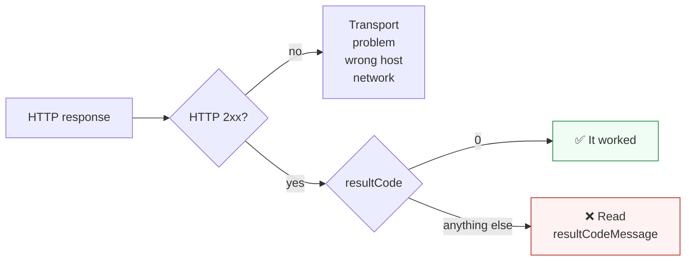
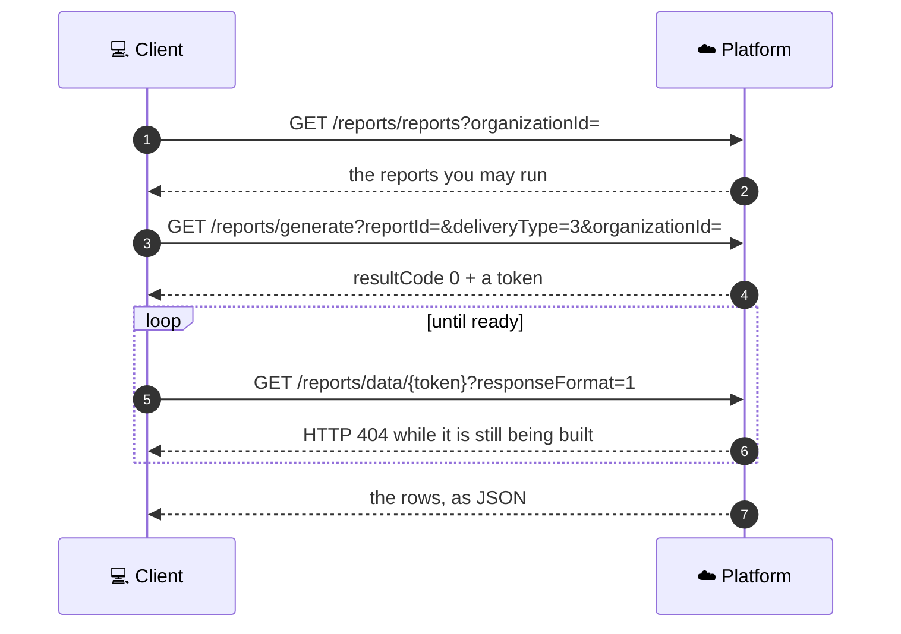

# Working with the REST API

The rules every Application and Admin API call follows: where to send it, how to read the answer,
how dates work, and how to page through long lists.

**When to use this page:** once, early, so none of it surprises you later.

---

## Requests

| Rule | Detail |
| --- | --- |
| Base URL | One per cloud. See the [Quick Start](../getting_started/quick_start.md#step-0-pick-a-server) |
| Paths | `/cloud/json/...` for the Application API, `/admin/json/...` for the Admin API, `/cloud/appstore/...` for bots and data streams, `/reports/...` for reports |
| Authentication | The `API_KEY` header. See [Authentication](authentication.md) |
| Bodies | JSON, with `Content-Type: application/json` on every `POST` and `PUT` that has a body |
| Methods | `GET` reads, `POST` creates, `PUT` creates or updates at a known address, `DELETE` removes |

Discover a server with no key at all:

```http
GET /cloud/json/settings                   every cloud and its servers
GET /cloud/json/settingsServer/wsapi       the WebSocket server for this cloud
GET /espapi/watch                          "OK" when the cloud is up
```

---

## Responses



A 2xx HTTP status means the request arrived. Whether it worked is `resultCode` inside the JSON.

| Field | Meaning |
| --- | --- |
| `resultCode` | `0` for success, anything else is an error. See [Result codes](result_codes.md) |
| `resultCodeDesc` | A short, general description of the code |
| `resultCodeMessage` | A specific, readable message about this failure. Safe to show a person |
| `keyExpire`, `keyExpireMs` | When your API key expires |
| `lockTime`, `lockTimeout` | When an operation is temporarily locked, and for how long, in milliseconds |
| `collectionTotalSize` | The total size of a sorted collection, for paging |

> **An empty collection is often a missing field.** Several list calls return no array at all when
> nothing matches, only `{"resultCode": 0}`. Test for the field before you count it.

---

## Dates and time zones

The platform **accepts** dates as milliseconds since the UNIX epoch or as ISO 8601
(`2026-09-27T08:00:00-07:00`). It **returns** ISO 8601, and many fields also come with a twin in
milliseconds, named with an `Ms` suffix: `lastDataReceivedDate` and `lastDataReceivedDateMs`.

Use the `Ms` field for arithmetic and the ISO field for display.

The time zone of a response is chosen in this order:

1. The `timeZone` query parameter, if you pass one, for example `timeZone=US/Pacific`.
2. Otherwise, the time zone of the location you asked about.
3. Otherwise, UTC.

Put a literal `+` in an ISO 8601 date through URL encoding (`%2B`). Tools like `curl --data-urlencode`
do this for you.

---

## Sorting and paging

Any `GET` that returns a collection accepts these optional parameters.

| Parameter | Meaning |
| --- | --- |
| `sortCollection` | The name of the collection to sort or limit, for example `notifications` |
| `sortBy` | The element property to sort by, for example `sendDateMs` |
| `sortOrder` | `asc` (default) or `desc` |
| `rowCount` | How many elements to return. The reference gives 100 as the minimum |
| `firstRow` | Zero-based index of the first element. Without it you get the **last** `rowCount` elements |

```http
GET /cloud/json/notifications?userId=123&startDate=2026-09-20T00:00:00Z
    &sortCollection=notifications&sortBy=sendDateMs&sortOrder=desc&rowCount=100&firstRow=0
```

Narratives page differently. `GET /cloud/json/locations/{locationId}/narratives` returns a
`nextMarker` when there is more; pass it back as `pageMarker` for the next page.

---

## History calls at a glance

| You want | Call |
| --- | --- |
| A device's measurements over time | `GET /cloud/json/devices/{deviceId}/parametersByDate/{startDate}?locationId=` |
| What the app's history timeline shows | `GET /cloud/json/locations/{locationId}/narratives?rowCount=` |
| History across an organization | `GET /admin/json/organizations/{organizationId}/narratives?rowCount=` |
| Mode changes (HOME, AWAY, ...) | `GET /cloud/json/location/{locationId}/events` |
| What was sent to a person | `GET /cloud/json/notifications?userId=&startDate=` |
| A time-series state, such as the daily report | `GET /cloud/json/locations/{locationId}/timeStates?name=&startDate=` |

Narratives can be filtered by `priority` and `toPriority`, `narrativeType`, `status`, `eventType`,
`searchBy` (with `*` as a wildcard), and a `startDate` and `endDate`. Deleted narratives are left
out by default.

---

## Reports

Organization reports are three calls, with an administrator key and **no** `/admin/json` prefix:



| Detail | Why it matters |
| --- | --- |
| `deliveryType=3` stores the report for you to fetch | `deliveryType=2` emails it to the signed-in account instead |
| `responseFormat=1` returns JSON | The default, `0`, is a ZIP file. Save it as bytes; reading it as text corrupts it |
| HTTP 404 on `/reports/data/{token}` means "not ready yet" | Generation is asynchronous. Poll a few times, a few seconds apart |
| Always pass `organizationId` | Without it, the catalog asks for reports beyond your organization |

Report rows can hold personal data. Treat them that way.

## Related

- [Result codes and gotchas](result_codes.md)
- [Application API reference](https://app.caredaily.ai/cloud/apidocs/cloud.html)
- [Admin API reference](https://app.caredaily.ai/cloud/apidocs/admin.html)
