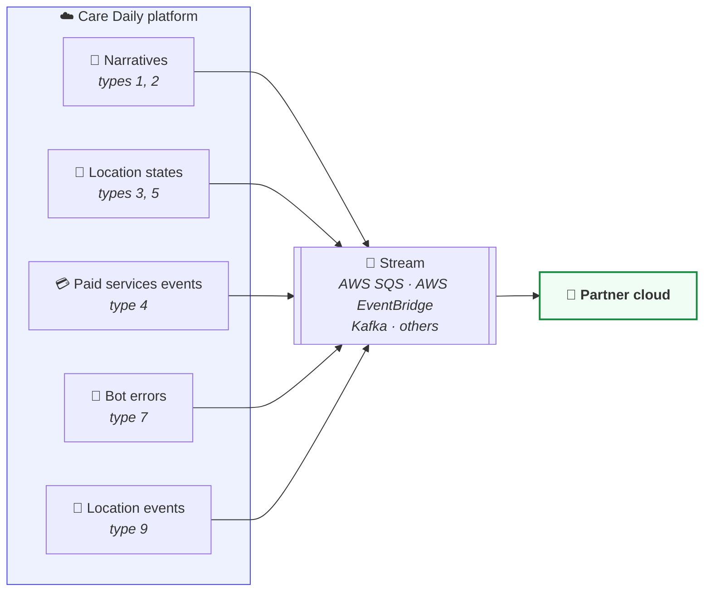
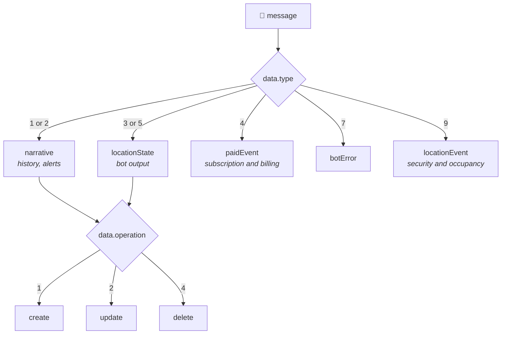
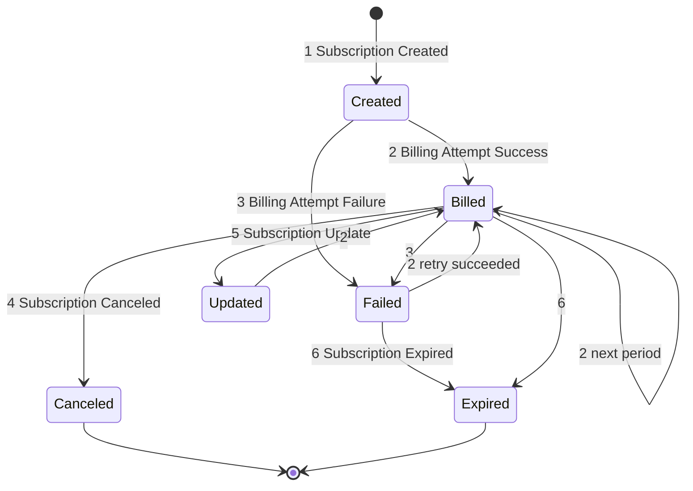

# Event Streaming

Care Daily's platform is capable of streaming events, subscription information, and insights into a partner's platform.
There are several mechanisms available to stream data into a partner's platform including tools like AWS SQS, AWS EventBridge, Kafka, and others.
This document will capture information about some of the data formats of information available to stream from the Care Daily platform.

**When to use it:** your own cloud needs to know what happens in Care Daily homes as it happens,
without polling: new alerts and history, bot state changes, mode changes, subscription and billing
events, and bot errors. For a screen that updates live, use [WebSockets](websockets.md) instead.



> **TODO(verify):** how a partner requests a stream, which transports are offered today, and
> whether a stream can be filtered by data type or organization. Until this is written up, ask your
> Care Daily contact.

**On this page:**
[Data types](#data-types) ·
[General data structure](#general-data-structure) ·
[Narratives](#narrative-event-streaming) ·
[Location state](#location-state-streaming) ·
[Paid events](#paid-events-streaming) ·
[Bot errors](#bot-errors-streaming) ·
[Location events](#location-event-streaming)

## Data types

Every message is one envelope with one payload inside `data`. Read `data.type` first, then
`data.operation`, then the one payload field that type fills.

| Data Type | Description | Payload field |
| :-------: | ----------- | ------------- |
| 1 | [Location Narrative](#narrative-event-streaming) | `data.narrative` |
| 2 | [Organization Narrative](#narrative-event-streaming) | `data.narrative` |
| 3 | [Location State](#location-state-streaming) | `data.locationState` |
| 4 | [Paid Services Event](#paid-events-streaming) | `data.paidEvent` |
| 5 | [Location Time-Series State](#location-state-streaming) | `data.locationState` |
| 7 | [Bot Error](#bot-errors-streaming) | `data.botError` |
| 9 | [Location Event](#location-event-streaming) | `data.locationEvent` |

| Operation | Description |
| :-------: | ----------- |
| 1 | Create |
| 2 | Update |
| 4 | Delete |



Messages are keyed by Care Daily IDs, and the `externalUsers` and `externalLocations` arrays map
those IDs to the IDs in your own system, so you can file each message against your own patient,
resident, room or unit.


## General Data Structure

```json
{ 
  "timestamp": long int,        // current time in milliseconds
  "cloudname": string,          // 'SBOX', 'Prod'
  "organizationId": int,        // Organization ID
  "parentOrganizationId": int,  // Parent Organization ID
  "locationExternalId": string, // Location external ID
  "externalUsers": [            // all external user IDs associated with the location
    {
      "userId": int,                // Care Daily internal user ID
      "applicationId": int,         // External cloud application ID
      "externalUserId": string,     // External cloud user ID (e.g. patient ID or resident ID)
      "externalLocationId": string  // External cloud location ID (e.g. room ID)
    }
  ],
  "externalLocations": [        // references to external locations, rooms, units linked to the related location
    {
      "applicationId": int,         // External cloud application ID
      "locationType": int,          // External location type
      "externalLocationId": string  // External cloud location ID (e.g. room ID or unit ID)
    }
  ],
  "data" : { 
    "type": byte,               // data type
    "operation": byte,          // 1 – create, 2 – update, 4 – delete
    "locationId": int,          // Location ID if available
    "narrative": {},            // Narrative data
    "locationState": {},        // Location state data
    "paidEvent": {},            // Paid services event data
    "params": [],               // Device parameters
    "botError": {},             // Bot error
    "locationEvent": {}         // Location event
  }
}
```


## Narrative Event Streaming

Narratives are time-series information produced by bots. They can be machine-readable (such as analytics) or human-readable.

Note that Narratives can be updated (see the `data.operation` field). The narrative title is typically human-readable, except in the case of analytic narratives (priority=-1) where the title is intended to be machine-readable.

See additional [Narrative documentation](https://app.caredaily.ai/cloud/apidocs/cloud.html#tag/Locations/operation/Create%20or%20Update%20a%20Narrative).

| Priority | Description |
| :------: | ----------- |
| -1 | Analytic, machine-readable narrative / analytic |
| 0 | Detail-level logging, human-readable narrative, usually with machine-readable `target` properties. |
| 1 | Info-level logging, human-readable narrative. Default for human-readable information. |
| 2 | Warning-level logging. |
| 3 | Critical-level logging. |


### Narrative JSON Formatting

```json
{ 
  "timestamp": long int,        // current time in milliseconds
  "cloudname": string,          // 'SBOX', 'Prod'
  "organizationId": int,        // Organization ID
  "parentOrganizationId": int,  // Parent Organization ID
  "locationExternalId": string, // Location external ID
  "data" : { 
    "type": byte,               // 1 - location narrative, 2 - organization narrative
    "operation": byte,          // 1 – create, 2 – update, 4 – delete
    "locationId": int,          // Location ID
    "narrative": {
      // narrative fields, many are optional 
      "narrativeId": int,       // auto generated ID, PK 
      "narrativeDate": long int, // part of a PK, can be different from creationDate, e.g. in the future
      "creationDate": long int, // creation time
      "locationId": int,        // location ID 
      "narrativeType": byte,    // 0 - default, 1 - deleted user, 2 - deleted location, 3 - location moved to another organization 
      "priority": byte,
      "status": byte,           // 0 - initial, 1 - deleted, 2 - resolved, 3 - reopened 
      "eventType": string,      // event type
      "appInstanceId": int,     // bot instance ID created this record, optional 
      "icon": string,           // 50 characters max 
      "iconFont": string,       // 50 characters max 
      "title": string,          // 250 characters max 
      "description": string,    // 1000 characters max 
      "target": {},             // flexible JSON structure with maximum serialized size of 10K characters 
      "organizationId": int,    // organization ID for organization narratives 
      "userId": int             // deleted user ID, populated when user is removed and downstream consumers should also purge user data 
    }
  }
}
```


## Location State Streaming

Location State variables are named objects with flexible structure set by bots or user apps for specific location.

Location Time-Series States are location states saved for specific timestamp.

See [Synthetic APIs](../synthetic_apis/README.md) for details.

The `deleted` array lists top-level properties removed from the state. It pairs with the `upd` and
`del` parameters of the [Set Location State API](https://app.caredaily.ai/cloud/apidocs/cloud.html#tag/Synthetic-APIs/operation/Set%20Location%20State),
which exist to tell a partner's cloud exactly which properties changed.


### Location State JSON Formatting

```json
{ 
  "timestamp": long int,        // current time in milliseconds
  "cloudname": string,          // 'SBOX', 'Prod'
  "organizationId": int,        // Organization ID
  "parentOrganizationId": int,  // Parent Organization ID
  "locationExternalId": string, // Location external ID
  "data" : { 
    "type": byte,               // 3 - Location State, 5 - Location Time-Series State
    "operation": byte,          // 1 – create, 2 – update, 4 – delete
    "locationId": int,          // Location ID
    "locationState": { 
      "locationId": int,        // location ID 
      "name": string,           // variable's name
      "stateDateMs": long int,  // timestamp of time-series state
      "value": {},              // flexible JSON structure
      "deleted": string[]       // string array of deleted top level properties
    }
  }
}
```


## Paid Events Streaming

| Event Type | Description |
| :--------: | ----------- |
| 1 | Subscription Created |
| 2 | Billing Attempt Success |
| 3 | Billing Attempt Failure |
| 4 | Subscription Canceled |
| 5 | Subscription Update |
| 6 | Subscription Expired |


### Subscription lifecycle

An illustrative order of paid services events for one subscription. The event types are the ones in the table above; the order a real store produces can vary.



### General Structure for all paid events

```json
{
  "timestamp" : long int,       // current time in milliseconds 
  "cloudname": string,          // 'SBOX', 'Prod' 
  "organizationId": int,        // Organization ID if available
  "parentOrganizationId": int,  // Parent Organization ID if available
  "data": { 
    "type": byte,               // 4 = paid event
    "operation": byte,          // 1 = create
    "locationId": int,          // Location ID
    "paidEvent": {
        "eventType": byte,      // 1 = subscription created, 2 = billing attempt success, 3 = billing attempt failure, 4 = subscription canceled, 5 = subscription update, 6 = subscription expired
        "eventTime": long int,  // when the event created in the store in milliseconds
        "eventDate": string,    // ISO-8601 date time with UTC timezone, 2021-08-20T12:09:15Z
        "subscriptionId": string, // subscription ID made as store subscription ID + store sub-domain name, e.g. "123@test-store"
        "startTime": long int,  // subscription billing period start time
        "startDate": string,    // ISO-8601 date time with UTC timezone, 2021-08-20T12:09:15Z
        "endTime": long int,    // subscription billing period end time
        "endDate": string,      // ISO-8601 date time with UTC timezone, 2021-08-20T12:09:15Z
        "transactionId": string, // financial transaction ID
        "orderId": string,      // store order ID
        "planId": int,          // service plan ID
        "planName": string,     // service plan name
        "priceId": int,         // plan price ID
        "userPlanId": int,      // assigned on location service plan instance ID
        "locationId": int,      // location ID
        "paymentType": byte,    // 5 = Shopify
        "subscriptionType": byte, // 1 = one time, 3 = monthly, 4 = annual, 5 = daily
        "customer": {           // user's data received from the store
            "email": string,
            "firstName" : string,
            "lastName" : string,
            "phone": string     // optional
        },
        "errorMessage": string, // Shopify error message
        "errorCode": string     // Shopify error code, see https://shopify.dev/api/admin/graphql/reference/orders/subscriptionbillingattempterrorcode
    }
  }
}
```

### Subscription created

```json
{
  "timestamp" : 1619644463123,
  "cloudname": "SBOX",
  "data": { 
    "type": 4,
    "operation": 1,
    "locationId": 123,
    "paidEvent": {
        "eventType": 1,
        "eventTime": 1619644463123,
        "eventDate": "2021-08-20T12:09:15Z",
        "subscriptionId": "123@test-store",
        "startTime": 1625097600000,
        "startDate": "2021-08-20T12:09:15Z",
        "endTime": 1625097600000,
        "endDate": "2021-09-21T00:00:00Z",
        "transactionId": "4569847984375943853",
        "orderId": "12345645645645",
        "planId": 11,
        "planName": "Home",
        "priceId": 12,
        "paymentType": 5,
        "subscriptionType": 3,
        "customer": {
            "email": "test@test.test",
            "firstName" : "First",
            "lastName" : "Last",
            "phone": "1234567890"
        }
    }
  }
}
```

### Billing success

```json
{ 
  "timestamp" : 1619644463123,
  "cloudname": "SBOX",
  "organizationId": 123,
  "parentOrganizationId": 456,
  "data": { 
    "type": 4,
    "operation": 1,
    "locationId": 123,
    "paidEvent": {
        "eventType": 2,
        "eventTime": 1619644463123,
        "eventDate": "2021-08-20T12:09:15Z",
        "subscriptionId": "123@test-store",
        "startTime": 1625097600000,
        "startDate": "2021-08-20T00:00:00Z",
        "endTime": 1625097600000,
        "endDate": "2021-09-21T00:00:00Z",
        "transactionId": "4569847984375943853",
        "planId": 11,
        "planName": "Home",
        "priceId": 12,
        "userPlanId": 56789,
        "paymentType": 5,
        "subscriptionType": 3,
        "locationId": 8901
    }
  }
}
```

### Billing attempt failure

```json
{ 
  "timestamp" : 1619644463123,
  "cloudname": "SBOX",
  "organizationId": 123,
  "parentOrganizationId": 456,
  "data": { 
    "type": 4,
    "operation": 1,
    "locationId": 123,
    "paidEvent": {
        "eventType": 3,
        "eventTime": 1619644463123,
        "eventDate": "2021-08-20T12:09:15Z",
        "subscriptionId": "123@test-store",
        "planId": 11,
        "planName": "Home",
        "priceId": 12,
        "userPlanId": 56789,
        "locationId": 8901,
        "paymentType": 5,
        "subscriptionType": 3,
        "errorMessage": "Payment method is expired",
        "errorCode": "EXPIRED_PAYMENT_METHOD"
    }
  }
}
```

### Subscription canceled

```json
{ 
  "timestamp" : 1619644463123,
  "cloudname": "SBOX",
  "organizationId": 123,
  "parentOrganizationId": 456,
  "data": { 
    "type": 4,
    "operation": 1,
    "locationId": 123,
    "paidEvent": {
        "eventType": 4,
        "eventTime": 1619644463123,
        "eventDate": "2021-08-20T12:09:15Z",
        "subscriptionId": "123@test-store",
        "planId": 11,
        "planName": "Home",
        "priceId": 12,
        "userPlanId": 56789,
        "locationId": 8901,
        "paymentType": 5,
        "subscriptionType": 3
    }
  }
}
```

### Subscription update

> **TODO(verify):** this example shows `"data.type": 5`, while the Data Types table gives `4` for
> every paid services event and uses `5` for something else. Confirm which value the stream sends
> for this event before you route on it. Routing on `paidEvent.eventType` is safe either way.

```json
{ 
  "timestamp" : 1619644463123,
  "cloudname": "SBOX",
  "organizationId": 123,
  "parentOrganizationId": 456,
  "data": { 
    "type": 5,
    "operation": 1,
    "locationId": 123,
    "paidEvent": {
        "eventType": 5,
        "eventTime": 1619644463123,
        "eventDate": "2021-08-20T12:09:15Z",
        "subscriptionId": "123@test-store",
        "startTime": 1625097600000,
        "startDate": "2021-08-20T12:09:15Z",
        "endTime": 1625097600000,
        "endDate": "2021-09-21T00:00:00Z",
        "planId": 11, // new plan ID
        "planName": "Home",
        "priceId": 12, // new price ID
        "userPlanId": 56789,
        "locationId": 8901,
        "paymentType": 5,
        "subscriptionType": 3
    }
  }
}
```

### Subscription expired

> **TODO(verify):** this example shows `"data.type": 6`, while the Data Types table gives `4` for
> every paid services event and has no type `6`. Confirm which value the stream sends
> for this event before you route on it. Routing on `paidEvent.eventType` is safe either way.

```json
{
  "timestamp" : 1619644463123,
  "cloudname": "SBOX",
  "organizationId": 123,
  "parentOrganizationId": 456,
  "data": { 
    "type": 6,
    "operation": 1,
    "locationId": 123,
    "paidEvent": {
        "eventType": 6,
        "eventTime": 1619644463123,
        "eventDate": "2021-08-20T12:09:15Z",
        "subscriptionId": "123@test-store",
        "startTime": 1625097600000,
        "startDate": "2021-07-13T00:00:00Z", // previous billing date of expired subscription
        "endTime": 1625097600000,
        "endDate": "2021-08-13T00:00:00Z",
        "planId": 11,
        "planName": "Home",
        "priceId": 12,
        "userPlanId": 56789,
        "locationId": 8901,
        "paymentType": 5,
        "subscriptionType": 3
    }
  }
}
```


## Bot Errors Streaming

Care Daily's platform can stream error messages produced by bots during execution.


### Bot Errors JSON Formatting

```json
{ 
  "timestamp": long int,        // current time in milliseconds
  "cloudname": string,          // 'SBOX', 'Prod'
  "organizationId": int,        // Organization ID
  "parentOrganizationId": int,  // Parent Organization ID
  "data" : { 
    "type": byte,               // 7 - bot error
    "operation": byte,          // 1 – create
    "locationId": int,          // Location ID
    "botError": {
      "bundle": string,         // bot bundle name
      "version": string,        // bot version
      "appInstanceId": int,     // bot instance ID
      "locationId": int,        // location ID for location bots
      "organizationId": int,    // organization ID for organization bots
      "error": string,          // error message
      "log": string             // bot execution log
    }
  }
}
```


## Location Event Streaming

Location event includes location's new Security and Occupancy states and previous state values.

The security and occupancy vocabulary (`HOME`, `AWAY`, `PRESENT`, `SLEEP` and the rest) is in
[Security Modes and Occupancy Status](modes.md).


### Location Event JSON Formatting

```json
{ 
  "timestamp": long int,        // current time in milliseconds
  "cloudname": string,          // 'SBOX', 'Prod'
  "organizationId": int,        // Organization ID
  "parentOrganizationId": int,  // Parent Organization ID
  "data" : { 
    "type": byte,               // 9 - location event
    "operation": byte,          // 2 – update
    "locationId": int,          // Location ID
    "locationEvent": {
      "securityState": string,      // new security state value
      "occupancyState": string,     // new occupancy state value
      "prevSecurityState": string,  // previous security state value
      "prevOccupancyState": string, // previous occupancy state value
      "comment": string             // bot execution log
    }
  }
}
```


## Related

- [WebSockets](websockets.md), the same kinds of changes pushed to an app session
- [Data streams and state](../concepts/data_streams_and_state.md), where location states come from
- [Modes](modes.md), the vocabulary of `securityState` and `occupancyState`
- [Narratives in the Application API reference](https://app.caredaily.ai/cloud/apidocs/cloud.html#tag/Locations/operation/Create%20or%20Update%20a%20Narrative)
