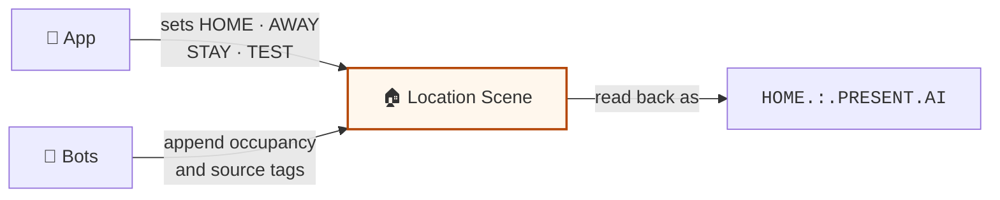
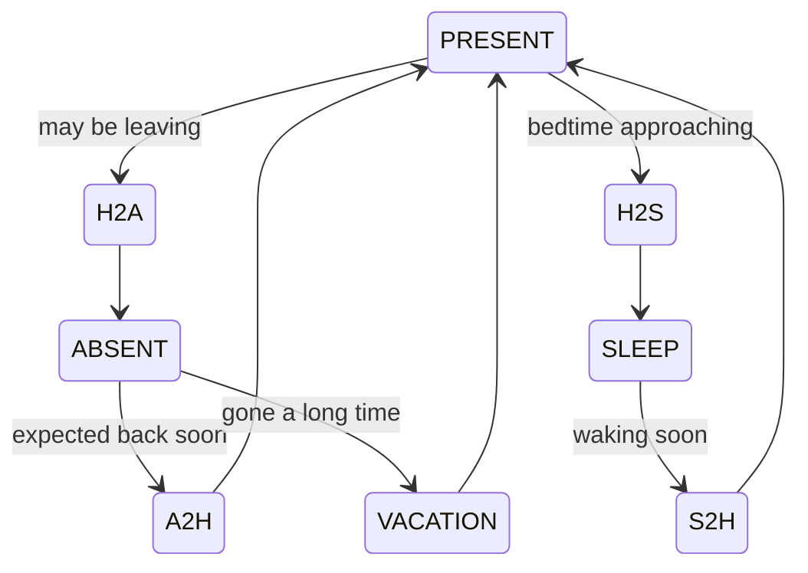

# Security Modes and Occupancy Status

This page describes the security system modes and occupancy status as recognized by Care Daily's
application layers, including existing bots.

**When to use it:** your app arms or disarms a home, shows whether anyone is home, or reacts to
mode changes.



## History

Care Daily's modes have evolved a lot over the years, and have always remained backwards
compatible with previous versions. The field is a single string associated with a location. You
can find it in the [Location Scene API documentation](https://app.caredaily.ai/cloud/apidocs/cloud.html#tag/Locations/operation/Change%20the%20Scene%20at%20a%20Location).

It started out controlling scenes for home automation and energy savings, then became the security
system mode, grew an extension to handle occupancy status, and further evolved to describe what was
responsible for the last update.

Today, we have settled on this vocabulary:

* **Mode** or **Security Mode** is the security system mode.
* **Occupancy Status** is whether occupants are present, absent, sleeping, and all the transitional
  states in between. It is typically not user-configurable, except through ambient sensing and
  machine learning services.

## Setting the mode

When the app wants to change the mode, it sets the
[Location Scene API](https://app.caredaily.ai/cloud/apidocs/cloud.html#tag/Locations/operation/Change%20the%20Scene%20at%20a%20Location)
to `HOME`, `AWAY`, `STAY`, or `TEST`.

## Getting the mode

When you get the mode for a location, you may see extra fields. These fields and their formatting
may be set by a bot. This is the format of the "Location Scene" string at our application layers:

```text
{Security Mode}.:.{Occupancy Status}
```

There may be other identifiers attached to the Security Mode or Occupancy Status, such as `AI` or
`USER`. When other identifiers exist, a period separates them. For example: `HOME.:.PRESENT.AI`

Your application should check whether a specific string exists inside this string to identify the
mode you are interested in.

```python
if "HOME" in mode:
   pass
```

Mode history, latest first, is available from
`GET /cloud/json/location/{locationId}/events`. Each entry records its source: `0` user app,
`1` rule, `2` bot, `9` third-party OAuth client.

## Valid Security Modes

Modes are case-sensitive. These are the only ones recognized by existing bots.

| Mode | Description |
| ---- | ----------- |
| HOME | Security system is disarmed, everything is running normally. |
| AWAY | Fully arm the security system, including motion sensors. |
| STAY | Arm the perimeter of the security system, ignoring motion sensors. |
| TEST | Disarm everything and stop services for interactive automated testing of the system and its sensors. |

## Valid Occupancy Status

Occupancy status is driven exclusively by a menu of machine learning algorithms. These are the only
occupancy states recognized by existing bots.



The diagram places each transitional state between the two states it connects. It illustrates the
vocabulary; the bots decide which transitions happen.

| Occupancy Status | Description |
| ---------------- | ----------- |
| PRESENT | At least one person is home. |
| ABSENT | Nobody is home. |
| SLEEP | Occupants should be asleep. |
| VACATION | Occupants have been gone for so long that this location is now in an automated vacation mode. |
| H2A | Home-to-absent: occupants may be going away. |
| A2H | Absent-to-home: occupants are expected to be back anytime now. |
| H2S | Home-to-sleep: occupants are expected to go to sleep soon. |
| S2H | Sleep-to-home: occupants are expected to wake up soon. |

## Related

- [Insights](../synthetic_apis/insights.md), where `security_mode` and `occupancy.status` also appear
- [Location Scene API](https://app.caredaily.ai/cloud/apidocs/cloud.html#tag/Locations/operation/Change%20the%20Scene%20at%20a%20Location)
