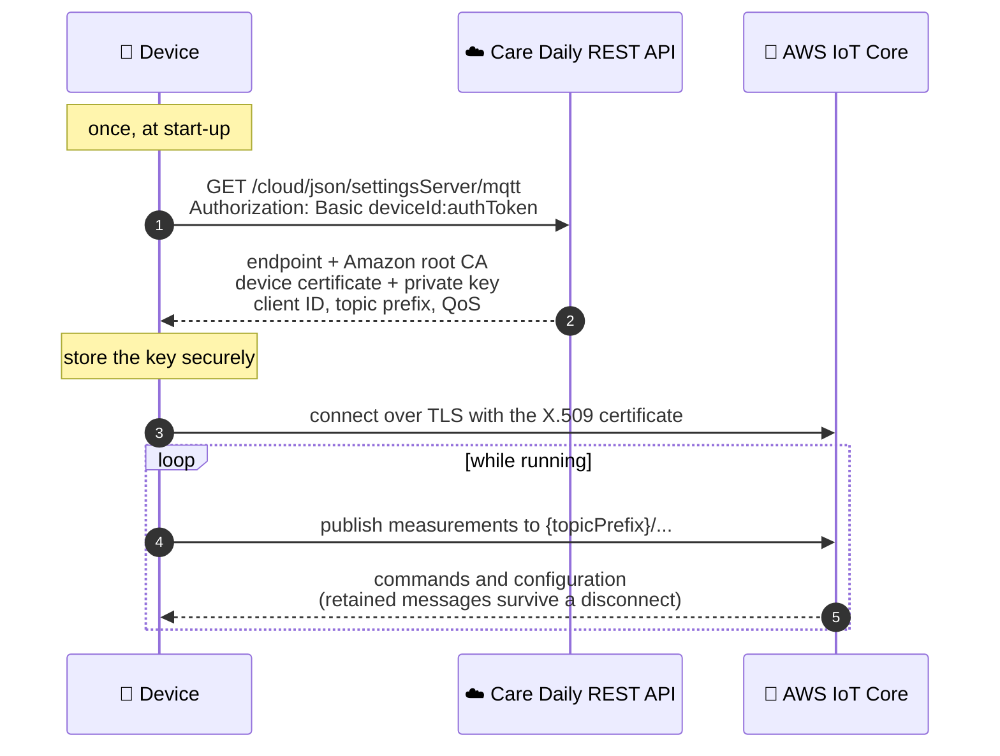

# AWS IoT and MQTT

Care Daily uses the [AWS IoT Core](https://docs.aws.amazon.com/iot/latest/developerguide/what-is-aws-iot.html)
service to receive device data in the cloud, and to send commands and configuration settings from
Care Daily services back to devices. AWS IoT Core accepts device connections over
[MQTT](https://docs.aws.amazon.com/iot/latest/developerguide/mqtt.html) and WebSocket.

A connected device publishes its data securely to the MQTT message broker and subscribes to
responses from the Care Daily cloud.

**When to use it:** you are writing firmware, or a gateway integration, and want the recommended
path for getting measurements up and commands down. For the HTTP and WebSocket device APIs, see
the [Device API reference](https://app.caredaily.ai/cloud/apidocs/devices.html).



---

## Device authentication and authorization

Care Daily recommends [X.509 certificates](https://docs.aws.amazon.com/iot/latest/developerguide/x509-client-certs.html)
to authenticate device connections to AWS IoT.

An X.509 certificate has an attached [AWS IoT policy](https://docs.aws.amazon.com/iot/latest/developerguide/iot-policies.html),
which specifies how the device may connect to the AWS IoT message broker and which MQTT topics it may
publish and subscribe to. By default, the topic filter in the policy is the device type's prefix
plus the device ID, ending in a wildcard:

```text
YourDeviceTypePrefix/DeviceID/*
```

This filter guarantees that a device can publish and subscribe only to its own topics.

Care Daily also supports [custom authentication and authorization](https://docs.aws.amazon.com/iot/latest/developerguide/custom-authentication.html),
which generates an IoT policy dynamically on each connection.

## AWS IoT connection settings

A device can call the [Get Connection Server API](https://app.caredaily.ai/cloud/apidocs/cloud.html#tag/Cloud-Connectivity/operation/Get%20Server)
with type `mqtt` to obtain everything it needs to connect:

| Returned | Detail |
| --- | --- |
| AWS IoT endpoint | Host, port and TLS version |
| Amazon root CA certificate | To verify the endpoint |
| Device X.509 certificate and private key | Generated by AWS IoT for this device, with an IoT policy attached. Store them securely and never share them with another device |
| MQTT client ID | As set in the IoT policy. Equal to the device ID by default |
| Topic prefix | Where the device may publish and subscribe, as the IoT policy specifies |
| Quality of Service | At least once (`QOS1`) by default |

Request MQTT settings **once, at device start-up**. The call uses Basic authentication, with the
device ID and its auth token in the `Authorization` header. Discuss the authentication mechanism
with the Care Daily team before a device vendor uses this API.

> **TODO(verify):** how a device obtains its auth token (the device registration call can request
> one with `authToken=true`) and whether that is the intended path for vendors.

## AWS IoT Device SDKs

The [AWS IoT Device SDKs](https://docs.aws.amazon.com/iot/latest/developerguide/iot-connect-devices.html#iot-connect-device-sdks)
provide language-specific support for the MQTT and WebSocket protocols that devices use to talk to
AWS IoT.

## MQTT retained messages

Care Daily can send commands and configuration settings to devices as
[MQTT retained messages](https://docs.aws.amazon.com/iot/latest/developerguide/mqtt.html#mqtt-retain).
This is a convenient way to reach a device that is temporarily disconnected: it receives the last
retained message when it reconnects.

## Related

- [Devices and parameters](../concepts/devices_and_parameters.md)
- [Device API reference](https://app.caredaily.ai/cloud/apidocs/devices.html)
- [Device Onboarding charts](../message_sequence_charts/diagrams/apps/device_onboarding/README.md)
