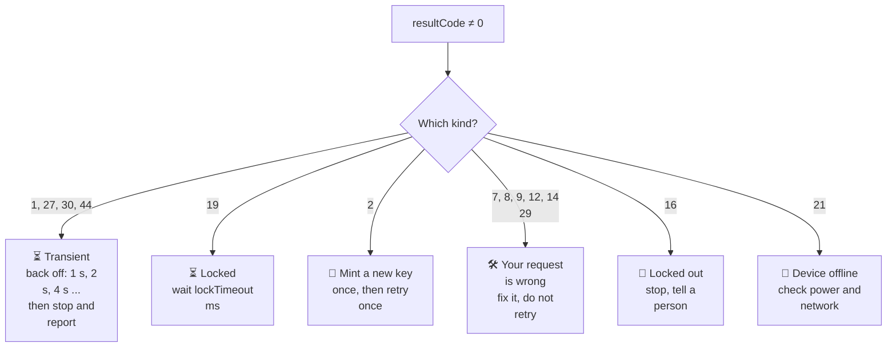

# Result codes and gotchas

Every response has a `resultCode`. `0` is success and anything else is an error. This page
says what each code usually means in practice, and lists the calls that report success without
doing what you hoped.

**When to use this page:** the moment a call returns a number you do not recognize, and before you
tell anyone that something "does not exist".

The authoritative list is at the top of the
[Application API reference](https://app.caredaily.ai/cloud/apidocs/cloud.html).

---

## The codes you will meet

| Code | The platform says | What it usually means for you |
| :---: | --- | --- |
| `0` | Success | For a device command: **queued**. The device applies it later |
| `1` | Internal error | Retry later, with back-off. If it persists, report it |
| `2` | Wrong API key | The key expired, or it belongs to another cloud. Mint a new one on the right cloud |
| `4` | Wrong device ID or device not found | A typo, or a device from another cloud |
| `6` | Object not found | A wrong ID, or an ID from another cloud |
| `7` | Access denied | Often a user key on an organization-scoped call. Also an object outside your reach |
| `8` | Wrong parameter value | At login: an unencoded `%` in the `PASSWORD` header |
| `9` | Missed mandatory parameter value | A required field is missing. On an object upload: no `Content-Type` header |
| `12` | Invalid username or wrong password | Wrong credentials, a badly encoded password, or `PASSWORD` sent with `passcode` |
| `14` | Error in parsing of input data | Malformed JSON, or text that is not valid UTF-8 |
| `16` | User account is locked out | Too many failed logins. Wait |
| `17` | A passcode is required to sign in | Expected on step one of an administrator login |
| `19` | Operation is temporarily locked | Read `lockTimeout`, wait that long |
| `21` | Device is offline or disconnected | On a device command. The platform cannot reach it right now |
| `22` | Device is under a different location | The device ID and `locationId` do not match |
| `24` | The second step is required | TOTP login. Finish with Login by Key |
| `27` | Server is busy or overloaded | Back off and retry |
| `29` | Requested API method not found | Wrong path or wrong HTTP method |
| `30` | Service is temporarily unavailable | Back off and retry |
| `41` | Request has not been completed | Not an error: there was nothing to do |
| `44` | Too many API calls | Slow down. Never retry in a tight loop |

---

## Retry etiquette

**Diagram in text:**

- **1, 27, 30, 44:** transient. Back off 1 s, 2 s, 4 s, and so on, then stop and report.
- **19:** locked. Wait `lockTimeout` ms.
- **2:** mint a new key once, then retry once.
- **7, 8, 9, 12, 14, 29:** your request is wrong. Fix it, and do not retry.
- **16:** locked out. Stop, and tell a person.
- **21:** device offline. Check power and network.

Never retry a login in a loop. Repeated failures lock the account, and every step-one call of an
administrator login throws away the previous passcode.

---

## Success that did not happen

The most dangerous category, because nothing tells you.

| Call | Why `0` is not proof |
| --- | --- |
| A device command (`PUT .../parameters`) | `0` means queued. Read the parameter back after a few seconds |
| A setting the firmware does not support | Can return `0` and never change. The read-back is the only proof |
| A state variable a bot owns, written directly | The bot rewrites it on its next run. Send the bot its data stream message instead |
| A data stream message | `0` means accepted for delivery. The effect shows up later, in state and history |
| Creating a space | Returns only `resultCode`, no ID. Read the list again to find it |
| Renaming a device | Leaves the "New Device" badge until you send `newDevice: false` |

**When a write matters, read it back.**

---

## Parsing traps

- **Device parameters are nested** at `devices[0].parameters[]`, one level below the top.
- **Parameter values are strings.** Compare with `"1"`.
- **A missing collection means zero rows.** `GET /admin/json/users` with no match returns no
  `users` field at all.
- **One state name returns `value`. Several return `states[]`.**
- **The organization row's ID field is `id`**, even though you query with `organizationId`.
- **Prefer `...Ms` fields for arithmetic.** The ISO strings are for display.
- **`connected` flaps.** Judge online and offline from `lastDataReceivedDateMs`.
- **Filters that are not there are ignored, silently.** `GET /admin/json/locations` has no `userId`
  filter; pass one and you get the unfiltered list. A big answer is not a finding.

---

## Two reasoning traps

1. **Concluding absence from one call's silence.** An empty answer, or an enormous one, proves
   nothing alone. Run a query you know returns rows, as a control, before you believe it.
2. **Treating "consistent with" as "verified".** If the question is "did X happen", read the data
   that would show X: the parameter history, the narrative, the notification record.

## Related

- [Authentication](authentication.md)
- [Working with the REST API](conventions.md)
- [Agent Kit: errors and retries](../agent_kit/05_errors_and_retries.md)
