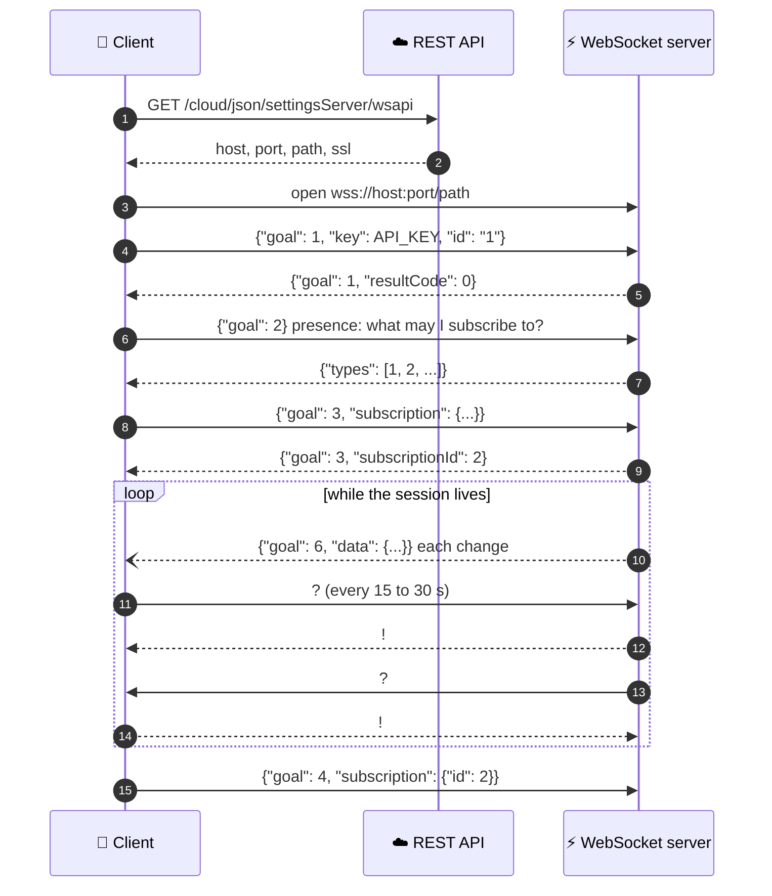

# WebSocket Application API

Real server push for apps and consoles. Subscribe once, and the platform sends you each new
narrative, bot state change, device parameter or SIM update as it happens. No polling.

**When to use it:** anything on screen that should change the moment the home changes: the
dashboard header during an alert, a live sensor during installation, the alert list on an
administrative console. For cloud-to-cloud delivery, use [Event Streaming](event_streaming.md).

**On this page:**
[Session at a glance](#a-session-at-a-glance) ·
[Get the URL](#get-the-websocket-url) ·
[Ping / Pong](#ping--pong) ·
[Data structure](#data-structure-architecture) ·
[Authenticate](#authenticate) ·
[Presence](#presence) ·
[Status](#status) ·
[Subscribe](#subscribe) ·
[Unsubscribe](#unsubscribe) ·
[Receiving data](#receiving-data) ·
[Chat](#chat) ·
[A minimal client](#a-minimal-client)

## A session at a glance



## Get the WebSocket URL

Each time the client starts a new WebSocket session, it must obtain its WebSocket API server connection settings and URL by calling the [Get Server Instance API](https://app.caredaily.ai/cloud/apidocs/cloud.html#tag/Cloud-Connectivity/operation/Get%20Server) with `type=wsapi`.

```http
GET /cloud/json/settingsServer/wsapi
```

```json
{
  "resultCode": 0,
  "server": { "type": "wsapi", "host": "<host>", "port": 8090, "path": "/wsapi", "ssl": true }
}
```

Build the address from those fields: `wss://<host>:<port><path>` when `ssl` is true. This call
needs no API key. Ask every time, rather than storing the answer, because the server you are given
can change.

## Ping / Pong

Ping / pongs are used to keep the WebSocket connection alive.

* **Ping** is the one-character text message "?"
* **Pong** is the one-character text message "!"

Both the client and the server are responsible for pinging and ponging:
* The client should ping the server with a 15-30 second periodicity. If no pong is received, the client should recreate the WebSocket connection, possibly with another server.
* The server will ping the client, and you are responsible for sending back a pong. If the server does not hear a pong, it will close the connection.

Note that the ping and pong characters are not wrapped in a JSON format - they are simply one-character messages sent over the WebSocket.


## Data Structure Architecture

JSON is used for all requests and responses.

### Common Properties
| Property | Type | Description |
| -------- | ---- | ----------- |
| id       | String | Mandatory. Every request or subscription has a unique 'id' field. The server will return the same `id` value in each response related to this subscription so the client will be able to identify what to do with the data. |
| goal     | int | Mandatory. The type of request or response. See the Goals table. |
| key      | String | API key used during authentication. |
| resultCode | int | Response from the server. See the Application API [Result Codes](https://app.caredaily.ai/cloud/apidocs/cloud.html#section/Result-Codes-and-Error-Messages). |
| resultCodeMessage | String | Describes any error that occurred. |

#### Goals
Setting a `goal` for each WebSocket JSON message tells the server or client what to do.

| `goal` | Name | Description |
| ------ | ---- | ----------- |
| 1 | auth | WebSocket session authentication |
| 2 | presence | Check the availability of WebSocket data subscriptions |
| 3 | subscribe | Subscribe to specific WebSocket data |
| 4 | unsubscribe | Unsubscribe from a single WebSocket data subscription |
| 5 | status | Get the status of the session, including the current WebSocket data subscriptions |
| 6 | data | New data from the server related to one of your current WebSocket data subscriptions |
| 7 | chat | AI request/response chat |

#### Data Types

These are the supported WebSocket subscription data types

| `type` | Description |
| ------ | ----------- |
| 1 | Location narrative updates (history being added by bots) |
| 2 | Organization narrative updates (admin-visible alerts and community history added by bots) |
| 3 | Location `state` variable updates from [Synthetic APIs](../synthetic_apis/README.md) |
| 6 | Updated device parameters |
| 8 | Updated SIM card attributes |
| 9 | Location event |
| 10 | Location Tag |
| 11 | Escalation |

#### Operations

The client can subscribe on specific actions being performed to the data object. The operation field is a *bitmask* of possible actions between 1 to 7.

| `operation` | Name |
| ----------- | ---- |
| 1 | Create |
| 2 | Update |
| 4 | Delete |

### Request example:
```json
{
    "goal": 1,
    "id": "unique request ID",
    ...
}
```

### Response example:
```json
{
    "goal": 1,
    "id": "replied request ID",
    "resultCode": 0,
    "resultCodeMessage": "Error Message",
    ...
}
```

## Authenticate

The initial authentication request must include the `"key"` field, which contains the `API_KEY` of the user.
The client must already be authenticated and retrieve the API key using the [Login API](https://app.caredaily.ai/cloud/apidocs/cloud.html#tag/Authentication/operation/Login%20by%20Username).

When the server authenticates the user, it will define the scope of the session based on the API key type and return success or an error response.

### Authentication request example
```json
{
  "goal": 1,
  "key": "API_KEY",
  "id": "1"
}
```

#### Authentication response example
Successful response:
```json
{
  "resultCode": 0,
  "id": "1",
  "goal": 1   
}
```

Unsuccessful response:
```json
{
  "resultCode": 2,
  "resultCodeMessage": "Wrong API key",
  "id": "1",
  "goal": 1
}
```

## Presence

*What WebSocket data subscriptions are available?*

The server will return supported subscription types based on the session scope.

### Presence response example

```json
{
  "goal": 2,
  "id": "2",
  "resultCode": 0,
  "types": [
    1,
    2
  ]
}
```

## Status

*What is the current status of my WebSocket data subscriptions?*

The server will return information about the current session.

### Status response example
```json
{
  "goal": 5,
  "id": "5",
  "resultCode": 0,
  "subscriptions": [
    {
      "requestId": "request ID, which made this subscription",
      "id": 123,
      "type": 1,
      "operation": 7,
      "locationId": 456,
      "priority": 1
    }
  ]
}
```

## Subscribe

*How can I subscribe to events and changes being made to data on the server?*

The client can subscribe to events and data changes (create, update, delete) happening on the server.

The client can have only one subscription with similar parameters.
A new subscription request can logically absorb the previously created subscriptions, if it subscribes to a wider range of data of the same kind.
In this case, the old subscription will be replaced.

To subscribe to a data model, the client sends a request with the goal "subscribe" and the subscription options.
After approval, the server starts sending messages to the client containing data objects matching the subscription options.
Both the `type` and `operation` are sent to the client in the data object when an event occurs.

See the 'Types' and 'Operations' tables at the top of this document for more information about specific values. 


### Example: Subscribe to Narratives

Read about the subscription parameters in the [GET Narratives API](https://app.caredaily.ai/cloud/apidocs/cloud.html#tag/Locations/operation/Create%20or%20Update%20a%20Narrative/get-narratives) documentation.

```json
{
  "goal": 3,
  "id": "3",
  "subscription": {
    "type": 2,
    "operation": 7,
    "organizationId": 316, // required for organization narratives, optional for location narratives
    "locationId": 123,     // either locationId or organizationId is required for location narratives
    // optional fields
    "priority": 0,
    "priorityTo": 2,
    "locationTags": ["GroupA", "GroupB"]
  }
}
```

#### Example: Subscribe to Location States

Request:
```json
{
  "goal": 3,
  "id": "3",
  "subscription": {
    "type": 3,
    "operation": 3,
    "organizationId": 316,
    "locationId": 123,     // either locationId or organizationId is required
    "name": "dashboard_header",
    // optional fields
    "locationTags": ["GroupA", "GroupB"]
  }
}
```


#### Example: Subscribe to Escalations

```
{
  "goal": 3,
  "id": "3",
  "subscription": {
    "type": 11,
    "operation": 7,
    "organizationId": 316,
    "locationId": 123,     // either locationId or organizationId is required
    // optional fields
    "escalationTypes": [1,2,3],
    "locationTags": ["GroupA", "GroupB"],
    "priority": 0,
    "priorityTo": 2
  }
}
```
#### Example: Subscribe to Device Parameters

Request:
```json
{
  "goal": 3,
  "id": "3",
  "subscription": {
    "type": 6,
    "operation": 1,     // Only create is supported
    "locationId": 123,
    "deviceId": "Optional device ID"
  }
}
```

#### Example: Subscribe to SIM card attribute changes

Request:
```json
{
  "goal": 3,
  "id": "3",
  "subscription": {
    "type": 8,
    "operation": 2,     // Only update is supported
    "locationId": 123,
    "deviceId": "Required device ID"
  }
}
```

#### Example: Successful Response
```json
{
  "resultCode": 0,
  "goal": 3,
  "id": "3",
  "subscriptionId": 2
}
```

## Unsubscribe

*The user tapped into a different part of the app, how do I stop receiving data?*

### Unsubscribe example

```json
{
  "goal": 4,
  "id": "4",
  "subscription": {
    "id": 2
  }
}
```

## Receiving Data

When the server receives any changes in data that a client is subscribed to, the server will send a WebSocket message to the client.
A message always contains a single type of data that was created, updated, or deleted.

The received message will contain the same "id" as at initial subscription request.
The data field contains a data structure corresponding to the data type.
Internal JSON data fields are flexible and include sub-objects and arrays.

### Example: Narrative (history) updated

```json
{
  "resultCode": 0,
  "id": "subscription request ID",
  "goal": 6,
  "data": {
    "type": byte,               // 1 - location narrative, 2 - organization narrative
    "operation": byte,          // 1 – create, 2 – update, 4 – delete
    "narrative": {
      "id": 123,
      "locationId": 1,
      "organizationId": 2,
      "narrativeDateMs": 1537692964000,
      "creationDateMs": 1537692964000,
      "appInstanceId": 123,
      "priority": 1,
      "status": 1,
      "icon": "alert",
      "title": "Water Leak",
      "description": "Water leak in the bathroom",
      "target": {
        "field": "value"
      }
    }
  }
}
```

#### Example: Synthetic API state variable updated

```json
{
  "resultCode": 0,
  "id": "subscription request ID",
  "goal": 6,
  "data": {
    "type": 3,
    "operation": byte,          // 1 – create, 2 – update, 4 – delete
    "locationState": {
      "locationId": 123,
      "name": "dashboard_header",
      "value": {
        "comment": "Occupants appear to be asleep.",
        "icon": "bed",
        "icon_font": "far",
        "name": "occupancy",
        "priority": 1,
        "title": "Likely Sleeping",
        "updated_ms": 1620630427464
      }
    }
  }
}
```

#### Example: Device parameters updated

```json
{
  "resultCode": 0,
  "id": "subscription request ID",
  "goal": 6,
  "data": {
    "type": 6,
    "operation": 1,             // always 1 - create
    "locationId": int,
    "params": [
      {
        "deviceId": string,     // device ID
        "name": string,         // parameter's name
        "index": string,        // optional index
        "group": string,        // optional parameter's group
        "value": string,        // measured or processed value
        "time": long int,       // measuring timestamp
        "updated": boolean      // flag if the value has been updated
      }
    ]
  }
}
```

#### Example: SIM card attributes updated

```json
{
  "resultCode": 0,
  "id": "subscription request ID",
  "goal": 6,
  "data": {
    "type": 8,
    "operation": 2,             // always 2 - update
    "simCard": {
      "id": "8900000000000000001",
      "status": 4,
      "deviceId": "ABC234",
      "serialNumber": "example-subscription-00000001",
      "carrierName": "KATTCC",
      "lifecycleStatus": "Suspended",
      "activationDateMs": 1423428106000,
      "inactivationDateMs": 1423429306000
    }
  }
}
```


## Chat

The user can send questions or messages to AI agents using this interface.

### Chat request example

```json
{
  "goal": 7,
  "id": "10",
  "chat": {
    "locationId": 123,
    "conversationId": "Current chat session ID provided in the previous chat response",
    "message": "Question or message"
  }
}
```

#### Chat response example

```json
{
  "goal": 7,
  "id": "10",
  "chat": {
    "locationId": 123,
    "conversationId": "Current chat session ID",
    "answer": "AI agents answer"
  }
}
```


## A minimal client

JavaScript, as a web UI runs it, with the browser's own `fetch` and `WebSocket` (no packages). It
asks for the server, authenticates, subscribes to one home's device parameters, answers the
server's pings, and sends its own. The API key is the signed-in user's, from your app's session;
never log it or put it in a URL.

```javascript
const SERVER = "https://app.caredaily.ai";   // REST base URL
const apiKey = session.apiKey;               // the signed-in user's key, from your app
const locationId = 123;                      // the home to watch

async function connect() {
  const res = await fetch(`${SERVER}/cloud/json/settingsServer/wsapi`);
  const { server: s } = await res.json();
  const url = `${s.ssl ? "wss" : "ws"}://${s.host}:${s.port}${s.path || ""}`;

  const ws = new WebSocket(url);
  let pinger;

  ws.onopen = () => {
    ws.send(JSON.stringify({ goal: 1, id: "auth", key: apiKey }));
    pinger = setInterval(() => ws.send("?"), 20000);   // our ping
  };

  ws.onmessage = (event) => {
    if (event.data === "?") { ws.send("!"); return; }  // the server's ping
    if (event.data === "!") return;                    // the server's pong
    const m = JSON.parse(event.data);
    if (m.goal === 1 && m.resultCode === 0) {
      ws.send(JSON.stringify({
        goal: 3, id: "params",
        subscription: { type: 6, operation: 1, locationId },
      }));
    } else if (m.goal === 6) {
      for (const p of m.data.params || []) {
        console.log(p.deviceId, p.name, "=", p.value);
      }
    } else if ((m.resultCode || 0) !== 0) {
      console.warn("error", m.resultCode, m.resultCodeMessage);
    }
  };

  ws.onclose = () => clearInterval(pinger);
  return ws;
}

connect();
```

Before you start listening, read each value's current state over REST
(`GET /cloud/json/devices/{deviceId}/parameters?locationId=`). Without that baseline you cannot tell
a change from a first observation.

> **TODO(verify):** a production client should reconnect with back-off when no pong arrives,
> re-authenticate, and resubscribe. Confirm whether subscriptions survive a reconnect before
> relying on that. Until then, resubscribe after every reconnect.

## Related

- [Get Server Instance API](https://app.caredaily.ai/cloud/apidocs/cloud.html#tag/Cloud-Connectivity/operation/Get%20Server)
- [Synthetic APIs](../synthetic_apis/README.md), the state variables behind subscription `type` 3
- [Watch a home live](../guides/watch_a_home_live.md), a worked example
- [Event Streaming](event_streaming.md), for delivery to another cloud
