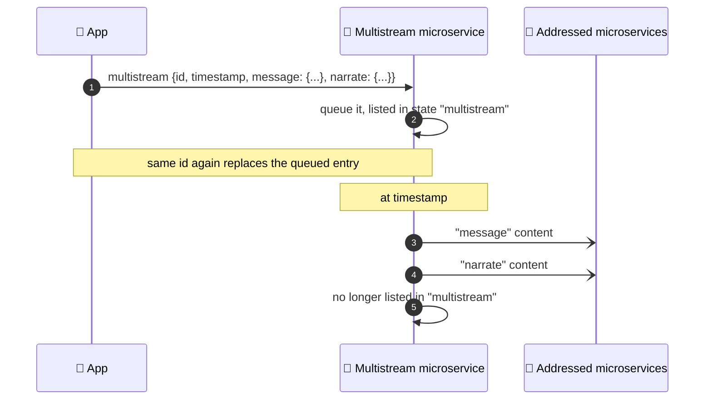

# Synthetic API: Multistream Messages

<!-- at-a-glance -->
> **Data stream in** `multistream`  ·  **State variable out** `multistream`  ·  [All Synthetic APIs](README.md)

Instead of one data stream message at a time, a multistream message can contain multiple data stream messages at a time, each with an optional specified delivery date in the future.

**When to use it:** you want to send several data stream messages at once, schedule them for later, or see, replace and cancel what is still waiting.



**Diagram in text:**

1. The app sends `multistream` with `id`, `timestamp`, `message`, and `narrate`. Sending the same `id` again replaces the queued entry.
2. The multistream microservice queues it, listed in state `multistream`.
3. At the timestamp, it sends the `message` content to the addressed microservices.
4. It sends the `narrate` content.
5. The entry is no longer listed in `multistream`.

Through the `multistream` state variable, it is possible to see what data stream messages have been scheduled with a multistream message, and edit/remove scheduled data stream messages from the queue.

To edit a queued multistream message, send a new multistream message with the same `id` and a future `timestamp`; it replaces the queued entry. To remove a queued multistream message, send a multistream message with the same `id` and no future `timestamp`; the queued entry is deleted and any data stream addresses included in the new message are delivered immediately (send `{"id": "hello"}` alone to remove without delivering anything).

| Property | Type | Description |
| -------- | ---- | ----------- |
| id       | String | Optional application-generated unique ID for scheduled multistream messages, to be able to edit/remove the multistream message in the future. If a multistream message is scheduled and an ID is not provided, then the multistream microservice will automatically generate a unique ID which the application layer can later reference to edit/remove the queued multistream message. |
| timestamp | int | Optional absolute timestamp in **milliseconds**, to schedule the delivery of the multistream message. The message is only queued if the timestamp is in the future; otherwise it is delivered immediately. |
| Data Stream Address | String | A multistream message can contain arbitrary key/value pairs, each interpreted with the *key* as a data stream address, and the *value* as the JSON content to be delivered internally to that data stream address. |


## Input

Data Stream Address : `multistream`

#### Content
```json
 {
    "id": "hello",
    "timestamp": optional_time_in_the_future_in_milliseconds,
    "message": {
       "push_content": "Hello from a multistream message."
    },
    "narrate": {
       "title": "Multistream Message",
       "description": "This is from a multistream message",
       "priority": 2,
       "icon": "stream"
    
    }
}
```

## Output

State Variable Address : `multistream`

The output only contains multistream content (multiple data stream messages) that are in the queue and have not executed yet.

The output content is a dictionary of multistream messages, where the key for each object is the `id` that was originally passed in as the multistream message ID (converted to a string). The `id` is stored only as the key and is not repeated inside the object.

```json
{
    "hello": {
        "timestamp": time_in_the_future_in_milliseconds,
        "message": {
           "push_content": "Hello from a multistream message."
        },
        "narrate": {
           "title": "Multistream Message",
           "description": "This is from a multistream message",
           "priority": 2,
           "icon": "stream"
        
        }
    }
}
```

## Related

- [Message](message.md) and [Narrate](narrate.md), the two addresses in the example
- [Data streams and state](../concepts/data_streams_and_state.md)

## References
* `com.ppc.Microservices/intelligence/multistream/location_multistream_microservice.py`
