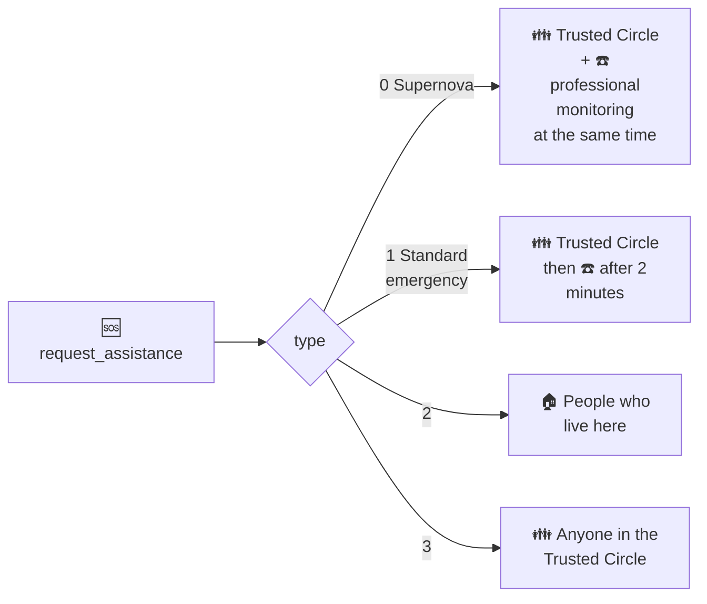

# Synthetic API: Request Assistance

<!-- at-a-glance -->
> **Data stream in** `request_assistance`  ·  [All Synthetic APIs](README.md)

Enable mobile apps and smart speakers to request assistance for the user.

**When to use it:** your app or smart speaker offers a help button, from a request to the people who live there up to an emergency.



**Diagram in text:**

- Type 0, Supernova: the Trusted Circle and professional monitoring at the same time.
- Type 1, standard emergency: the Trusted Circle, then professional monitoring after 2 minutes.
- Type 2: the people who live here.
- Type 3: anyone in the Trusted Circle.

A new request is ignored while a previous request's conversation is still unresolved.

#### Properties

| Property | Type | Description |
| -------- | ---- | ----------- |
| `type` | int | Required. Type of assistance request, see the Types table. |
| `agent` | int | Preferred. Type of device that is making this request, so we can make a comment about the method used. |
| `user_id` | int | Optional. User ID that is making the request, if available. |
| `latitude` | String | Optional. Latitude for mobile alerts. |
| `longitude` | String | Optional. Longitude for mobile alerts. |
| `no_dispatch` | Bool | Optional. Declare that professional monitoring services should not dispatch. Applies to `type` 0 only. |
| `priority` | Bool | Optional. True if this is a priority request and emergency dispatch should be contacted immediately. Applies to `type` 0 only, and is ignored when `no_dispatch` is true. |

#### Types

| `type` value | Description |
| ------------ | ----------- |
| 0 | Direct Emergency "Supernova" - alert the Trusted Circle and escalate to professional monitoring simultaneously.  |
| 1 | Standard Emergency - alert the Trusted Circle for 2 minutes before escalating to professional monitoring, decreases false alarms. |
| 2 | Request assistance from people who live here. |
| 3 | Request assistance from anyone in the Trusted Circle. |

#### Agents

| `agent` value | Description |
| ------------- | ----------- |
| 0 | Request made from a mobile app. |
| 1 | Request made from a smart speaker. |

## Inputs

Data Stream Address: `request_assistance`

#### Example content

**Supernova**
```json
{
  "type": 0,
  "agent": 0,
  "user_id": 123456789,
  "latitude": "47.620500",
  "longitude": "-122.349300"
}
```

**Supernova without dispatch**
```json
{
  "type": 0,
  "agent": 0,
  "user_id": 123456789,
  "latitude": "47.620500",
  "longitude": "-122.349300",
  "no_dispatch": true
}
```

## Related

- [Dashboard Alerts: Request Assistance](dashboard_alerts.md#request-assistance)
- [The life of an alert](../guides/life_of_an_alert.md)
- [Action Plans](action_plans.md)

## References
* `com.ppc.BotProprietary/signals/request_assistance.py`
* `com.ppc.Microservices/intelligence/care/pers/location_requestassistance_microservice.py`

